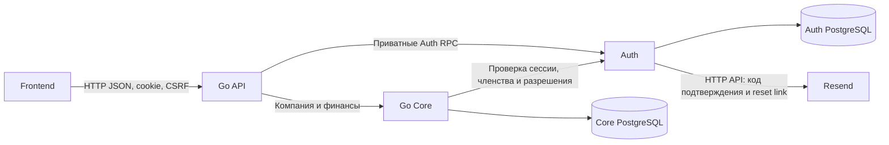

# Auth Saldo: адаптация референса и полный пользовательский флоу

Дата: 2026-10-23.
Статус: предложен для согласования; реализация не начата.
Основание: прямое поручение владельца составить план после обсуждения адаптации
`references/auth-service/`. Отдельная Issue к задаче не привязана;
план публикуется самостоятельным draft PR и связан с API-планом ниже.
Это детализация **этапа 3 общего архитектурного плана**, а не перенумерация этапов.
Все подэтапы 3.1–3.6 имеют статус «Не начат».
По уточнению владельца интеграция в Go API передана разработчику
[@Prosteyshiyyy](https://github.com/Prosteyshiyyy) в отдельном
[плане Go API — PR #16](https://github.com/benzocloud/hack-rnd-autumn-2026/pull/16).
Она не реализуется внутри Auth-задачи.
Режим реализации: после каждого подэтапа — результат, проверки и остановка
до ревью и явного апрува разработчика по ADR-020.
Составление этого документа не запускает реализацию, коммит, push или deployment.

## 1. Цель и проверенное текущее состояние

Получить отдельный Auth-сервис Saldo: регистрация, подтверждение email, вход,
серверные сессии, выход, восстановление пароля, членства и приглашения финансистов.
Go API предоставляет браузерный REST; Core владеет компанией и финансовыми данными
и получает актуальное решение о доступе через Auth.

Проверены рабочая копия проекта на HEAD
`ed31678886f853117ce992ad2d2ddd37d9b3632e` и чистая рабочая копия референса
на HEAD `e80059486dc3d0eee19792bc75fb4b292bf16cd1`.
На момент первичного обследования прикладные сервисы и protobuf отсутствовали.
На момент исправления плана локально начата отдельная работа над `services/core/`;
это не реализация Auth и не часть этой поставки. Есть локальные изменения общего
плана, ADR, REST и плана Core; перед реализацией зависимости сверяются повторно.
GBrain: unavailable — согласно ADR-010 rollout отложен; сведения из него не использовались.
Сборка, runtime-проверки и тесты референса не запускались.

Источники:

- [Продуктовый REST и архитектура — PR #14](https://github.com/benzocloud/hack-rnd-autumn-2026/pull/14):
  общий этап 3, аккаунт, компании, сотрудники и контракт фронтенда.
  При подготовке исправлений PR #14 уже слит в main. Источники:
  [архитектура](saldo-architecture.md), [продукт](saldo-product.md),
  [OpenAPI](../../docs/api/openapi.yaml), [пояснения REST](../../docs/api/README.md).
  Публикация REST не заменяет принятие Auth-политик этапа 3.1.
- Детализация основания Core в `.agent/plans/go-core-foundation.md` ведётся
  отдельно и на момент публикации Auth-плана остаётся локальной работой.
  Необходимые результаты Core для Auth перечислены в 3.5 этого плана явно;
  их готовность подтверждается с разработчиком Core, а не наличием файла плана.
- [Референсы](../references/go-services.md), [ADR](../decisions.md)
  и [правила этапов](../workflows/issue-planning.md).

Подтверждённые ограничения референса:

| Источник в `references/auth-service/` | Наблюдение и следствие |
| --- | --- |
| `internal/service/auth.go:33–78` | Есть исходники входа, хеширования и регистрации; `RefreshToken:47–50` возвращает пустые токены с `nil` |
| `proto/auth.proto:9–12`, `internal/delivery/grpc/server.go` | Объявлены Login/Register/Refresh; явного gRPC-обработчика Refresh нет |
| `internal/delivery/grpc/server.go:45–54` | На ошибках логируется полный credentials request с полем пароля; переносить это поведение нельзя |
| `internal/infrastructure/postgres/repository/sql/save_user.sql:1` | Обратные кавычки вокруг колонок несовместимы с PostgreSQL |
| `internal/config/config.go:125–137` | DSN жёстко задаёт `sslmode=disable`, игнорируя конфигурационную секцию |
| `internal/delivery/http/router.go` | HTTP обслуживает только health; браузерного auth/CSRF транспорта нет |
| `migrations/`, `internal/domain/`, `internal/service/` | Не обнаружены сессии, подтверждения email, восстановление пароля, членства, приглашения и их хранилища |
| Дерево исходников | Не обнаружены `*_test.go`; наличие референса не подтверждает работоспособность |

## 2. Согласованные основания и предлагаемые решения

Владелец определил самостоятельное приложение, полноценный вход/регистрацию,
отдельный Auth, две роли `owner`/`financier` и приглашение зарегистрированного
пользователя по известному email. Онбординг финансиста не создаёт ему компанию.
HTTP/JSON на границе браузера, DDD-монолит Core и PostgreSQL следуют текущему плану.

На согласование этим планом предлагаются:

1. Выборочно адаптировать референс в `services/auth/`. Каркас не переносит
   автоматически его JWT, SQL-драйвер, конфигурационные библиотеки или версии Go.
2. Реализовать профиль проекта REST: email/password, подтверждение email,
   непрозрачная серверная сессия в `HttpOnly` cookie и synchronizer CSRF token.
   По решению владельца о названии Saldo имя cookie — `__Host-saldo_session`.
   В JSON не выдаются access/refresh/session tokens.
3. Использовать приватный gRPC API Auth с каноническим `proto/auth/v1/`.
   Это расширение текущего набора protobuf; требуется отдельная фиксация решения,
   а не утверждение, что ADR-003 уже описывает Auth.
4. Auth владеет пользователями, credentials, сессиями, одноразовыми токенами,
   членствами и приглашениями. Core владеет Company/BankAccount и финансами.
   API координирует запросы и cookie, не создаёт отдельную БД пользователей/прав.
5. Для Auth выделить собственную БД/роль PostgreSQL. Допустим общий экземпляр
   PostgreSQL с Core; прямые SQL-запросы между БД сервисов и shared tables исключены.
6. Ручная сборка зависимостей через `internal/app`; SQL и транзакции в адаптерах,
   интерфейсы около потребителя. Для Auth предлагаются тот же выбранный toolchain
   и подход pgx/goose, что обсуждаются для Core; это ещё не утверждённые библиотеки.
   Не выделять общий Go-модуль только ради похожих config/log.
7. Обычный logout отзывает текущую сессию. После успешного сброса пароля
   предлагается отзывать все сессии пользователя; отдельный UI «выйти везде» не входит.

### Уточнение владельца: Resend и подтверждение email кодом

По обсуждению 2026-10-23 владелец выбрал **Resend** для транзакционных писем
и поручил включить в план следующий профиль подтверждения, хранения и лимитов.
Это уточнение плана; отправка писем и изменение REST пока не реализованы.

- Auth отправляет письма через **Resend HTTP API**. Собственный SMTP-сервер,
  отдельный notification-сервис, Redis и брокер для этого не нужны.
  До демо подтвердить домен/поддомен отправителя через DNS, настроить адрес From
  и передать API-ключ только через секреты окружения Auth.
- Подтверждение email: **6 случайных цифр**, включая ведущие нули; например,
  `048271`. Код передаётся строкой, отображение с пробелом не меняет его значение.
  Генерация криптографическая, срок действия — **10 минут** от создания.
  Пользователь вводит код на frontend; запрос проходит через Go API в Auth.
  Восстановление пароля остаётся отдельным флоу с одноразовой ссылкой, а не этим кодом.
- Хранение — собственная PostgreSQL Auth, таблица
  `email_verification_challenges`: `id`, `user_id`, `code_digest`, `expires_at`,
  `attempts`, `consumed_at`, `created_at`; состояние отмены/активного challenge
  должно позволять атомарно отозвать предыдущий код. `id` — случайный непрозрачный
  `challenge_id`, привязанный к пользователю и назначению подтверждения email.
  Проверочный digest — HMAC-SHA-256 от однозначно закодированных purpose,
  challenge_id и кода. HMAC-ключ хранится отдельно от БД в секретах Auth;
  обычный SHA-256 короткого кода и открытый текст не использовать.
- Проверка кода, увеличение числа неверных попыток, погашение challenge
  и установка `email_verified_at` выполняются атомарно в Auth. Чужой, истёкший,
  отменённый или использованный challenge не подтверждает email.
  Неподтверждённый аккаунт не создаёт компанию и не принимает приглашения;
  frontend предоставляет экран ожидания, повторную отправку и выход.
- Кнопка **«Отправить код повторно»** доступна через **60 секунд** после выдачи.
  Новый код отменяет предыдущий. Первичная и повторные выдачи входят в общие лимиты;
  транспортный повтор того же запроса не создаёт новый challenge и письмо.

Начальные серверные ограничения MVP:

| Действие / область | Лимит |
| --- | --- |
| Повторная выдача кода одному аккаунту | Не чаще одного раза в 60 секунд |
| Выдачи кода одному аккаунту, включая первичную | Не более 5 за скользящий час и 10 за скользящие 24 часа |
| Выдачи с одного IP, включая первичную | Не более 20 за скользящий час |
| Неверные проверки одного challenge | Не более 5; затем challenge недействителен |
| Общий бюджет неверных проверок аккаунта | Не более 5 за скользящие 10 минут; resend не сбрасывает этот счётчик |

Счётчики, cooldown и блокировки хранятся в PostgreSQL Auth и переживают restart
и переключение реплики. Резервирование лимитов при конкурентных запросах атомарно;
при блокировке новый код не создаётся. IP берётся из соединения или проверенной
цепочки доверенных прокси; произвольный клиентский forwarded header не обходит лимит.
Численные значения — начальный профиль MVP, дальнейшая настройка явная.

Дополнительно нужен общий бюджет **всех** писем Auth под квоту аккаунта Resend:
на проверенном бесплатном тарифе — **100 писем за сутки UTC, 3 000 за месяц**.
В нём учитываются подтверждение, resend, reset и другие отправки этого аккаунта;
период месячного сброса сверяется с провайдером. Локальный бюджет не подменяет
ошибки/лимиты Resend. При исчерпании нельзя бесконечно ставить просроченные коды
в очередь или сообщать пользователю, что письмо доставлено.

Задание доставки сохраняется с challenge в одной транзакции PostgreSQL;
ограниченные повторы выполняются внутри Auth без брокера. Для отправки код нужен
восстановимым: payload хранится зашифрованным с проверкой целостности, отдельным
от HMAC ключом вне БД и идентификатором ключа. После успешной передачи провайдеру
или окончательного завершения/истечения задания секретный payload удаляется.
Перед отправкой проверяются актуальность challenge и TTL; устаревшие задания
отменяются. Повторы одного задания используют стабильный ключ идемпотентности
Resend в пределах поддерживаемого провайдером окна. Принятие письма провайдером
не считается подтверждением email или доказательством доставки в ящик.
Коды, reset links и ключи не попадают в обычные логи, ошибки или REST JSON.

В этапе 3.1 совместно с @Prosteyshiyyy обновить OpenAPI/приватные RPC:
подтверждение принимает `challenge_id` и `code` (строка, `^[0-9]{6}$`),
а ответы регистрации/resend предоставляют `challenge_id`, `expires_at`
и `resend_available_at`. Существующий общий `TokenRequest` не превращать
в числовой код: password reset сохраняет собственную token-семантику.
Go API отображает rate limit Auth в **HTTP 429 + Retry-After**, frontend
показывает countdown по серверному времени; отключённая кнопка не заменяет
проверку Auth. Публичные ответы сохраняют защиту от перебора зарегистрированных
email, challenge_id сам по себе не даёт сессию или членство.

Источники выбора провайдера и требований:
[Resend quotas](https://resend.com/docs/knowledge-base/account-quotas-and-limits),
[отправка из Go](https://resend.com/docs/send-with-go),
[подтверждение домена](https://resend.com/docs/dashboard/domains/introduction),
[OWASP email verification](https://cheatsheetseries.owasp.org/cheatsheets/Email_Validation_and_Verification_Cheat_Sheet.html).
Перед подключением сверить актуальные квоты и возможности idempotency Resend.

### Карта адаптации

| Берём как ориентир | Как адаптируем |
| --- | --- |
| `internal/app`, `cmd`, readiness reader/writer | Явное владение ресурсами, ограниченный shutdown, ошибки запуска и освобождение частично открытых ресурсов |
| Типизированный `internal/config` | Defaults → окружение → валидация; без глобального logger и обязательного TOML/.env loader |
| User repository и SQL рядом с адаптером | Наша схема/ID, выбранный PostgreSQL-драйвер, исправленный SQL и реальные integration tests |
| Argon2id-подход | Выбранная проверенная библиотека; параметры и предел одновременного хеширования по ресурсам runner/runtime, а не `uint8(runtime.NumCPU())` |
| Разделение transport/service/repository | Наши контракты, consumer-side interfaces, явные доменные ошибки и безопасное transport mapping |
| JWT generator/validator и глобальный `pkg/log` | Не включаются в базовую реализацию; сессии и локальная настройка `slog` проектируются под Saldo |

Заимствование фиксируется по source SHA и применимым notices. Отдельный LICENSE
в дереве референса не обнаружен; до копирования кода проверить происхождение
и право использования. Приёмы и публичные библиотеки можно использовать как
ориентир для собственной реализации без полного копирования checkout.

## 3. Объём и границы

В объёме: Auth, его миграции и приватные RPC; необходимая граница доступа Core;
контракт доставки email; внутренние части восстанавливаемого создания компании
и проверки двух аккаунтов. Браузерные auth/company/member адаптеры, cookie/CSRF
middleware и client/orchestration код `services/api/` переданы @Prosteyshiyyy
по отдельному плану. Контракты и итоговая сквозная приёмка согласуются совместно.

Вне объёма: SSO/OAuth, MFA, social login, банковская идентификация по ИНН,
третья роль, передача владения, приглашение ещё не зарегистрированного адресата,
внешние коннекторы, ML, брокер, отдельная notification-платформа и deployment.
Полная финансовая реализация API/Core и разработка frontend-страниц идут своими
этапами; здесь проверяются их auth-контракты и необходимые интеграционные точки.
Инфраструктура Fadwix, runner и локальные checkout референсов не изменяются.

## 4. Целевая граница и инварианты



- Регистрация создаёт аккаунт с неподтверждённым email, не компанию или членство.
  Подтверждение само по себе не выдаёт доступ к произвольной компании.
- Пароли хранятся только как парольные хеши. Случайные session/one-time tokens
  генерируются криптографически; в БД хранятся проверочные хеши, сроки и состояние.
  Исходные токены не оказываются в обычных логах, ошибках и API JSON.
- Сессия сохраняется в Auth и переживает рестарт. При входе идентификатор
  ротируется, предавторизационный контекст отзывается; CSRF связывается с текущим
  контекстом. SameSite не заменяет CSRF. Cookie: Secure, HttpOnly, SameSite=Lax,
  Path=/, без Domain; браузер и API имеют один origin в базовом профиле.
- Пользователь имеет `credential_version`, сессия сохраняет версию credentials,
  проверенных при login. Login сравнивает пароль без длительной блокировки БД,
  затем перед созданием сессии блокирует строку пользователя и повторно сверяет
  версию. Reset под той же блокировкой меняет пароль, увеличивает версию
  и отзывает сессии в одной транзакции. Auth проверяет совпадение версии сессии
  с текущей версией пользователя при каждой авторизации. Старый проверенный пароль
  не позволяет выдать действующую сессию после reset; API/Core эту версию не хранят.
- API проверяет Origin/CSRF на изменяющих запросах, включая вход/регистрацию;
  Auth владеет состоянием, необходимым для проверки и ротации. Точные RPC и
  атомарные границы определяются в 3.1. Rate limiting учитывает аккаунт и IP;
  состояние/лимиты не должны обходиться переключением реплики.
- User ID и Company ID непрозрачны для клиента. Email, ИНН, CSV company_id,
  тело запроса и произвольные `X-User-*`/`X-Role-*` не являются доказательством доступа.
- Членство уникально по `(company_id, user_id)` и не является глобальной ролью.
  Удаление финансиста сохраняет его аккаунт и финансовые данные компании.
  Создание/отзыв/принятие приглашений проверяются в транзакции с полномочиями
  инициатора и текущей версией; повтор не создаёт дополнительное членство.
- Решение о доступе проверяется на каждом новом защищённом запросе, включая
  status polling. Недоступность Auth не даёт разрешение по умолчанию.
  Проверка завершается до выдачи финансовых данных/запуска новой операции.
  Политика уже принятых заданий фиксируется отдельно; отзыв не означает
  автоматическое удаление результата или отмену ранее выполненных платежных записей.

### Создание компании между двумя сервисами

Предлагается последовательность с долговечным состоянием команды в Auth:

1. Проверенный пользователь отправляет создание компании с Idempotency-Key.
   Auth сохраняет намерение, инициатора, стабильный Company ID и отпечаток тела.
2. API вызывает приватное идемпотентное создание Company/BankAccount в Core
   с тем же ID команды и компании. Оно не принимает выбранного браузером owner.
3. После подтверждённой записи Core Auth атомарно создаёт owner-членство
   и завершает команду. Только после этого API возвращает успешное создание.

Повтор того же запроса возобновляет сохранённую команду и использует прежние ID;
иное тело с тем же ключом даёт конфликт. Недоступность Auth после записи Core
не превращается в ложный успех. Неполная компания не видна в обычном списке
аккаунта и не получает финансовый доступ без активного членства.
Не удалять автоматически намерение с неизвестным исходом записи Core; определить
правила восстановления зависших команд и диагностики в 3.1. API не хранит своё
независимое бизнес-состояние, распределённая SQL-транзакция и брокер не требуются.

## 5. Предлагаемые компоненты

Пути ниже — целевая карта ответственности; наличие параллельно создаваемых
Core-компонентов сверяется перед этапом. Это не требование создавать пустые пакеты.

```text
proto/auth/v1/auth.proto                # приватные Auth RPC
services/auth/
  cmd/auth/main.go
  go.mod, go.sum, README.md, .env.example, Makefile
  internal/
    app/                               # конструкторы, ресурсы, lifecycle
    config/                            # типизированная конфигурация
    domain/                            # user, session, token, membership, invitation
    service/                           # use cases и нужные им интерфейсы
    repository/postgres/               # SQL, транзакции и отображение строк
    handler/grpc/                      # приватный транспорт и безопасные ошибки
    handler/http/                      # live/ready
    email/                             # bounded delivery/retry и адаптер
    gen/auth/v1/                       # только сгенерированные bindings
  migrations/                          # users, sessions, tokens, memberships,
                                       # invitations, onboarding/delivery commands
  testdata/                            # синтетические сценарии без реальных секретов
services/core/internal/client/auth/    # authorizer без копии прав
services/core/internal/handler/grpc/   # защищённая граница и создание компании
```

Generated bindings размещаются отдельно в каждом потребителе. API-модуль,
его clients/handlers и bindings создаёт ответственный за Go API в своей задаче.
Общий `go.work`, если понадобится, согласуется между владельцами модулей;
чужие checkout не становятся `replace`-зависимостями. Общая конфигурация CI/Buf
меняется только в пределах реально появившихся модулей и согласованных контрактов.

## 6. Подэтапы реализации

### Этап 3.1 — контракт Auth и принятые правила доступа

Статус: Не начат.
Зависимости: согласование этого плана и auth-профиля текущего REST; сверка
параллельного плана Core. Этап 1A интеграций остаётся в общем плане и здесь не выполняется.
Результат: согласованы браузерный контракт, приватные RPC и поведение частичных сбоев.
Компоненты: `docs/api/openapi.yaml`, `docs/api/README.md`, новый `proto/auth/v1/`,
ADR со свободным на момент реализации номером, описание взаимодействия с Core.

- [ ] Принять или явно скорректировать email/password + cookie/CSRF; перенести
  согласованный профиль Resend/шестизначного кода/лимитов из раздела 2 в REST/RPC,
  зафиксировать название cookie, TTL сессии/reset/pre-auth, абсолютное/idle истечение,
  нормализацию email и политику пароля. Примеры дат REST не считать выбранными TTL.
- [ ] Утвердить матрицу по операциям: owner управляет компанией/доступом,
  financier работает с финансовыми данными; просмотр участников, несколько
  компаний, отзыв доступа и уже принятые задания определяются явно.
- [ ] Описать RPC регистрации, входа, сессии/CSRF, подтверждений, восстановления,
  членств, приглашений и создания компании. Определить доверенную identity
  между API/Core/Auth и аутентификацию сервисов; публичного обхода Auth нет.
- [ ] С разработчиком Core принять create/read/`UpdateCompany` контракты:
  частичное изменение name/inn, owner-only, проверка версии, сохранение
  currency/timezone. `UpdateCompany` реализует Core; API предоставляет только REST.
- [ ] Зафиксировать состояния/повторы создания компании из раздела 4, права
  приватного bootstrap-вызова Core, хранение результата и восстановление команд.
- [ ] Для выбранного Resend HTTP API согласовать sender/domain, secrets,
  шифрование delivery payload, ротацию ключей, бюджет квоты и границу retry.
  Уточнить происхождение заимствуемого кода. Согласовать библиотеки/версии
  и владельцев API/Core-стыков.

Проверки: трассировка каждой auth/member операции REST к владельцу и RPC;
примеры конфликтов и ошибок; Buf lint/generation после появления proto;
структурная проверка OpenAPI при его изменении.
Критерий: нет неопределённого источника прав, session state или recovery;
утверждённая семантика не подменена устройством референса.
После результата — ревью разработчиком и апрув до 3.2.

### Этап 3.2 — каркас Auth и собственное хранилище

Статус: Не начат.
Зависимости: принят 3.1; согласованы toolchain, драйвер, мигратор и доступная тестовая PostgreSQL.
Результат: Auth запускается с проверенной конфигурацией и миграциями без публичных auth-операций.
Компоненты: `services/auth/{cmd,internal/app,internal/config,internal/repository/postgres,migrations}`,
health/readiness, локальные инструкции сборки и тестов.

- [ ] Перенести только выбранные lifecycle/config/repository-приёмы с provenance;
  поведение незавершённых auth-методов и глобальный logger не включать.
- [ ] Настроить явное владение pool/servers, startup cleanup, context/timeouts,
  readiness и ограниченный shutdown. DSN/TLS берутся из валидируемой конфигурации.
- [ ] Добавить миграции users/credentials с `credential_version`, sessions с версией
  credentials, security contexts и token records;
  остальные таблицы вводить вместе с использующим их этапом.
- [ ] Ввести самостоятельные IDs и уникальность нормализованного email;
  SQL и migration tool соответствуют выбранной версии PostgreSQL.

Проверки: unit config/lifecycle; миграции на пустой БД; repository с реальной
PostgreSQL; ошибки подключения/запуска и освобождение ресурсов; сборка и выбранный lint.
Критерий: перезапуск не теряет данные, конфигурация не выводит secrets,
неисправный startup не оставляет ресурсы; готовность не объявляется преждевременно.
После результата — ревью разработчиком и апрув до 3.3.

### Этап 3.3 — регистрация, вход и отзываемые серверные сессии

Статус: Не начат.
Зависимости: принят 3.2.
Результат: приватные Auth RPC реализуют аккаунт и полный жизненный цикл сессии.
Компоненты: `services/auth/internal/{domain,service,repository/postgres,handler/grpc}`,
session/security-context migrations, service-local generated bindings.

- [ ] Реализовать регистрацию без автосоздания компании/членства, проверки email,
  хеширование/сравнение пароля и ограничение дорогих auth-операций.
- [ ] Реализовать pre-auth/CSRF context, вход, ротацию, проверку сессии и logout;
  ограничения неподтверждённого аккаунта соответствуют 3.1.
- [ ] После сравнения пароля атомарно сверять сохранённую `credential_version`
  с текущей версией под блокировкой пользователя перед созданием сессии.
  Проверять версию при последующем Auth session validation/authorization.
- [ ] Сохранять session/token hashes, сроки и отзыв в Auth PostgreSQL; не добавлять
  JWT access/refresh ради повторения референса.
- [ ] Установить единые безопасные ошибки; не логировать credentials request,
  cookie, пароль или токен. Ошибки хранилища не выдавать за неверный пароль.

Проверки: неверный/неизвестный пользователь, duplicate register, лимиты,
session fixation, неправильный CSRF/context, истечение, logout и повтор logout,
проверка после рестарта, ошибочный/недоступный backend и отсутствие секретов в логах.
Критерий: отозванная сессия не проходит последующую проверку; непроверенный ввод
не превращается в доверенного actor; ни один credentials RPC не является заглушкой.
После результата — ревью разработчиком и апрув до 3.4.

### Этап 3.4 — подтверждение email и восстановление доступа

Статус: Не начат.
Зависимости: принят 3.3; доступен Resend, подтверждён домен и настроены секреты.
Результат: пользователь подтверждает email и восстанавливает пароль одноразовым действием.
Компоненты: Auth token/email use cases, delivery adapter, необходимые миграции,
подтверждённые RPC и transport errors.

- [ ] Реализовать verify/resend/forgot/reset: ограниченные сроки, назначение токена,
  безопасные повторы, generic acknowledgement и ограничения частоты.
  Email verification использует код и challenge из раздела 2; reset — отдельную ссылку.
- [ ] Добавить `email_verification_challenges`, HMAC-проверку, атомарную выдачу/отзыв,
  погашение и счётчик попыток; лимиты аккаунта/IP/провайдера хранить в PostgreSQL.
  Повторная выдача не обнуляет общий бюджет проверок; смена реплики не обходит лимиты.
- [ ] Совместно с разработчиком Go API проверить challenge/code REST/RPC,
  `resend_available_at`, HTTP 429/Retry-After и frontend countdown для кнопки
  «Отправить код повторно»; UI реализуется в отдельной frontend-задаче.
- [ ] Потребление токена, изменение аккаунта/пароля и отзыв сессий выполнять
  согласованно в локальной транзакции; увеличить `credential_version` под той же
  блокировкой пользователя, которую использует выдача сессии в login.
  Согласовать единый порядок user/token/session locks для reset и login.
  Два конкурентных reset не потребляют токен дважды.
- [ ] Сохранить задание доставки в транзакции с изменением, обеспечить ограниченный
  retry без брокера через Resend HTTP API; код/reset link шифровать в delivery payload,
  не писать в логи и удалять payload после отправки/окончательного завершения.
  Отменять устаревшие задания; повторять с тем же ключом идемпотентности
  в пределах окна провайдера. Недоступность/429 Resend не выдавать за доставку.
- [ ] Предусмотреть test sink/mail catcher для тестов; он не доказывает доставку
  в реальный ящик. Не возвращать verification/reset token в обычном REST ответе.

Проверки: истёкший/чужой/уже использованный токен, resend, гонка reset,
ошибка email provider, рестарт до отправки, повтор доставки, отзыв старых сессий;
отдельная наблюдаемая доставка письма в согласованном демо-окружении.
Для кода проверить ведущий ноль, TTL 10 минут, cooldown 60 секунд, отмену старого
кода и граничные значения каждого лимита, HTTP 429/Retry-After; конкурентные
verify/resend и исчерпание попыток не дают повторного подтверждения/обхода лимита.
Повторная выдача, restart и переключение реплики не сбрасывают общий бюджет проверок.
Проверить квоту всех типов писем, HMAC/шифрование и очистку payload,
отмену просроченной доставки и безопасный повтор при потерянном ответе Resend.
Конкурентные проверки с управляемыми барьерами: login уже проверил старый пароль
→ reset зафиксирован → попытка выдать сессию отклоняется; login успел создать
сессию до reset → reset делает её недействующей. Повторная Auth-авторизация
не принимает сессию со старой `credential_version` после рестарта.
Критерий: подтверждение и reset завершены пользователем; повторы не дают
дополнительного действия, сбой доставки не маскируется как проверенная отправка.
После результата — ревью разработчиком и апрув до 3.5.

### Этап 3.5 — компания, owner-членство и приглашение финансиста

Статус: Не начат.
Зависимости: принят 3.4; разработчик Core подготовил хранение Company/BankAccount,
приватные идемпотентные create/read RPC и согласовал контракт `UpdateCompany`.
Защищённый RPC редактирования реализуется в 3.6, не является зависимостью 3.5.
Результат: создание компании восстанавливается после сбоя, приглашение выдаёт ровно одно членство.
Компоненты: Auth memberships/invitations/onboarding use cases и миграции;
минимальная Core company-граница; RPC для последующей координации API.

- [ ] Реализовать долговечную команду создания компании с устойчивыми IDs,
  отпечатком тела и атомарным завершением owner-членства; Core принимает
  только доверенный bootstrap и повтор не создаёт второй счёт/компанию.
- [ ] Реализовать создание приглашения существующему аккаунту по email,
  входящие/исходящие списки, принятие, отклонение, отзыв и истечение.
- [ ] Привязать адресата к user_id; перед принятием проверить его email/сессию,
  действительность компании/приглашения и текущие полномочия приглашающего.
  Получатель не выбирает owner из браузера; аккаунт/компания для него не создаются.
- [ ] Защитить уникальность членства и optimistic versions, одновременные
  accept/revoke, повторные запросы и владельца от удаления последнего owner.
  Не вводить публичный каталог/автодополнение всех аккаунтов.

Проверки: падение между Core write и owner commit, потерянный ответ и повтор
Idempotency-Key, конфликт тела, чужой адресат/company, неизвестный email,
истечение/отзыв, accept/revoke race и повтор accept; изоляция двух компаний.
Критерий: нет дубликатов и доступа до принятия; повтор завершает ту же компанию;
финансист не управляет доступом и не повышает роль; неполный onboarding не выдаётся за готовый.
После результата — ревью разработчиком и апрув до 3.6.

### Этап 3.6 — защищённая граница Core и готовность к интеграции API

Статус: Не начат.
Зависимости: приняты 3.1–3.5; согласован защищённый транспорт Core.
Результат: Core проверяет актуальный доступ, Auth предоставляет готовые приватные контракты разработчику API.
Компоненты: Auth authorizer/private transport в `services/core/`, Auth RPC,
интеграционные проверки Auth ↔ Core и описание передачи для Go API.

- [ ] Передать @Prosteyshiyyy принятые RPC, ошибки, session/security-context
  семантику и протокол создания компании из 3.5; указать готовые и отложенные методы.
- [ ] Внедрить проверку Auth в реальную transport-границу Core; не принимать
  присланные браузером user_id/role за проверенный identity и не кешировать
  положительный доступ бессрочно. Auth outage даёт недоступность, а не разрешение.
- [ ] Разработчик Core реализует защищённый `UpdateCompany`: owner-only через Auth,
  optimistic version и `409` при конфликте; меняются только переданные name/inn,
  `inn: null` очищает значение, currency/timezone неизменны. Auth-разработчик
  предоставляет разрешение; API-разработчик подключает соответствующий PATCH
  по отдельному плану после готовности этого RPC. Публичного обхода авторизации нет.
- [ ] Проверить Auth ↔ Core с двумя аккаунтами/компаниями, повторной проверкой
  после отзыва, session expiry, отказами и попыткой обойти защищённый транспорт.

Проверки: реальные приватные RPC и PostgreSQL, подмена identity/company,
restarts/timeouts и отказ Auth; targeted race tests при конкурентных изменениях,
lint/Buf и применимый dependency scan.
Для Core `UpdateCompany`: owner success, financier denial, чужая компания,
stale version без записи, сохранение пропущенных полей, очистка inn через null
и отсутствие изменения currency/timezone. Проверки RPC выполняет разработчик Core.
Критерий: Core закрывает доступ после отзыва/истечения и при недоступности Auth;
контракты и исходники готовы к интеграции API. Готовность этого этапа не означает,
что браузерная интеграция уже реализована.
После результата — ревью и явный апрув разработчика. HTTP/cookie/CSRF и итоговый
frontend E2E реализуются/принимаются по отдельному плану @Prosteyshiyyy; это внешний
критерий готовности продукта, а не циклическая зависимость для завершения 3.6.
Deployment отдельно.

## 7. Общая приёмка и открытые решения

К готовности относятся работающие регистрация/подтверждение/вход/выход/reset,
owner onboarding, приглашение financier и актуальная проверка доступа Core.
Сессии и команды переживают рестарт; повторы не дублируют аккаунт, компанию
или членство. Доставка email и cookie/CSRF проверяются в целевом демо-профиле,
а не только mock-тестами. Требования из таблицы референса исправлены либо
исключены из адаптации. Положительные результаты тестов не заменяют апрув этапа.

Resend, шестизначный код, его хранение и начальные лимиты определены владельцем
для плана в разделе 2; это не утверждение об их реализации или готовой доставке.
До 3.2 нужны решения этапа 3.1: профиль входа, матрица прав, остальные сроки и ротация,
ID/нормализация, sender/domain и key rotation доставки, recovery создания компании,
service-to-service authentication, версии/инструменты и происхождение заимствований.
Это технические решения команды; вопросы о датасете или ФНС их не блокируют.
Не запрашивать пароли, SMTP/API secrets или signing keys через чат/план.

Основные риски: объём адаптации больше каркаса референса; незаметный обход
отзыва через кэш/старую сессию; рассогласование двух хранилищ при onboarding;
утечка токена через delivery/log; нагрузка password hashing; несовпадение
cookie-профиля frontend и HTTPS demo; конфликты параллельных изменений Core/REST.
Зависимости и неопределённые политики принимаются до соответствующего кода.

При написании этого плана выполнена статическая сверка исходников и контрактов.
Предложенные проверки реализации не запускались, этапы не приняты.
