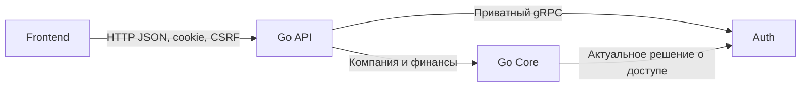

# Go API: интеграция с Auth Saldo

Приоритет владельца от 2026-10-24: [сквозная интеграция к сдаче](demo-integration.md)
25 октября, 12:00 МСК. Разработчик API сохраняет владение своим планом исполнения;
минимальные финансовые маршруты согласуются совместно с Core/ML прямо сейчас,
а не ждут полного Auth-флоу. ADR-028 разрешает явно обозначенный серверный
demo-mock подтверждения email; это узкое исключение из запрета незаметного mock
ниже. Обычный режим остаётся строгим, финансовые запросы используют настоящий
backend; runtime-готовность demo-profile ещё не подтверждена.

Дата: 2026-10-24. Исходный план подготовлен 2026-10-23.
Статус: исторический контекст границ Auth-интеграции. API-реализация десяти
auth/account endpoints выполнена локально по последующему Goal разработчика;
текущие этапы/проверки — [план первой реализации](go-api-implementation.md)
и [отчёт](../../services/api/verification.md). Следующие этапы этого старого
предложения не принимаются автоматически.
Уточнение владельца при общей интеграции 24.10.2026: **разработчик Go API сам
составляет план исполнения**. Прежняя декомпозиция ниже остаётся предложением
для обсуждения, не назначенными этапами и не утверждённым планом разработчика.
Актуальная готовность компонентов — [состояние интеграции](../../docs/integration-status.md).
Новый [план первой реализации Go API](go-api-implementation.md) подготовлен
разработчиком для согласования; дальнейший Goal явно разрешил реализацию
и итоговое ревью после всех этапов.
Ответственный за реализацию: [@Prosteyshiyyy](https://github.com/Prosteyshiyyy), разработчик Go API.
Основание: владелец поручил передать интеграцию Auth в Go API ответственному
разработчику и создать отдельный PR с этой задачей.
Это отдельная поставка плана, выделенная из API-части этапа 3.6
[опубликованного Auth-плана — PR #17](https://github.com/benzocloud/hack-rnd-autumn-2026/pull/17).
Этапы Auth 3.1–3.6 и контракты доступны исполнителю через эту зависимость.
Реализация Auth, проверка прав внутри Core и финансовые алгоритмы сюда не входят.
После каждого этапа — результат, проверки, ревью и явный апрув по ADR-020.
Все четыре этапа имеют статус «Не начат». План не разрешает merge или deployment.

## 1. Цель и исходное состояние

Предоставить frontend единый браузерный вход через Go API:



Go API принимает `/api/v1/auth/*`, `/me`, операции компаний, сотрудников
и приглашений. Auth выполняет соответствующие use cases и хранит пользователей,
сессии, членства и приглашения. Core владеет Company/BankAccount и финансами.
Frontend не вызывает Auth или Core напрямую.

При подготовке плана проверена main
`21e3bf8eafffb8d3c054dd1d8348559eb9d37a37`.
В этой исторической базе прикладные `services/api/`, `services/auth/` и `proto/auth/v1/`
отсутствуют. К моменту исправлений продуктовый REST и архитектура из
[PR #14 — docs: define cash flow REST contracts](https://github.com/benzocloud/hack-rnd-autumn-2026/pull/14)
уже слиты в main; это не объявляет работающий backend и не принимает все Auth-политики.
Источник DTO — `docs/api/openapi.yaml`, пояснений — `docs/api/README.md`.
В объединённой поставке уже есть Auth-каркас и его protobuf, Core foundation
из [PR #23](https://github.com/benzocloud/hack-rnd-autumn-2026/pull/23), frontend
и ML baseline. Go API, Auth business RPC и Core transport ещё отсутствуют;
исторические pinned-ссылки ниже не заменяют текущие файлы репозитория.
Перед кодом сверить актуальный принятый SHA контрактов и согласовать Auth RPC из PR #17.
Строки ниже задают область работы, а не заменяют схемы OpenAPI.

Issue не привязана; требования получены напрямую от владельца. При исходной
подготовке GBrain не использовался по тогдашнему ADR-010. При сверке 24.10.2026
выполнен реальный recall общей памяти по API/Auth; он не дал дополнительных
результатов поиска. Текущее подключение описано ADR-023 в Auth/main-контексте,
а старое утверждение о недоступности не является действующей настройкой.
Код и runtime-тесты API в этой поставке плана не создавались и не запускались.

### Контрактная точка синхронизации с PR #17

Сверен PR #16 на `9b9c419434bf5df469faae5b0fbaa2b639784a68` и Auth PR #17
на `ad50d5b7ae0f843a93bbf2fbe17f0b7380f71b2c`. Для интеграции использовать
следующие опубликованные источники этого Auth-снимка:

- [Auth 0.1.2 и точное REST → RPC соответствие](https://github.com/benzocloud/hack-rnd-autumn-2026/blob/ad50d5b7ae0f843a93bbf2fbe17f0b7380f71b2c/docs/auth/contract.md);
- [OpenAPI 0.1.3](https://github.com/benzocloud/hack-rnd-autumn-2026/blob/ad50d5b7ae0f843a93bbf2fbe17f0b7380f71b2c/docs/api/openapi.yaml)
  и [канонический auth.proto](https://github.com/benzocloud/hack-rnd-autumn-2026/blob/ad50d5b7ae0f843a93bbf2fbe17f0b7380f71b2c/proto/auth/v1/auth.proto);
- [ADR-027 и границы принятия](https://github.com/benzocloud/hack-rnd-autumn-2026/blob/ad50d5b7ae0f843a93bbf2fbe17f0b7380f71b2c/.agent/adr/027-auth-contract.md),
  [состояние реализации 3.2](https://github.com/benzocloud/hack-rnd-autumn-2026/blob/ad50d5b7ae0f843a93bbf2fbe17f0b7380f71b2c/docs/auth/stage-3.2.md).

Эта сверка обновляет API-план, но не принимает его этапы и не объявляет готовыми
business RPC: Auth 3.1 принят владельцем как основание 3.2, исправленный 3.2
остаётся на человеческом ревью; Auth 3.3–3.6 ещё не реализованы. При смене SHA
перед кодом повторить сверку контракта и готовности с владельцами Auth/Core.
Запуск health/readiness Auth не означает доступность Register/Login и других RPC.

## 2. Разделение ответственности

| Ответственный | Результат |
| --- | --- |
| Разработчик Go API — @Prosteyshiyyy | HTTP handlers/middleware, cookie/CSRF/Origin, Auth/Core clients, преобразование ошибок, координация создания компании, контрактные и интеграционные проверки API |
| Разработчик Auth | Приватные RPC, password hashing, sessions/security contexts, подтверждение/reset и доставка email, membership/invitation use cases, долговечное состояние команды создания компании |
| Разработчик Core | Идемпотентное создание/read Company/BankAccount, защищённый `UpdateCompany` с owner-only и version conflict, собственное хранение и проверка разрешений через Auth |
| Frontend-разработчик | Страницы и состояния по REST; вызовы только Go API, получение CSRF token и обработка session/access errors |

Согласование RPC и браузерного профиля — совместная зависимость, но изменения
в `services/auth/` или `services/core/` не становятся обязанностью разработчика API
из-за зависимости его задачи от этих сервисов. Для недостающего RPC сначала
согласовать контракт с владельцем сервиса, затем реализовать API-адаптер.

## 3. Объём HTTP-интеграции

Все REST-пути ниже указаны относительно `/api/v1`.

| Область | Операции |
| --- | --- |
| Текст отдельного согласия | `GET /auth/personal-data-consent` |
| Предавторизационный контекст | `GET /auth/csrf` |
| Аккаунт | `POST /auth/register`, `POST /auth/login`, `GET /me` |
| Подтверждение | `POST /auth/verify-email`, `POST /auth/resend-verification` |
| Восстановление | `POST /auth/forgot-password`, `POST /auth/reset-password` |
| Выход | `POST /auth/logout` |
| Компании | `GET/POST /companies`, `GET/PATCH /companies/{company_id}` |
| Участники | `GET /companies/{company_id}/members`, `DELETE /companies/{company_id}/members/{user_id}` |
| Приглашения владельца | `GET/POST /companies/{company_id}/invitations`, `DELETE /companies/{company_id}/invitations/{invitation_id}` |
| Приглашения адресата | `GET /me/invitations`, `POST /me/invitations/{invitation_id}/accept`, `POST /me/invitations/{invitation_id}/decline` |

В объём входит минимальный API startup/router/client, если он ещё не готов:
он согласуется с общей структурой Go API и не создаётся вторым параллельным сервисом.
Наличие endpoints в таблице не утверждает, что их RPC/backend уже реализованы.

Вне объёма: реализация самого Auth и его миграций, Core domain/repositories,
ML/импорт/финансовые REST-методы, frontend-страницы, JWT browser access/refresh,
собственная БД пользователей/членств в API, новые роли, SSO/MFA, брокер и deployment.
Инфраструктура runner/Fadwix не затрагивается.

## 4. Обязательные свойства интеграции

- API — браузерный адаптер. Сессии, credentials, token records и права хранятся
  в Auth, финансовые данные — в Core; API не обращается напрямую к их БД.
- В согласуемом профиле REST используется непрозрачная серверная сессия:
  `__Host-saldo_session; Secure; HttpOnly; SameSite=Lax; Path=/`, без Domain,
  как в опубликованных OpenAPI/Auth. Это актуальное имя после ребрендинга;
  прежнее имя из исходного API-плана не переносить в реализацию. Session token
  не возвращать в JSON и не предлагать хранить в localStorage.
- Один origin и HTTPS — базовый браузерный профиль. API проверяет Origin
  и synchronizer CSRF token на изменяющих запросах, включая вход/регистрацию.
  Auth владеет проверяемым security context и повторяет CSRF/authorization
  атомарно с мутацией. API передаёт исходные BrowserContext/WriteContext и
  проверенный client context по auth.proto; trusted boolean `csrf_valid` или
  присланная браузером роль их не заменяют. После входа контекст ротируется; frontend получает
  новый CSRF token. SameSite самостоятельно не заменяет CSRF.
- API устанавливает/удаляет cookie по фактическому результату Auth и сохраняет
  правильные Path/flags при удалении. Истечение сессии и отказ RPC — разные ошибки.
  Никаких full request/body/cookie/token в логах; `Cache-Control: no-store` на ответах.
- Actor/session context получается из доверенной проверки, а не из тела запроса
  и пользовательских `X-User-*`/`X-Role-*`. Применить приватный mTLS/URI SAN и
  peer allowlist из Auth-контракта, согласовать certificates/config с владельцами
  Auth/Core; недоступность Auth закрывает доступ.
- Роль относится к конкретному членству. Проверяются текущая сессия и разрешение
  на конкретную компанию; проверка Core остаётся в ответственности Core и не
  заменяется одной проверкой API. После отзыва новый запрос/polling не получает данные.
- Два вида ошибок различаются: доменный отказ/неверная сессия и недоступность
  Auth/Core. HTTP codes, безопасные `code/message/request_id` и маскирование
  недоступных ресурсов берутся из согласованного OpenAPI.
- RPC выполняются с deadline/cancellation и освобождением соединений. Создающие
  операции не повторяются автоматически без согласованной идемпотентности.
  API не кеширует положительные права бессрочно и не выдаёт доступ при ошибке.
- До регистрации frontend получает отдельный текст согласия через
  `GetPersonalDataConsent`, показывает его и передаёт активное принятие с
  `document_version`/`document_sha256`. API проксирует поля по REST/RPC;
  Auth проверяет актуальный текст и сохраняет evidence в своей транзакции.
  Отсутствие принятия даёт CONSENT_REQUIRED/422, смена версии —
  CONSENT_DOCUMENT_CHANGED/409; API не подставляет согласие за пользователя.
- Вход — email/password. Подтверждение email — challenge и строка из шести
  ASCII цифр, включая ведущие нули, TTL 10 минут; Register/resend возвращают
  generic 202 с challenge_id/expires_at без кода. Reset использует отдельную
  одноразовую ссылку и после успеха не выполняет автоматический login.
  Resend HTTP API и доставка принадлежат Auth, а не браузерному API.

### Создание компании без дубликатов

API координирует согласованный протокол: Auth сохраняет намерение создания
со стабильными IDs и отпечатком тела → Core идемпотентно создаёт Company/BankAccount
→ Auth атомарно завершает команду и owner-членство → API возвращает успех.
Состояние команды принадлежит Auth; API не хранит вторую копию бизнес-состояния.
Повтор с тем же Idempotency-Key возобновляет прежнюю команду; другое тело даёт
конфликт. После сбоя между Core write и Auth commit API не возвращает ложный успех
и не создаёт новую компанию. Неполный результат не появляется как готовая компания
в workspace. Восстановление, срок хранения и внутренние RPC принимает разработчик
Auth совместно с Core до реализации API orchestration.
Новый Company ID — ненулевой UUIDv7, выданный Auth один раз при сохранении
durable intent; API сохраняет его при каждом повторе. До завершения членства
Auth проверяет durable Core receipt по согласованному протоколу. Одного
предъявленного API идентификатора компании для Complete недостаточно.

## 5. Предлагаемые компоненты

Пути ещё не реализованы; окончательная раскладка согласуется с владельцем Go API.
Не создавать пустые абстракции ради соответствия карте.

```text
services/api/
  internal/app/                       # startup/router/clients, если ещё отсутствуют
  internal/config/                    # endpoints, TLS/identity, deadlines, cookie profile
  internal/client/auth/               # private RPC adapter
  internal/client/core/               # company operations
  internal/handler/http/
    auth/                             # csrf, register/login/verify/reset/logout
    me/                               # current user, incoming invitations
    companies/                        # company reads and create coordination
    members/                          # members and outgoing invitations
    middleware/                       # session context, Origin/CSRF, error mapping
  internal/gen/auth/v1/               # generated from canonical proto/auth/v1
  internal/gen/core/v1/               # generated from canonical proto/core/v1
  testdata/                           # own synthetic HTTP/RPC fixtures
```

Interfaces располагаются около потребителя; ручная сборка через конструкторы,
явные ресурсы и `slog` без global state. Generated bindings не редактируются руками;
общие Buf/go.work/CI изменения согласуются с остальными владельцами модулей.
Go-skills: `golang-how-to`, design patterns, context, error handling, security,
gRPC/testing и относящиеся к реальной реализации вторичные skills.

## 6. Этапы

### Этап 1 — согласованный контракт и Auth client API

Статус: Не начат.
Зависимости: принятый REST из PR #14; согласованные Auth RPC, cookie/CSRF,
матрица разрешений, service authentication и протокол создания компании.
Результат: HTTP/RPC соответствие определено, API client встроен в lifecycle.
Компоненты: `services/api/internal/{app,config,client/auth,gen/auth/v1}`,
совместная документация и Buf-конфигурация при необходимости.

- [ ] Сверить все операции таблицы с принятыми DTO/RPC и владельцами поведения.
- [ ] Подключить generation, управляемые соединения, identity/TLS и deadlines;
  подтвердить отсутствие второго API-каркаса и прямых SQL-зависимостей.
- [ ] Зафиксировать error mapping и передачу session/CSRF/actor context.
  Если RPC отсутствует, оформить зависимость владельцу Auth, не подменять контракт.

Проверки: Buf generation/lint, сборка, unit client tests с явно тестовым RPC peer;
ошибка запуска, отмена context и недоступность Auth.
Критерий: нет неподтверждённых wire assumptions; отказ Auth не считается успешным входом.
После результата — ревью и явный апрув до этапа 2.

### Этап 2 — браузерные auth-операции и /me

Статус: Не начат.
Зависимости: принят этап 1; Auth предоставляет register/session/verify/reset RPC.
Результат: auth endpoints обслуживают согласованный cookie/CSRF флоу.
Компоненты: HTTP auth/me handlers, middleware и безопасное transport mapping.

- [ ] Подключить `/auth/*` и `/me`, Origin/CSRF, ротацию/очистку cookie и no-store.
- [ ] Подключить получение текста согласия и передачу принятия с версией/хешем;
  проверить отказ без согласия и обновление текста при конфликте версии.
- [ ] Сохранить generic acknowledgement регистрации/восстановления из REST;
  токены подтверждения/сессии не выдавать в обычном JSON и не писать в логи.
- [ ] Различать validation, невалидную сессию, отказ политики и upstream timeout;
  не подтверждать отправку email по одному локальному HTTP успеху.

Проверки: HTTP contract tests, login/logout/expiry, неправильный Origin/CSRF,
pre-auth context после ротации, cookie flags, запрет логирования credentials,
неверный/истёкший challenge/code, ведущие нули, resend, повтор правильного кода
до expiry, отдельный использованный/истёкший reset token и RPC failure.
Проверить CONSENT_REQUIRED/422 и CONSENT_DOCUMENT_CHANGED/409 без создания аккаунта.
Mock не заменяет реальный Auth E2E.
Критерий: frontend использует cookie и новый CSRF после входа; API не изобретает
собственную политику аккаунтов или sessions.
После результата — ревью и явный апрув до этапа 3.

### Этап 3 — workspace, сотрудники и company orchestration

Статус: Не начат.
Зависимости: принят этап 2; Auth готовит memberships/invitations/onboarding,
Core предоставляет create/read и защищённый `UpdateCompany` с собственной
проверкой owner/version (Auth-план PR #17, этапы 3.5–3.6). Пока эти RPC не готовы,
этап не считается завершённым; их реализация остаётся у разработчика Core.
Результат: API собирает workspace и координирует company/member операции.
Компоненты: `client/core`, company/member/invitation HTTP handlers.

- [ ] Реализовать создание компании по согласованному восстановимому протоколу,
  обработку Idempotency-Key, конфликтов и потери ответа без дубликатов.
- [ ] Собрать список/детали компании из действующих членств Auth и Company Core.
- [ ] Подключить `PATCH /companies/{company_id}` к Core `UpdateCompany`:
  передать version, различать отсутствующее поле и `inn: null`, сохранить
  currency/timezone и преобразовать доменный version conflict в HTTP 409.
  Core проверяет owner независимо от API; API не реализует обновление SQL сам.
- [ ] Подключить приглашения зарегистрированного пользователя, входящие списки,
  accept/decline/revoke и удаление финансиста; роль owner клиентом не выбирается.

Проверки: два аккаунта/две компании; чужой адресат и company_id, повторы,
accept/revoke race на границе с Auth, ошибки обеих систем, сбой после Core write.
Для PATCH: owner success, financier denial, stale version даёт 409 без изменения;
пропущенное поле сохраняется, `inn: null` очищает ИНН, currency/timezone неизменны.
Критерий: неполный onboarding не выдаётся за успех, авторизация не живёт
в отдельной таблице API, приглашение не создаёт чужой аккаунт/компанию.
После результата — ревью и явный апрув до этапа 4.

### Этап 4 — совместная сквозная приёмка и передача фронтенду

Статус: Не начат.
Зависимости: приняты этапы 1–3; реальные Auth/Core и HTTPS demo/test profile;
проверка прав Core готова и принимается его разработчиком отдельно.
Результат: проверен путь пользователя через единственный публичный Go API.
Компоненты: API integration tests, согласованный browser test client,
`docs/api/README.md` и примеры запросов после принятия REST.

- [ ] Пройти register → verify → login → create company → invite existing user
  → accept → проверить разрешённые действия → revoke → logout/reset.
- [ ] Проверить отзыв доступа при открытой вкладке/polling, истечение,
  перезапуск сервисов, отказ Auth/Core и повтор создания компании. После reset
  сессия со старой версией credentials не проходит авторизацию; синхронизацию
  login/reset реализует Auth, API не вводит собственный credential counter.
- [ ] Передать фронтенду точные cookie/CSRF правила, error codes и состояния;
  отметить отдельно доступные финансовые методы и ещё не реализованные.

Проверки: реальные HTTP → gRPC → PostgreSQL цепочки, browser cookie/CSRF при HTTPS,
отсутствие доступа к чужой компании и прямого публичного обхода Go API,
targeted race tests при появлении конкурентного кода и применимые lint/Buf checks.
Критерий: API-часть работает по REST с реальными upstream; одни mock/unit tests
не выдаются за законченный пользовательский флоу.
После результата — итоговое ревью и апрув; merge/deployment требуют отдельного разрешения.

## 7. Зависимости и результат передачи

До кода нужно принять профиль cookie/CSRF, Auth RPC, матрицу прав и recovery
создания компании. Их разработка/согласование сохраняется за владельцами сервисов.
API-разработчик может готовить карту DTO и client tests после согласования
контрактов; отсутствие готового Auth не разрешает незаметный mock в runtime.

Принятие этой задачи переносит реализацию `services/api/` и API-часть сквозной
интеграции на @Prosteyshiyyy. Разработчик Auth завершает приватные use cases/RPC,
разработчик Core — authorizer и свою transport-границу. Взаимная проверка является
интеграционным критерием, а не передачей чужих модулей ответственному за API.
Все проверки выше запланированы; их успешное выполнение не заявляется этим PR.
