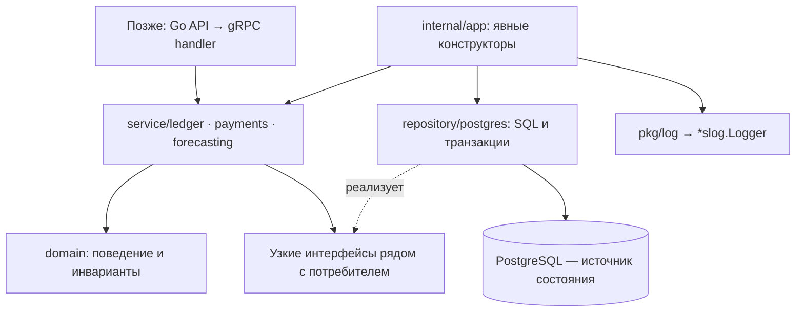

# Первый этап Go Core: домен и хранение

Дата: 2026-10-23.
Статус плана: подэтап 2.1 принят разработчиком 2026-10-24;
последующие подэтапы ещё не начаты.
Основание: исходники `ed31678886f853117ce992ad2d2ddd37d9b3632e`,
[общая архитектура](saldo-architecture.md),
[REST](../../docs/api/openapi.yaml),
[паспорт данных](../references/dataset-profile.md),
[референсы](../references/go-services.md), решения владельца в текущем обсуждении.
Это детализация **этапа 2 общего плана**, а не перенумерация этапов 1–8.
Подэтап 2.1 — «Принят», 2.2–2.4 — «Не начат»; общий этап 2 — «В работе».
Режим: после каждого подэтапа реализации — результат, проверки и остановка
до ревью и явного апрува разработчика по ADR-020.

## Цель и текущее состояние

Получить основу модульного DDD-монолита Core: проверяемые финансовые модели,
прикладные операции и PostgreSQL-хранение, из которого можно получить
согласованный входной снимок Ledger + Payments. Это ещё не работающий
HTTP/gRPC API, прогноз ML или импорт файлов.

До старта 2.1 `services/`, `proto/` и Go-модули продукта отсутствовали. Есть REST-проект,
проверенный паспорт локального CSV и архитектурные описания. Автоматическое
ревью PR #14 по SHA выше завершилось без замечаний; в отчёте явно указаны
статический характер проверки и отсутствие реализации/подтверждения CI.
Отчёт не заменяет апрув разработчика. GBrain недоступен; источники — Git/ADR,
контракты и локальные референсы. Их тесты в рамках этого планирования не запускались.

По общему плану сначала принимается REST-поставка, затем выполняется исследование
1A ФНС/1С; разработка идёт по согласованным зависимостям. Этот документ не объявляет
этап 1 завершённым и не отменяет 1A. Реальные подключения и выбранная ML-модель
технически не требуются для чистого домена и хранения.

## Решения и границы

Принято ранее: HTTP/JSON Frontend ↔ Go API; gRPC/protobuf API ↔ Core и Core ↔ ML;
PostgreSQL; канонические `proto/core/v1/` и `proto/ml/v1/` (ADR-002/003).
Владелец выбрал DDD-монолит; Ledger, Payments и Forecasting остаются его модулями.
Самостоятельная регистрация, owner/financier и приглашение зарегистрированного
финансиста по email уже определены продуктом; повторное решение об их наличии не нужно.

В текущем обсуждении владелец подтвердил:

- ручную сборку зависимостей через конструкторы в `internal/app`;
- RUB, суммы в копейках и один подключённый счёт на компанию в MVP;
- локальный `services/core/pkg/log`; общий модуль с API сейчас не выделяется.

«Один счёт» означает один учитываемый банковский счёт, а не все деньги бизнеса
и не открытие счёта в банке. В модели Company и BankAccount разделены, записи
содержат `account_id`; создание второго счёта в MVP недоступно. Остаток и прогноз
подписываются как относящиеся к этому счёту. Консолидация, собственные переводы
и мультивалютность потребуют отдельного этапа. RUB — решение продукта/адаптера,
а не установленная валюта CSV: в исходнике валюты нет.

В объёме этого плана: Go-модуль, log/config, доменные модели и ошибки,
узкие прикладные порты, миграции, PostgreSQL repositories, атомарные изменения
и согласованный финансовый снимок. Библиотеки и точная схема ниже — предложения
для принятия этого плана; они ещё не установлены и не проверены нашей сборкой.

В последующих этапах остаются: публичные бизнес-RPC, Auth/проверка членства,
онбординг между Auth и Core, Worker/задания, CSV/parser/preview/commit, внешние
адаптеры, ML, сценарии, регулярный scheduler, доставка email и deployment.
Пока нет защищённого транспорта, прикладные операции доступны только локальным
тестам/внутреннему коду; не вводить временный сетевой обход Auth.

## Структура и зависимости

Предлагается отдельный модуль
`github.com/benzocloud/hack-rnd-autumn-2026/services/core`.
Для единственного Go-модуля `go.work` не нужен. При появлении API workspace
согласуется отдельно; не использовать `replace` на чужие checkout в `references/`.

```text
services/core/
  go.mod, go.sum
  Taskfile.yml, .env.example, README.md, .golangci.yml
  pkg/log/
    logger.go, logger_test.go
  internal/
    config/
      config.go, config_test.go
    app/
      app.go, app_test.go              # сборка ресурсов появляется в 2.3
    domain/
      money/                          # точные суммы, валюта, переполнение
      ledger/                         # BankAccount, Transaction, BalanceObservation
      payments/                       # ExpectedPayment, PaymentMatch
      forecasting/                    # FinancialSnapshot в 2.4, без ML-результатов
    service/
      ledger/                         # операции и нужные им repository interfaces
      payments/                       # календарь/сопоставления и их порты
      forecasting/                    # сборка снимка через узкий read-порт
    repository/postgres/
      postgres.go                     # pool, Ping, границы времени и Close
      transaction.go                  # конкретная координация локальных транзакций
      ledger/                         # SQL, row mapping, факты/остатки/источник
      payments/                       # SQL и блокировки сопоставлений
      forecasting/                    # запись и чтение неизменяемого снимка
  migrations/
    00001_core_ledger.sql
    00002_payments.sql
    00003_financial_snapshots.sql
  testdata/                           # маленькие собственные синтетические примеры
```

Это карта файлов к завершению этапа, а не команда создавать пустые пакеты.
Тесты домена/repository лежат рядом с кодом; реальные SQL-проверки отделены тегом
`integration` и используют только выделенную тестовую БД.
`cmd/core/main.go`, `handler/grpc/`, `internal/gen/`, `client/auth/` добавляются
при реализации защищённого сервера общего этапа 3. `client/ml/`, `worker/`,
`cmd/worker/main.go` — при реализации соответствующих ролей. На этапе основы
не создавать бинарник, который только ждёт сигнал, и фиктивные бизнес-handlers.



Domain не импортирует SQL, protobuf, gRPC, logger и config. Service координирует
операции, но не знает `pgx.Tx`. PostgreSQL-адаптер переводит строки БД в доменные
типы и ошибки. Forecasting не меняет таблицы Ledger/Payments; согласованное
чтение проходит через их read-порты в одной локальной транзакции. Интерфейсы
создаются для действительного потребителя, а не для каждого struct.
Не вводить generic repository, BaseEntity/BaseAggregate, общий service locator,
пакет всех interfaces, универсальный UnitOfWork или внутренний event bus.

## Что адаптируем из референсов

Пути ниже отсчитываются от корня репозитория. `references/` — игнорируемые
локальные ссылки; зависимостей сборки от их наличия не будет.

| Наш компонент | Проверенный источник | Адаптация |
| --- | --- | --- |
| `pkg/log` | `references/maxhack/services/gateway/pkg/log/logger.go:13–41` | Конструктор возвращает `*slog.Logger`, явная передача владельцу; JSON/text через стандартные handlers, без tint; добавить передаваемый `io.Writer` и строгую проверку параметров |
| `internal/config` | `references/maxhack/services/gateway/internal/config/config.go:20–43,86–110` | Типизированные секции, stdlib env-loader, defaults → env → validation; файл/TOML не нужен для первого этапа |
| `internal/app` | `references/hack-rnd-2026-spring/services/engine-go/internal/app/app.go:40–65` | Явный порядок конструкторов; освобождение уже открытых ресурсов при ошибке сборки |
| Владение ресурсами | `references/centralservice/internal/app/app.go:131–174` | Сначала прекращается использование ресурсов, затем закрывается pool; без большого lazy-container и dummy DB fallback |
| Consumer-side ports | `references/hack-rnd-2026-spring/services/engine-go/internal/service/analytics/analytics.go:10–20` | Нужные методы рядом с прикладным потребителем, context на I/O; без копирования предметной модели |
| SQL в отдельных файлах | `references/auth-service/internal/infrastructure/postgres/repository/user_queries.go:3–9`; `references/centralservice/internal/repository/minecraft/trust/queries.go:3–9` | `//go:embed`, параметризованные запросы, явный mapping; наши схемы и запросы пишутся отдельно |

Проверенные HEAD: maxhack `06e680152ea6b62ea023551498018d7e7b08d877`,
engine-go repo `2f5a45ffdb9cce3113e495b21daae72b31942de2`, centralservice
`795caee50db60bffc8175019ca8fec96b4c698cd`, auth-service
`e80059486dc3d0eee19792bc75fb4b292bf16cd1`. В maxhack/centralservice есть
посторонние локальные изменения; источник переноса ограничен указанными файлами,
logger maxhack не изменён относительно HEAD. В maxhack MIT; при адаптации его
кода сохранить применимое уведомление. Из остальных источников здесь берутся
описанные приёмы организации, а не их реализация целиком.

Не переносить глобальные `sync.Once` logger и `slog.SetDefault` из других
референсов, неявную инициализацию logger внутри config, `sslmode=disable`
по умолчанию, чужие protobuf/SQL/JWT/certificates, MAX/Kafka/Minecraft.
В app не закрывать pool параллельно ещё работающим обработчикам.

### Предлагаемые зависимости

Документация сверена 2026-10-23 через Context7 и первичные источники.
`godig` локально отсутствует; новые инструменты не устанавливались.
Версии из референсов не считаются выбранными версиями нашего сервиса.

| Задача | Предложение | Зачем / граница |
| --- | --- | --- |
| Логи | stdlib [`log/slog`](https://pkg.go.dev/log/slog) | `NewJSONHandler` для сервера, `NewTextHandler` локально; без tint и цветного formatter; в конструкторы передаётся `*slog.Logger`, собственного Logger interface не нужно |
| PostgreSQL | [`github.com/jackc/pgx/v5` + `pgxpool`](https://github.com/jackc/pgx) | Native PostgreSQL driver/pool, явные транзакции и SQL; предлагаем вместо автоматического наследования sqlx/libpq референсов |
| Миграции | [`github.com/pressly/goose/v3`](https://github.com/pressly/goose) как отдельный закреплённый CLI | Последовательные SQL Up/Down; отдельная команда, не запуск каждой репликой; приложению не нужна встроенная migration framework |
| Config/ошибки/тесты | `os`, `strconv`, `time`, `errors`, `fmt`, `testing` | Достаточно env, `%w`/`errors.Is` и table-driven tests; Viper/cleanenv/TOML, error framework и mock generator пока не нужны |

Точные Go/pgx/goose/linter версии закрепить перед кодом в 2.1 после проверки
совместимости и поддерживаемого toolchain. Локально найден Go `1.27.0`;
это наблюдение о машине, а не выбранная версия CI/runtime. `@latest` в сохранённых
командах сборки/CI запрещён. Для goose явно проверить используемый PostgreSQL
driver и режим блокировки выбранной версии; инфраструктура запускает один migrator.
ORM, sqlc, decimal library, DI framework, Redis и брокер этому этапу не нужны.

`pkg/log` остаётся маленькой библиотекой настройки: конструктор с writer/параметрами,
без `init`, package-global logger, `Fatal`, токенов и печати DSN. Неверные level/format
дают ошибку конфигурации. Метаданные service/component/request_id добавляются
через `With`, финансовые строки и персональные данные в логи не попадают.
Тесты используют buffer/handler без подмены process-global stdout.

## Доменные инварианты и хранение

Предлагаемые таблицы принадлежат модулям: Ledger — company/account,
transaction source binding, transactions, dated balance observations и категории;
Payments — expected payments и matches; Forecasting — финансовые снимки.
Ledger также владеет неизменяемой привязкой внешней компании источника к счёту.
Таблица `command_results` принадлежит прикладной границе Core, а не финансовому
агрегату; её хранение и транзакционная координация — `repository/postgres/`.
Company здесь — финансовое рабочее пространство, а не credential/account пользователя.
Пароли, сессии и членство принадлежат Auth; онбординг и матрица прав ещё требуют
отдельного контракта. До него company создаётся только тестовым/internal сценарием.

- Money: `int64` в копейках и явная RUB, проверка переполнения; без float64.
  Операция/платёж имеют положительную сумму и отдельное inflow/outflow;
  остаток бывает отрицательным. Wire-строка не становится типом арифметики.
  Единый диапазон: Money −9223372036854775808…9223372036854775807,
  PositiveMoney 1…9223372036854775807, NonnegativeMoney 0…9223372036854775807.
  Согласовать его с REST, PostgreSQL BIGINT и будущим protobuf до реализации:
  десятичную строку разбирать точно, проверять диапазон до приведения, не усекать.
  Выход входного значения за границы — 422 VALIDATION_ERROR с ошибкой amount_minor;
  переполнение вычисления — явная ошибка без записи частичного результата.
  maxLength в OpenAPI ограничивает длину, но не заменяет числовую проверку диапазона.
- ID компании CSV `C001` — внешний ID, не tenant и не право доступа. Каждый I/O
  получает company/account scope; поиск по одному record ID недопустим.
- Account остаётся отдельной сущностью с `UNIQUE(company_id)` для MVP.
  В связях БД защищать согласованность company/account составными ключами
  или эквивалентными ограничениями, а не только условием в handler.
- `balance_eod` — отдельное наблюдение на дату, не сумма по строкам и не баланс
  после каждой операции. Разницу сверки сохранять с предупреждением, без
  вымышленной корректирующей операции. Не считать пропущенный день нулевым.
- Первая успешная запись фактов закрепляет единственный namespace источника
  атомарно: manual transaction либо внешний импорт transactions/балансов.
  Preview/connection/ожидаемые платежи/manual EOD не закрепляют namespace.
  Источник нельзя переключать/смешивать; неподходящий namespace даёт конфликт.
- Отдельно от factual authority хранить привязку company + account + source_system
  к единственному source_company_id. Она нужна и для дополнительных источников
  только planned_payments: импорт другой внешней компании из той же системы
  в тот же счёт отклоняется `SOURCE_BINDING_CONFLICT`. Привязка создаётся при
  первом принятом импорте соответствующего источника атомарно с записями;
  она не заменяет transaction_source и не связывает дополнительный источник фактов.
- External ID уникален в scope company + account + source system + source company
  + record kind. Идентичный повтор не создаёт факт и не меняет input revision;
  другой финансовый факт под тем же ID — конфликт. Совпадающее содержимое с разными
  ID не удалять автоматически. Parser/import jobs реализуются позднее.
- Платёж — одно ожидаемое движение, состояния planned/partially_matched/matched/
  cancelled; дата сама не превращает его в факт. RecurrenceRule из обзорной схемы
  не реализуется этим этапом: в REST нет контракта регулярного расписания.
- Match связывает факт и ожидание того же tenant/account/currency/direction.
  Суммы распределений ограничены обеими сторонами; remaining amount, version
  и match изменяются одной транзакцией. Нового движения денег не возникает.
  Чтение/блокировка чужого модуля идёт через его узкий порт, а не чужой repository
  в прикладном коде Payments; владельцем записи matches остаётся Payments.

Повторы ручных create/match-команд защищаются отдельно от external ID.
Ключ команды приходит от доверенного адаптера вместе с actor/company scope и
идентификатором операции/ресурса; будущий API отображает сюда scope Idempotency-Key
из REST (actor, tenant, method/path). Для одного scope+key сохраняются digest
канонического тела и исходный стабильный результат, минимум на 24 часа.
Резервирование уникального ключа, финансовая запись, revision и результат
коммитятся одной PostgreSQL-транзакцией. Не добавлять command bus/framework.
Тот же ключ и тело возвращают сохранённый результат, даже после потери ответа
или перезапуска; другое тело — IDEMPOTENCY_CONFLICT. Проверка replay выполняется
до проверки уже изменившейся ресурсной версии; права будущий адаптер проверяет
заново. Конкурентные одинаковые запросы не исполняются дважды; rollback не оставляет
ложного успешного результата. Domain не знает HTTP и не хранит токены/сессии.

Предлагаемая семантика версий для согласования: `Account.data_version` — одна
монотонная input revision финансового счёта, отдельная от version ресурса.
Любое принятое изменение входа снимка (факт, остаток, категория, ожидание,
сопоставление) изменяет её в той же транзакции; чтение/preview/повтор не изменяет.
Ресурсные версии проверяются перед записью для optimistic concurrency.
Короткая блокировка строки account сериализует финансовые записи этого счёта;
порядок command key (для идемпотентной команды) → account → конкретные ресурсы/ID
одинаковый у всех команд; прямые внутренние записи без ключа начинают с account.
Это не распределённая транзакция и не хранение всей истории компании в агрегате.

Снимок фиксирует company/account, input revision, cutoff, происхождение остатка,
факты до cutoff и допустимые ожидаемые движения с остаточными суммами.
Дата — бизнес-дата Europe/Moscow, timestamps — UTC. Нужен принятый EOD ровно
на cutoff; старый остаток не переносится молча, отсутствие — отдельная ошибка.
Исторический календарь включается лишь при доказанной доступности на cutoff;
CSV таких временных меток не даёт. Реальный imported_at не подменять исторической датой.
Остаточная сумма/статус ожидания также должны соответствовать cutoff:
сопоставление или коррекция, известные позднее, не уменьшают исторический остаток.
Если состояние календаря на cutoff нельзя восстановить из доступных версий,
пометить его недоступным для исторического снимка и явно исключить неподтверждённые
ожидания с ограничением качества. Не подставлять живой remaining_amount;
полное temporal/event-sourcing хранилище этим требованием не вводится.

Чтение Ledger/Payments/version — одна PostgreSQL REPEATABLE READ транзакция;
если в ней записывается снимок, она read-write. Без ML/Auth/HTTP внутри транзакции.
Записанный финансовый снимок неизменяем; последующая запись счёта даёт новую
input revision, не переписывая старую. Это внутренний `FinancialSnapshot`,
**не полный REST ForecastInput**: ModelContext, правила риск-метрики и атомарное
создание forecast+job будут добавлены после отдельного согласования контрактов.

## Подэтапы реализации

### 2.1 — Go-модуль, config и pkg/log

Статус: Принят разработчиком 2026-10-24.
Зависимости: апрув границ этого плана; выбор совместимых закреплённых версий.
Результат: собираемый модуль с явной конфигурацией и тестируемым logger.
Файлы: `services/core/{go.mod,go.sum,Taskfile.yml,README.md,.env.example,.golangci.yml}`,
`pkg/log/`, `internal/config/`; при адаптации кода — применимое MIT notice.
`services/core/AGENTS.md` включает Go-skills для этого сервиса;
`services/core/.gitignore` исключает локальные env-файлы, сохраняя `.env.example`.
В 2.1 используются только stdlib-зависимости; `go.sum`, pgx и goose появятся
при фактическом подключении сторонних модулей в 2.3.

- [x] Закрепить module path, toolchain и версии используемых зависимостей/инструментов.
- [x] Адаптировать logger maxhack с writer и строгой валидацией без global state.
- [x] Добавить env-конфигурацию log/Postgres/таймаутов, без реальных секретов
  в `.env.example`, без file-loader и без подключения к БД внутри config.Load.
- [x] Описать build/test/vet/lint и запуск только выделенных integration-проверок.

Проверки: `go test ./...`, `go vet ./...`, форматирование и закреплённый lint;
неверный level/format/timeout, безопасное сообщение о неверной DB-конфигурации,
валидный JSON log и отсутствие влияния одного logger на другой.
Завершение: модуль воспроизводимо проверяется без `references/` и без БД,
конфигурация не выполняет скрытые I/O, logger явно передаётся потребителю.
После результата — остановка на ревью и апрув разработчика.

Фактический результат 2.1 (2026-10-23): модуль в `services/core/`, Go 1.27.3,
golangci-lint 2.15.0, stdlib-only config и logger. Параметры: env-only,
отдельные Host/Port/User/Password/Database/SSLMode, ограниченные int32 pool settings,
положительные таймауты, ошибки без значений параметров. `Postgres.DSN()` собирает
URL с экранированием credentials/имени БД, поддержкой IPv6 и настроенным SSLMode;
готовая строка отдельно не хранится. Поля подключения заменили входной DSN по
уточнению владельца от 2026-10-24; `CORE_POSTGRES_DSN` больше не читается.
После перехода на поля повторный `task check` прошёл build/format/unit/race/
vet/lint (0 issues). Добавлены проверки URL roundtrip для спецсимволов
credentials/имени БД, IPv6 и сохранения настроенного SSLMode; проверяются
отсутствующие поля, некорректный порт и безопасные сообщения об ошибках.
Logger принимает writer и
типизированный `slog.Level`, поддерживает JSON/text, без global state и tint.
Применимое MIT notice сохранено; корневой LICENSE совпадает с лицензией maxhack.

Первоначально локально выполнен полный набор build, fmt-check, unit tests,
race tests, vet и lint прошли; два пакета, lint — 0 issues. Проверены defaults,
env overrides, неверные/пустые настройки, переполнение pool settings/таймаутов,
безопасные ошибки, JSON-поля, фильтрация и независимость logger.
Для проверки использован официальный golangci-lint 2.15.0 во временном каталоге
с проверенным release checksum. Установленный 2.13.2 оказался несовместим
с export data Go 1.27.3; глобальные инструменты не изменялись.
По уточнению владельца команды перенесены в `Taskfile.yml` вместо Makefile:
Task 3.48+, последовательный `task check`, закреплённые Go/linter сохранены.
Проверено на Task 3.48.0: полный `task check` прошёл build/fmt-check/unit/race/
vet/lint (0 issues), в том числе при внешнем `GOTOOLCHAIN=local`.
Проверены список команд, отказ `task integration` и отклонение старого линтера
2.13.2 до запуска анализа. Go-код при переносе entrypoint не изменялся.
Сетевых бизнес-endpoint и SQL-тестов нет; `task integration` пока явно отказывает,
а не выдаёт отсутствие SQL-проверок за успешный прогон. CI не запускался.
На момент первоначального отчёта подэтап ожидал апрува, 2.2 не был начат;
commit/push не выполнялись. Владелец принял результат и разрешил commit/push
2026-10-24 сообщением «апрув пуш, давай дальше».

Дополнение по запросу владельца от 2026-10-24: подготовить CI и Dockerfile,
опираясь на Dockerfile engine-go/auth-service из `references/`. Область:
`.github/workflows/go-core-ci.yml`, `services/core/{Dockerfile,Dockerfile.dockerignore,README.md}`.
Проверки отдельными последовательными job: lint → test → build → publish;
race/shuffle-тесты выполняются в `test`, tidy/govulncheck/Docker build — в `build`;
публикация только из `main` после проверок через `GITHUB_TOKEN`.
Пока нет `cmd/core/main.go`, проверять target `build`, явно пропускать GHCR;
после появления настоящего entrypoint проверять `runtime` и публиковать его.
Runtime — scratch, CA/tzdata, статический бинарник, непривилегированный UID/GID;
контекст не включает env-файлы, dataset и references. Сервер-заглушка и VPS deploy
не входят в это дополнение; границы следующих подэтапов не меняются.
Локальная проверка дополнения: actionlint 1.7.12 — без замечаний;
`task check` — успешно, lint 0 issues; отдельный
`go test -race -shuffle=on -count=1 ./...` — успешно;
govulncheck 1.9.0 — `No vulnerabilities found`; `go mod tidy` не изменил module files.
Проверены обе ветви выбора Docker target и ограничения permissions/publishing.
Docker daemon локально не запущен: фактическая контейнерная сборка не проверена.
GitHub workflow и GHCR publish не запускались; commit/push не выполнялись.

### 2.2 — финансовая модель Ledger и Payments

Статус: Не начат.
Зависимости: принят 2.1; подтверждены инварианты/граница данных этого плана.
Результат: чистый домен денег, фактов, остатков и ожидаемых платежей.
Файлы: `internal/domain/{money,ledger,payments}/`, соответствующие тесты.

- [ ] Реализовать Money, scope company/account, направление и доменные ошибки;
  закрепить единый диапазон REST/Core/BIGINT и будущего protobuf.
- [ ] Описать BankAccount/source binding, Transaction, BalanceObservation;
  категории — принадлежность компании и nullable category_id, без ML-классификатора.
- [ ] Реализовать ExpectedPayment/PaymentMatch и проверяемые переходы состояний.
- [ ] Отделить source provenance, ресурсные версии и input revision;
  дату операции/дня не смешивать со временем импорта.

Проверки: обе границы Money и соседние значения за ними, PositiveMoney с нулём,
NonnegativeMoney с −1, точный разбор REST-строк, overflow/валюта/знак;
source conflict, повтор/изменившийся
external ID, отрицательный остаток, частичный/full match, превышение обеих
сторон распределения, отмена/просрочка без выдуманного факта, чужой scope.
Конкурентная атомарность проверяется с БД в 2.3, не только unit-тестами модели.
Завершение: инварианты выражены поведением моделей, тестируются без SQL/сети,
не добавлены recurrence engine, ML-модели или транспортные DTO в domain.
После результата — остановка на ревью и апрув разработчика.

### 2.3 — PostgreSQL, прикладные операции и владение ресурсами

Статус: Не начат.
Зависимости: приняты 2.1–2.2, pgx/goose и семантика версий; есть выделенная
тестовая PostgreSQL, способ её локального запуска согласован без Fadwix.
Результат: состояние Ledger/Payments сохраняется атомарно и изолированно.
Файлы: `migrations/00001_core_ledger.sql` (включая `command_results`), `00002_payments.sql`,
`internal/{app,service/ledger,service/payments,repository/postgres}/`.

- [ ] Создать миграции, ключи/FK/CHECK/UNIQUE и индексы по company/account/date/ID.
- [ ] Реализовать pool с ограничениями и Ping/deadline; конструктор закрывает
  открытые ресурсы при последующей ошибке, недоступная обязательная БД — ошибка.
- [ ] Добавить узкие consumer-side repository ports, отдельный SQL и row mapping;
  перевод no rows/unique/version conflict в безопасные доменные ошибки.
- [ ] Реализовать внутренние команды записи факта/остатка/ожидания/match,
  source guards и version changes в одной транзакции. Не делать bulk CSV importer.
- [ ] Добавить persistent scope+key/digest/result для ручных create/match-команд;
  сохранить результат атомарно с финансовой записью и data_version, воспроизвести
  его до stale-version guard. Внешние ID остаются отдельной защитой импорта.
- [ ] Согласовать единый порядок блокировок; app собирает конкретные реализации.
- [ ] Запускать миграции отдельной закреплённой командой; startup их не применяет.
  В pgx отмена context сама не откатывает транзакцию: явно завершать rollback
  с ограниченным контекстом очистки и возвращать connection/pool resources.

Проверки: integration-тесты пустая БД → up → roundtrip → reconnect, повторный up;
down/up только на одноразовой БД, rollback без частичной записи, межтенантный ID,
одновременное закрепление разных factual namespaces, смена внешней компании
одного supplemental source и два конкурентных match, stale version.
Для ручных create/match: commit с потерянным ответом → повтор после reconnect
возвращает исходный результат без дубля/revision bump; конкурентный одинаковый
ключ исполняет команду один раз; другое тело конфликтует; rollback не сохраняет
успех и не мешает следующей попытке. Отдельно — повтор внешнего ID без дубля
и ошибочный SQL/context без утечки соединений.
Тесты не используют существующие production/dev БД; DSN в логи не печатается.
Завершение: ограничения подтверждены настоящим PostgreSQL, а не DB mocks;
данные переживают повторное подключение, конфликты не оставляют частичных денег.
После результата — остановка на ревью и апрув разработчика.

### 2.4 — согласованный финансовый снимок

Статус: Не начат.
Зависимости: приняты 2.2–2.3; согласованы cutoff/availability и input revision.
Результат: неизменяемый финансовый снимок одной версии Ledger + Payments.
Файлы: `internal/domain/forecasting/`, `service/forecasting/`,
`repository/postgres/forecasting/`, `migrations/00003_financial_snapshots.sql`.

- [ ] Ввести внутренний FinancialSnapshot и read-порт без pgx/protobuf в service.
- [ ] Связать read-порты Ledger/Payments с одной транзакцией, захватить revision,
  dated opening balance, факты и remaining expectations с provenance/ограничениями.
- [ ] Сохранять снимок без сетевых вызовов; после сохранения его содержимое не меняется.
- [ ] Отдельно отразить отсутствие EOD/исторических меток доступности; не выдавать
  внутренний снимок за готовый контракт inference или успешный прогноз.

Проверки: писатель меняет ожидание/match между двумя чтениями — snapshot содержит
одну согласованную версию; последующие записи не меняют сохранённый снимок;
факт после cutoff исключён, EOD другой даты не подставлен; ожидание, сопоставленное
позже с будущим фактом, не помечается исполненным на cutoff. Невосстановимый
календарь явно ограничен, распределённая сумма не учтена повторно, чужая компания
недоступна. Отдельный integration-test roundtrip
проверяет сохранение точных сумм, дат и revision.
Завершение: смешанный снимок исключён настоящей транзакцией и проверен тестом;
R01/ModelContext и запуск job не объявлены реализованными.
После результата — остановка на ревью и апрув разработчика.

## Приёмка, открытые решения и следующий шаг

Приёмка всего этапа: сборка и актуальные unit/integration/vet/lint проходят
на закреплённых версиях; критические финансовые ограничения проверены;
код не зависит от локальных референсов, не содержит credentials/чужих данных,
контракты и схема согласованы. Для данных брать маленькие синтетические fixtures,
а не коммитить исходный `dataset/`. Фактические проверки config/log подэтапа 2.1
отражены выше; домен, PostgreSQL и снимок данных ещё не реализованы и не проверены.

Перед реализацией нужно принять предложенные pgx/goose, диапазон Money/int64,
семантику input revision, схему межмодульного match и границы FinancialSnapshot.
Полное согласование REST/протокола Auth не подменяется ответами о RUB/DI/logger.
Go API ↔ Core protobuf и проверяемая идентичность понадобятся до бизнес-RPC;
составить их отдельной контрактной поставкой, не разрабатывать transport на догадках.

Открытая корректировка общего плана R02/T07 сохраняется: минимальный Worker/job
store должен появиться до этапа импорта 4, а не после него в этапе 6.
Этот фундамент не реализует очередь и не закрывает замечание перестановкой номеров.
R01/T06 о закреплении ModelContext до inference также остаётся отдельным условием
до ML/сценариев; успешный FinancialSnapshot его не закрывает.

Вопрос о достаточности одного счёта закрыт переданным ответом эксперта Анастасии
от 2026-10-23, 22:58–22:59: один или несколько счетов — на усмотрение команды;
одного достаточно, поддержка нескольких будет плюсом. У небольших компаний
может быть 2–3 счёта; это ориентир сценария, не технический лимит платформы.
Ответ не подтверждает наличие account ID и признаков собственных переводов
в исходном CSV. Текущее решение MVP (ADR-022) сохраняется: один подключённый
счёт, без консолидации. Мультисчётность — опциональный последующий этап после
основного рабочего пути; mapping счетов, собственные переводы и правила общего
прогноза должны быть согласованы перед таким расширением.

После принятия этапа — отдельный план защищённого Core gRPC и онбординга с Auth.
Deployment, коммит/пуш и публикация PR требуют собственных поручений;
этот файл их не выполняет и не отмечает результаты принятыми.
