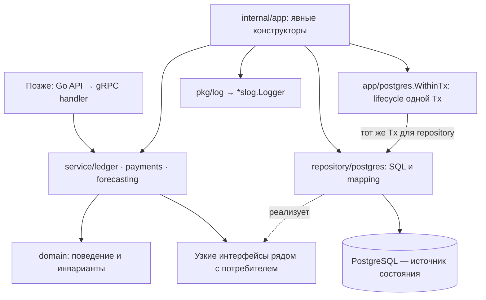

# Первый этап Go Core: домен и хранение

Дата: 2026-10-23.
Статус плана: подэтап 2.1 принят разработчиком 2026-10-24;
подэтап 2.2 принят разработчиком 2026-10-24; 2.3/2.3.R включены в main
через PR #23/#24. Подэтап 2.4 принят разработчиком 2026-10-24 после ревью.
Его начало явно разрешено владельцем после обсуждения следующего шага.
Исторические отчёты о [корректировке 2.3.R](#core-transaction-simplification)
ниже описывают состояние на момент соответствующих проверок.
Основание: исходники `ed31678886f853117ce992ad2d2ddd37d9b3632e`,
[общая архитектура](saldo-architecture.md),
[REST](../../docs/api/openapi.yaml),
[паспорт данных](../references/dataset-profile.md),
[референсы](../references/go-services.md), решения владельца в текущем обсуждении.
Это детализация **этапа 2 общего плана**, а не перенумерация этапов 1–8.
Подэтапы 2.1–2.2 — «Приняты», 2.3 — в main, 2.4 — «Принят»;
основа этапа 2 (2.1–2.4) принята разработчиком.
Режим: после каждого подэтапа реализации — результат, проверки и остановка
до ревью и явного апрува разработчика по ADR-020.

## Цель и текущее состояние

Получить основу модульного DDD-монолита Core: проверяемые финансовые модели,
прикладные операции и PostgreSQL-хранение, из которого можно получить
согласованный входной снимок Ledger + Payments. Это ещё не работающий
HTTP/gRPC API, прогноз ML или импорт файлов.

До старта 2.1 `services/`, `proto/` и Go-модули продукта отсутствовали. Есть REST-проект,
проверенный паспорт локального CSV и архитектурные описания. Автоматическое
ревью PR #14 по SHA выше завершилось без замечаний; в отчёте явно указаны
статический характер проверки и отсутствие реализации/подтверждения CI.
Отчёт не заменяет апрув разработчика. GBrain недоступен; источники — Git/ADR,
контракты и локальные референсы. Их тесты в рамках этого планирования не запускались.

По общему плану сначала принимается REST-поставка, затем выполняется исследование
1A ФНС/1С; разработка идёт по согласованным зависимостям. Этот документ не объявляет
этап 1 завершённым и не отменяет 1A. Реальные подключения и выбранная ML-модель
технически не требуются для чистого домена и хранения.

## Решения и границы

Принято ранее: HTTP/JSON Frontend ↔ Go API; gRPC/protobuf API ↔ Core и Core ↔ ML;
PostgreSQL; канонические `proto/core/v1/` и `proto/ml/v1/` (ADR-002/003).
Владелец выбрал DDD-монолит; Ledger, Payments и Forecasting остаются его модулями.
Самостоятельная регистрация, owner/financier и приглашение зарегистрированного
финансиста по email уже определены продуктом; повторное решение об их наличии не нужно.

В текущем обсуждении владелец подтвердил:

- ручную сборку зависимостей через конструкторы в `internal/app`;
- RUB, суммы в копейках и один подключённый счёт на компанию в MVP;
- локальный `services/core/pkg/log`; общий модуль с API сейчас не выделяется.

«Один счёт» означает один учитываемый банковский счёт, а не все деньги бизнеса
и не открытие счёта в банке. В модели Company и BankAccount разделены, записи
содержат `account_id`; создание второго счёта в MVP недоступно. Остаток и прогноз
подписываются как относящиеся к этому счёту. Консолидация, собственные переводы
и мультивалютность потребуют отдельного этапа. RUB — решение продукта/адаптера,
а не установленная валюта CSV: в исходнике валюты нет.

В объёме этого плана: Go-модуль, log/config, доменные модели и ошибки,
узкие прикладные порты, миграции, PostgreSQL repositories, атомарные изменения
и согласованный финансовый снимок. Библиотеки и точная схема ниже — предложения
для принятия этого плана; они ещё не установлены и не проверены нашей сборкой.

В последующих этапах остаются: публичные бизнес-RPC, Auth/проверка членства,
онбординг между Auth и Core, Worker/задания, CSV/parser/preview/commit, внешние
адаптеры, ML, сценарии, регулярный scheduler, доставка email и deployment.
Пока нет защищённого транспорта, прикладные операции доступны только локальным
тестам/внутреннему коду; не вводить временный сетевой обход Auth.

## Структура и зависимости

Предлагается отдельный модуль
`github.com/benzocloud/hack-rnd-autumn-2026/services/core`.
Для единственного Go-модуля `go.work` не нужен. При появлении API workspace
согласуется отдельно; не использовать `replace` на чужие checkout в `references/`.

```text
services/core/
  go.mod, go.sum
  Taskfile.yml, .env.example, README.md, .golangci.yml
  pkg/log/
    logger.go, logger_test.go
  internal/
    config/
      config.go, config_test.go
    app/
      app.go, app_test.go              # верхняя сборка ресурсов в 2.3
      postgres/                       # готово: pool.go, config.go, errors.go, pool_test.go
        transaction.go                # 2.3.R: только WithinTx и lifecycle Tx
    domain/
      money/                          # точные суммы, валюта, переполнение
      ledger/                         # BankAccount, Transaction, BalanceObservation
      payments/                       # ExpectedPayment, PaymentMatch
      forecasting/                    # FinancialSnapshot в 2.4, без ML-результатов
    service/
      ledger/                         # операции и нужные им repository interfaces
      payments/                       # календарь/сопоставления и их порты
      forecasting/                    # сборка снимка через узкий read-порт
    repository/postgres/
      ledger/                         # SQL, row mapping, факты/остатки/источник
      payments/                       # SQL и блокировки сопоставлений
      commands/                       # 2.3.R: key/digest/opaque receipt, без use cases
      forecasting/                    # запись и чтение неизменяемого снимка
  migrations/
    00001_core_ledger.sql
    00002_payments.sql
    00003_financial_snapshots.sql
  testdata/                           # маленькие собственные синтетические примеры
```

Это карта файлов к завершению этапа, а не команда создавать пустые пакеты.
Транзакционная граница уточнена в [корректировке 2.3.R](#core-transaction-simplification):
`commands/` и общий WithinTx реализованы локально; прежние адаптеры ниже описаны как история.
Тесты домена/repository лежат рядом с кодом; реальные SQL-проверки отделены тегом
`integration` и используют только выделенную тестовую БД.
`cmd/core/main.go`, `handler/grpc/`, `internal/gen/`, `client/auth/` добавляются
при реализации защищённого сервера общего этапа 3. `client/ml/`, `worker/`,
`cmd/worker/main.go` — при реализации соответствующих ролей. На этапе основы
не создавать бинарник, который только ждёт сигнал, и фиктивные бизнес-handlers.



Domain не импортирует SQL, protobuf, gRPC, logger и config. Service координирует
операции, но не знает `sqlx.Tx`. PostgreSQL-адаптер переводит строки БД в доменные
типы и ошибки. Forecasting не меняет таблицы Ledger/Payments; согласованное
чтение проходит через их read-порты в одной локальной транзакции. Интерфейсы
создаются для действительного потребителя, а не для каждого struct.
Не вводить generic repository, BaseEntity/BaseAggregate, общий service locator,
пакет всех interfaces, универсальный UnitOfWork или внутренний event bus.

## Что адаптируем из референсов

Пути ниже отсчитываются от корня репозитория. `references/` — игнорируемые
локальные ссылки; зависимостей сборки от их наличия не будет.

| Наш компонент | Проверенный источник | Адаптация |
| --- | --- | --- |
| `pkg/log` | `references/maxhack/services/gateway/pkg/log/logger.go:13–41` | Конструктор возвращает `*slog.Logger`, явная передача владельцу; JSON/text через стандартные handlers, без tint; добавить передаваемый `io.Writer` и строгую проверку параметров |
| `internal/config` | `references/maxhack/services/gateway/internal/config/config.go:20–43,86–110` | Типизированные секции, stdlib env-loader, defaults → env → validation; файл/TOML не нужен для первого этапа |
| `internal/app` | `references/hack-rnd-2026-spring/services/engine-go/internal/app/app.go:40–65` | Явный порядок конструкторов; освобождение уже открытых ресурсов при ошибке сборки |
| Владение ресурсами | `references/centralservice/internal/app/app.go:131–174` | Сначала прекращается использование ресурсов, затем закрывается pool; без большого lazy-container и dummy DB fallback |
| Consumer-side ports | `references/hack-rnd-2026-spring/services/engine-go/internal/service/analytics/analytics.go:10–20` | Нужные методы рядом с прикладным потребителем, context на I/O; без копирования предметной модели |
| SQL в отдельных файлах | `references/auth-service/internal/infrastructure/postgres/repository/user_queries.go:3–9`; `references/centralservice/internal/repository/minecraft/trust/queries.go:3–9` | `//go:embed`, параметризованные запросы, явный mapping; наши схемы и запросы пишутся отдельно |

Проверенные HEAD: maxhack `06e680152ea6b62ea023551498018d7e7b08d877`,
engine-go repo `2f5a45ffdb9cce3113e495b21daae72b31942de2`, centralservice
`795caee50db60bffc8175019ca8fec96b4c698cd`, auth-service
`e80059486dc3d0eee19792bc75fb4b292bf16cd1`. В maxhack/centralservice есть
посторонние локальные изменения; источник переноса ограничен указанными файлами,
logger maxhack не изменён относительно HEAD. В maxhack MIT; при адаптации его
кода сохранить применимое уведомление. Из остальных источников здесь берутся
описанные приёмы организации, а не их реализация целиком.

Не переносить глобальные `sync.Once` logger и `slog.SetDefault` из других
референсов, неявную инициализацию logger внутри config, `sslmode=disable`
по умолчанию, чужие protobuf/SQL/JWT/certificates, MAX/Kafka/Minecraft.
В app не закрывать pool параллельно ещё работающим обработчикам.

### Предлагаемые зависимости

Документация сверена 2026-10-23 через Context7 и первичные источники.
`godig` локально отсутствует; новые инструменты не устанавливались.
Версии из референсов не считаются выбранными версиями нашего сервиса.

| Задача | Предложение | Зачем / граница |
| --- | --- | --- |
| Логи | stdlib [`log/slog`](https://pkg.go.dev/log/slog) | `NewJSONHandler` для сервера, `NewTextHandler` локально; без tint и цветного formatter; в конструкторы передаётся `*slog.Logger`, собственного Logger interface не нужно |
| PostgreSQL | [`sqlx`](https://github.com/jmoiron/sqlx) + [`pgx/stdlib`](https://github.com/jackc/pgx) | Выбор владельца (ADR-025): sqlx поверх database/sql, явные транзакции и SQL; pool создаёт отдельный app/postgres, не repository |
| Миграции | [`github.com/pressly/goose/v3`](https://github.com/pressly/goose) как отдельный закреплённый CLI | Последовательные SQL Up/Down; отдельная команда, не запуск каждой репликой; приложению не нужна встроенная migration framework |
| Config/ошибки/тесты | `os`, `strconv`, `time`, `errors`, `fmt`, `testing` | Достаточно env, `%w`/`errors.Is` и table-driven tests; Viper/cleanenv/TOML, error framework и mock generator пока не нужны |

Точные Go/sqlx/driver/goose/linter версии закрепить перед кодом в 2.1 после проверки
совместимости и поддерживаемого toolchain. Локально найден Go `1.27.0`;
это наблюдение о машине, а не выбранная версия CI/runtime. `@latest` в сохранённых
командах сборки/CI запрещён. Для goose явно проверить используемый PostgreSQL
driver и режим блокировки выбранной версии; инфраструктура запускает один migrator.
ORM, sqlc, decimal library, DI framework, Redis и брокер этому этапу не нужны.

`pkg/log` остаётся маленькой библиотекой настройки: конструктор с writer/параметрами,
без `init`, package-global logger, `Fatal`, токенов и печати DSN. Неверные level/format
дают ошибку конфигурации. Метаданные service/component/request_id добавляются
через `With`, финансовые строки и персональные данные в логи не попадают.
Тесты используют buffer/handler без подмены process-global stdout.

## Доменные инварианты и хранение

Предлагаемые таблицы принадлежат модулям: Ledger — company/account,
transaction source binding, transactions, dated balance observations и категории;
Payments — expected payments и matches; Forecasting — финансовые снимки.
Ledger также владеет неизменяемой привязкой внешней компании источника к счёту.
Таблица `command_results` принадлежит прикладной границе Core, а не финансовому
агрегату; её хранение и транзакционная координация — `repository/postgres/`.
Company здесь — финансовое рабочее пространство, а не credential/account пользователя.
Пароли, сессии и членство принадлежат Auth; онбординг и матрица прав ещё требуют
отдельного контракта. До него company создаётся только тестовым/internal сценарием.

- Money: `int64` в копейках и явная RUB, проверка переполнения; без float64.
  Операция/платёж имеют положительную сумму и отдельное inflow/outflow;
  остаток бывает отрицательным. Wire-строка не становится типом арифметики.
  Единый диапазон: Money −9223372036854775808…9223372036854775807,
  PositiveMoney 1…9223372036854775807, NonnegativeMoney 0…9223372036854775807.
  Согласовать его с REST, PostgreSQL BIGINT и будущим protobuf до реализации:
  десятичную строку разбирать точно, проверять диапазон до приведения, не усекать.
  Выход входного значения за границы — 422 VALIDATION_ERROR с ошибкой amount_minor;
  переполнение вычисления — явная ошибка без записи частичного результата.
  maxLength в OpenAPI ограничивает длину, но не заменяет числовую проверку диапазона.
- ID компании CSV `C001` — внешний ID, не tenant и не право доступа. Каждый I/O
  получает company/account scope; поиск по одному record ID недопустим.
- Account остаётся отдельной сущностью с `UNIQUE(company_id)` для MVP.
  В связях БД защищать согласованность company/account составными ключами
  или эквивалентными ограничениями, а не только условием в handler.
- `balance_eod` — отдельное наблюдение на дату, не сумма по строкам и не баланс
  после каждой операции. Разницу сверки сохранять с предупреждением, без
  вымышленной корректирующей операции. Не считать пропущенный день нулевым.
- Первая успешная запись фактов закрепляет единственный namespace источника
  атомарно: manual transaction либо внешний импорт transactions/балансов.
  Preview/connection/ожидаемые платежи/manual EOD не закрепляют namespace.
  Источник нельзя переключать/смешивать; неподходящий namespace даёт конфликт.
- Отдельно от factual authority хранить привязку company + account + source_system
  к единственному source_company_id. Она нужна и для дополнительных источников
  только planned_payments: импорт другой внешней компании из той же системы
  в тот же счёт отклоняется `SOURCE_BINDING_CONFLICT`. Привязка создаётся при
  первом принятом импорте соответствующего источника атомарно с записями;
  она не заменяет transaction_source и не связывает дополнительный источник фактов.
- External ID уникален в scope company + account + source system + source company
  + record kind. Идентичный повтор не создаёт факт и не меняет input revision;
  другой финансовый факт под тем же ID — конфликт. Совпадающее содержимое с разными
  ID не удалять автоматически. Parser/import jobs реализуются позднее.
- Платёж — одно ожидаемое движение, состояния planned/partially_matched/matched/
  cancelled; дата сама не превращает его в факт. RecurrenceRule из обзорной схемы
  не реализуется этим этапом: в REST нет контракта регулярного расписания.
- Match связывает факт и ожидание того же tenant/account/currency/direction.
  Суммы распределений ограничены обеими сторонами; remaining amount, version
  и match изменяются одной транзакцией. Нового движения денег не возникает.
  Чтение/блокировка чужого модуля идёт через его узкий порт, а не чужой repository
  в прикладном коде Payments; владельцем записи matches остаётся Payments.

Повторы ручных create/match-команд защищаются отдельно от external ID.
Ключ команды приходит от доверенного адаптера вместе с actor/company scope и
идентификатором операции/ресурса; будущий API отображает сюда scope Idempotency-Key
из REST (actor, tenant, method/path). Для одного scope+key сохраняются digest
канонического тела и исходный стабильный результат, минимум на 24 часа.
Резервирование уникального ключа, финансовая запись, revision и результат
коммитятся одной PostgreSQL-транзакцией. Не добавлять command bus/framework.
Тот же ключ и тело возвращают сохранённый результат, даже после потери ответа
или перезапуска; другое тело — IDEMPOTENCY_CONFLICT. Проверка replay выполняется
до проверки уже изменившейся ресурсной версии; права будущий адаптер проверяет
заново. Конкурентные одинаковые запросы не исполняются дважды; rollback не оставляет
ложного успешного результата. Domain не знает HTTP и не хранит токены/сессии.

Предлагаемая семантика версий для согласования: `Account.data_version` — одна
монотонная input revision финансового счёта, отдельная от version ресурса.
Любое принятое изменение входа снимка (факт, остаток, категория, ожидание,
сопоставление) изменяет её в той же транзакции; чтение/preview/повтор не изменяет.
Ресурсные версии проверяются перед записью для optimistic concurrency.
Короткая блокировка строки account сериализует финансовые записи этого счёта;
порядок command key (для идемпотентной команды) → account → конкретные ресурсы/ID
одинаковый у всех команд; прямые внутренние записи без ключа начинают с account.
Это не распределённая транзакция и не хранение всей истории компании в агрегате.

Снимок фиксирует company/account, input revision, cutoff, происхождение остатка,
факты до cutoff и допустимые ожидаемые движения с остаточными суммами.
Дата — бизнес-дата Europe/Moscow, timestamps — UTC. Нужен принятый EOD ровно
на cutoff; старый остаток не переносится молча, отсутствие — отдельная ошибка.
Исторический календарь включается лишь при доказанной доступности на cutoff;
CSV таких временных меток не даёт. Реальный imported_at не подменять исторической датой.
Остаточная сумма/статус ожидания также должны соответствовать cutoff:
сопоставление или коррекция, известные позднее, не уменьшают исторический остаток.
Если состояние календаря на cutoff нельзя восстановить из доступных версий,
пометить его недоступным для исторического снимка и явно исключить неподтверждённые
ожидания с ограничением качества. Не подставлять живой remaining_amount;
полное temporal/event-sourcing хранилище этим требованием не вводится.

Чтение Ledger/Payments/version — одна PostgreSQL REPEATABLE READ транзакция;
если в ней записывается снимок, она read-write. Без ML/Auth/HTTP внутри транзакции.
Записанный финансовый снимок неизменяем; последующая запись счёта даёт новую
input revision, не переписывая старую. Это внутренний `FinancialSnapshot`,
**не полный REST ForecastInput**: ModelContext, правила риск-метрики и атомарное
создание forecast+job будут добавлены после отдельного согласования контрактов.

## Подэтапы реализации

### 2.1 — Go-модуль, config и pkg/log

Статус: Принят разработчиком 2026-10-24.
Зависимости: апрув границ этого плана; выбор совместимых закреплённых версий.
Результат: собираемый модуль с явной конфигурацией и тестируемым logger.
Файлы: `services/core/{go.mod,go.sum,Taskfile.yml,README.md,.env.example,.golangci.yml}`,
`pkg/log/`, `internal/config/`; при адаптации кода — применимое MIT notice.
`services/core/AGENTS.md` включает Go-skills для этого сервиса;
`services/core/.gitignore` исключает локальные env-файлы, сохраняя `.env.example`.
В 2.1 используются только stdlib-зависимости; `go.sum`, pgx и goose появятся
при фактическом подключении сторонних модулей в 2.3.

- [x] Закрепить module path, toolchain и версии используемых зависимостей/инструментов.
- [x] Адаптировать logger maxhack с writer и строгой валидацией без global state.
- [x] Добавить env-конфигурацию log/Postgres/таймаутов, без реальных секретов
  в `.env.example`, без file-loader и без подключения к БД внутри config.Load.
- [x] Описать build/test/vet/lint и запуск только выделенных integration-проверок.

Проверки: `go test ./...`, `go vet ./...`, форматирование и закреплённый lint;
неверный level/format/timeout, безопасное сообщение о неверной DB-конфигурации,
валидный JSON log и отсутствие влияния одного logger на другой.
Завершение: модуль воспроизводимо проверяется без `references/` и без БД,
конфигурация не выполняет скрытые I/O, logger явно передаётся потребителю.
После результата — остановка на ревью и апрув разработчика.

Фактический результат 2.1 (2026-10-23): модуль в `services/core/`, Go 1.27.3,
golangci-lint 2.15.0, stdlib-only config и logger. Параметры: env-only,
отдельные Host/Port/User/Password/Database/SSLMode, ограниченные int32 pool settings,
положительные таймауты, ошибки без значений параметров. `Postgres.DSN()` собирает
URL с экранированием credentials/имени БД, поддержкой IPv6 и настроенным SSLMode;
готовая строка отдельно не хранится. Поля подключения заменили входной DSN по
уточнению владельца от 2026-10-24; `CORE_POSTGRES_DSN` больше не читается.
После перехода на поля повторный `task check` прошёл build/format/unit/race/
vet/lint (0 issues). Добавлены проверки URL roundtrip для спецсимволов
credentials/имени БД, IPv6 и сохранения настроенного SSLMode; проверяются
отсутствующие поля, некорректный порт и безопасные сообщения об ошибках.
Logger принимает writer и
типизированный `slog.Level`, поддерживает JSON/text, без global state и tint.
Применимое MIT notice сохранено; корневой LICENSE совпадает с лицензией maxhack.

Первоначально локально выполнен полный набор build, fmt-check, unit tests,
race tests, vet и lint прошли; два пакета, lint — 0 issues. Проверены defaults,
env overrides, неверные/пустые настройки, переполнение pool settings/таймаутов,
безопасные ошибки, JSON-поля, фильтрация и независимость logger.
Для проверки использован официальный golangci-lint 2.15.0 во временном каталоге
с проверенным release checksum. Установленный 2.13.2 оказался несовместим
с export data Go 1.27.3; глобальные инструменты не изменялись.
По уточнению владельца команды перенесены в `Taskfile.yml` вместо Makefile:
Task 3.48+, последовательный `task check`, закреплённые Go/linter сохранены.
Проверено на Task 3.48.0: полный `task check` прошёл build/fmt-check/unit/race/
vet/lint (0 issues), в том числе при внешнем `GOTOOLCHAIN=local`.
Проверены список команд, отказ `task integration` и отклонение старого линтера
2.13.2 до запуска анализа. Go-код при переносе entrypoint не изменялся.
Сетевых бизнес-endpoint и SQL-тестов нет; `task integration` пока явно отказывает,
а не выдаёт отсутствие SQL-проверок за успешный прогон. CI не запускался.
На момент первоначального отчёта подэтап ожидал апрува, 2.2 не был начат;
commit/push не выполнялись. Владелец принял результат и разрешил commit/push
2026-10-24 сообщением «апрув пуш, давай дальше».

Дополнение по запросу владельца от 2026-10-24: подготовить CI и Dockerfile,
опираясь на Dockerfile engine-go/auth-service из `references/`. Область:
`.github/workflows/go-core-ci.yml`, `services/core/{Dockerfile,Dockerfile.dockerignore,README.md}`.
Проверки отдельными последовательными job: lint → test → build → publish;
race/shuffle-тесты выполняются в `test`, tidy/govulncheck/Docker build — в `build`;
публикация только из `main` после проверок через `GITHUB_TOKEN`.
Пока нет `cmd/core/main.go`, проверять target `build`, явно пропускать GHCR;
после появления настоящего entrypoint проверять `runtime` и публиковать его.
Runtime — scratch, CA/tzdata, статический бинарник, непривилегированный UID/GID;
контекст не включает env-файлы, dataset и references. Сервер-заглушка и VPS deploy
не входят в это дополнение; границы следующих подэтапов не меняются.
Локальная проверка дополнения: actionlint 1.7.12 — без замечаний;
`task check` — успешно, lint 0 issues; отдельный
`go test -race -shuffle=on -count=1 ./...` — успешно;
govulncheck 1.9.0 — `No vulnerabilities found`; `go mod tidy` не изменил module files.
Проверены обе ветви выбора Docker target и ограничения permissions/publishing.
Docker daemon локально не запущен: фактическая контейнерная сборка не проверена.
GitHub workflow и GHCR publish не запускались; commit/push не выполнялись.

### 2.2 — финансовая модель Ledger и Payments

Статус: Принят разработчиком 2026-10-24.
Зависимости: принят 2.1; подтверждены инварианты/граница данных этого плана.
Результат: чистый домен денег, фактов, остатков и ожидаемых платежей.
Файлы: `internal/domain/{money,ledger,payments}/`, соответствующие тесты.

- [x] Реализовать Money, scope company/account, направление и доменные ошибки;
  закрепить единый диапазон REST/Core/BIGINT и будущего protobuf.
- [x] Описать BankAccount/source binding, Transaction, BalanceObservation;
  категории — принадлежность компании и nullable category_id, без ML-классификатора.
- [x] Реализовать ExpectedPayment/PaymentMatch и проверяемые переходы состояний.
- [x] Отделить source provenance, ресурсные версии и input revision;
  дату операции/дня не смешивать со временем импорта.

Проверки: обе границы Money и соседние значения за ними, PositiveMoney с нулём,
NonnegativeMoney с −1, точный разбор REST-строк, overflow/валюта/знак;
source conflict, повтор/изменившийся
external ID, отрицательный остаток, частичный/full match, превышение обеих
сторон распределения, отмена/просрочка без выдуманного факта, чужой scope.
Конкурентная атомарность проверяется с БД в 2.3, не только unit-тестами модели.
Завершение: инварианты выражены поведением моделей, тестируются без SQL/сети,
не добавлены recurrence engine, ML-модели или транспортные DTO в domain.
После результата — остановка на ревью и апрув разработчика.

Фактический результат 2.2 (2026-10-24): чистые пакеты money/ledger/payments,
без сторонних зависимостей, БД, сетевых вызовов и транспортных DTO.
Money использует int64 и RUB; отдельные строгие парсеры подписанной,
положительной и неотрицательной суммы, Add/Sub с проверкой переполнения.
BankAccount разделяет factual authority и внешние company bindings;
Transaction проверяет source identity/replay и принадлежность категории,
BalanceObservation хранит датированный EOD с provenance, не суммирует повторы.
Ресурсная версия Transaction/ExpectedPayment отделена от Account.dataVersion.
ExpectedPayment возвращает новые состояния и PaymentMatch; guards проверяют
обе стороны распределения, scope, направление и сумму. Просрочка не создаёт факт,
отмена сохраняет уже распределённую историю. БД-атомарность и storage uniqueness
этим результатом не заявляются; это предмет 2.3.

По замечанию владельца выполнена отдельная механическая декомпозиция файлов:
ledger/{account,transaction,balance,scope,date,direction,source,category,errors}.go;
money/{money,parse,arithmetic,errors}.go;
payments/{payment,match,errors}.go. Тесты расположены по соответствующим файлам.
Пакеты и публичные API не менялись; нормализованные Go-токены деклараций и
комментарии до/после переноса совпали. Race/shuffle-тесты домена прошли до/после.
Полный `task check` после переноса прошёл build/fmt/unit/race/vet/lint (0 issues).
Дополнительно fuzz денежной арифметики со сверкой через math/big:
3 секунды, 521751 проверок, PASS. Интеграционных проверок PostgreSQL ещё нет.
На момент первоначального отчёта 2.2 ожидал ревью. Владелец принял результат
2026-10-24 сообщением «апрув коммит пуш погнали дальше»; 2.3 не начат.
По замечанию владельца проверки NewBalanceObservation вынесены в приватный
validateBalanceObservation; порядок проверок и ошибки сохранены. Правило
многошаговой валидации конструкторов закреплено в .agent/instructions.md (п. 13).

### 2.3 — PostgreSQL, прикладные операции и владение ресурсами

Статус: включён в main через PR #23/#24 (2026-10-24), вместе с
[корректировкой 2.3.R](#core-transaction-simplification). Владелец разрешил переход к 2.4.
Исторические записи ревью ниже сохранены.
Зависимости: приняты 2.1–2.2, sqlx/driver/goose и семантика версий; есть выделенная
тестовая PostgreSQL, способ её локального запуска согласован без Fadwix.
Результат: состояние Ledger/Payments сохраняется атомарно и изолированно.
Файлы: `migrations/00001_core_ledger.sql` (включая `command_results`), `00002_payments.sql`,
`internal/{app,service/ledger,service/payments,repository/postgres}/`.

- [x] Создать миграции, ключи/FK/CHECK/UNIQUE и индексы по company/account/date/ID.
- [x] Реализовать pool с ограничениями и Ping/deadline; конструктор закрывает
  открытые ресурсы при последующей ошибке, недоступная обязательная БД — ошибка.
- [x] Добавить узкие consumer-side repository ports, отдельный SQL и row mapping;
  перевод no rows/unique/version conflict в безопасные доменные ошибки.
- [x] Реализовать внутренние команды записи факта/остатка/ожидания/match,
  source guards и version changes в одной транзакции. Не делать bulk CSV importer.
- [x] Добавить persistent scope+key/digest/result для ручных create/match-команд;
  сохранить результат атомарно с финансовой записью и data_version, воспроизвести
  его до stale-version guard. Внешние ID остаются отдельной защитой импорта.
- [x] Согласовать единый порядок блокировок; app собирает конкретные реализации.
- [x] Запускать миграции отдельной закреплённой командой; startup их не применяет.
  Использовать `BeginTxx` с ограниченным context; отмена context приводит к
  rollback в database/sql. Явно завершать Commit/Rollback и проверять ошибки;
  закрытие pool принадлежит приложению.

Проверки: integration-тесты пустая БД → up → roundtrip → reconnect, повторный up;
down/up только на одноразовой БД, rollback без частичной записи, межтенантный ID,
одновременное закрепление разных factual namespaces, смена внешней компании
одного supplemental source и два конкурентных match, stale version.
Для ручных create/match: commit с потерянным ответом → повтор после reconnect
возвращает исходный результат без дубля/revision bump; конкурентный одинаковый
ключ исполняет команду один раз; другое тело конфликтует; rollback не сохраняет
успех и не мешает следующей попытке. Отдельно — повтор внешнего ID без дубля
и ошибочный SQL/context без утечки соединений.
Тесты не используют существующие production/dev БД; DSN в логи не печатается.
Завершение: ограничения подтверждены настоящим PostgreSQL, а не DB mocks;
данные переживают повторное подключение, конфликты не оставляют частичных денег.
После результата — остановка на ревью и апрув разработчика.

### 2.4 — согласованный финансовый снимок

Статус: Принят разработчиком 2026-10-24 после ревью.
Зависимости: приняты 2.2–2.3; согласованы cutoff/availability и input revision.
Результат: неизменяемый финансовый снимок одной версии Ledger + Payments.
Файлы: `internal/domain/forecasting/`, `service/forecasting/`,
`repository/postgres/forecasting/`, `migrations/00003_financial_snapshots.sql`.

- [x] Ввести внутренний FinancialSnapshot и read-порт без sqlx/protobuf в service.
- [x] Связать read-порты Ledger/Payments с одной транзакцией, захватить revision,
  dated opening balance, факты и remaining expectations с provenance/ограничениями.
- [x] Сохранять снимок без сетевых вызовов; после сохранения его содержимое не меняется.
- [x] Отдельно отразить отсутствие EOD/исторических меток доступности; не выдавать
  внутренний снимок за готовый контракт inference или успешный прогноз.

Проверки: писатель меняет ожидание/match между двумя чтениями — snapshot содержит
одну согласованную версию; последующие записи не меняют сохранённый снимок;
факт после cutoff исключён, EOD другой даты не подставлен; ожидание, сопоставленное
позже с будущим фактом, не помечается исполненным на cutoff. Невосстановимый
календарь явно ограничен, распределённая сумма не учтена повторно, чужая компания
недоступна. Отдельный integration-test roundtrip
проверяет сохранение точных сумм, дат и revision.
Завершение: смешанный снимок исключён настоящей транзакцией и проверен тестом;
R01/ModelContext и запуск job не объявлены реализованными.
После результата — остановка на ревью и апрув разработчика.

## Приёмка, открытые решения и следующий шаг

Приёмка всего этапа: сборка и актуальные unit/integration/vet/lint проходят
на закреплённых версиях; критические финансовые ограничения проверены;
код не зависит от локальных референсов, не содержит credentials/чужих данных,
контракты и схема согласованы. Для данных брать маленькие синтетические fixtures,
а не коммитить исходный `dataset/`. Фактические проверки config/log, домена и PostgreSQL отражены по подэтапам
и в дополнениях ниже; FinancialSnapshot (2.4) реализован, проверен и принят разработчиком;
актуальный отчёт — в дополнении ниже.

Исходный gate до старта: согласовать библиотеки PostgreSQL, диапазон Money/int64,
семантику input revision, схему межмодульного match и границы FinancialSnapshot.
Владелец разрешил реализацию 2.3 и затем выбрал sqlx (ADR-025); полный подэтап
пока не принят. Полное согласование REST/протокола Auth не подменяется ответами о RUB/DI/logger.
Go API ↔ Core protobuf и проверяемая идентичность понадобятся до бизнес-RPC;
составить их отдельной контрактной поставкой, не разрабатывать transport на догадках.

Открытая корректировка общего плана R02/T07 сохраняется: минимальный Worker/job
store должен появиться до этапа импорта 4, а не после него в этапе 6.
Этот фундамент не реализует очередь и не закрывает замечание перестановкой номеров.
R01/T06 о закреплении ModelContext до inference также остаётся отдельным условием
до ML/сценариев; успешный FinancialSnapshot его не закрывает.

Вопрос о достаточности одного счёта закрыт переданным ответом эксперта Анастасии
от 2026-10-23, 22:58–22:59: один или несколько счетов — на усмотрение команды;
одного достаточно, поддержка нескольких будет плюсом. У небольших компаний
может быть 2–3 счёта; это ориентир сценария, не технический лимит платформы.
Ответ не подтверждает наличие account ID и признаков собственных переводов
в исходном CSV. Текущее решение MVP (ADR-022) сохраняется: один подключённый
счёт, без консолидации. Мультисчётность — опциональный последующий этап после
основного рабочего пути; mapping счетов, собственные переводы и правила общего
прогноза должны быть согласованы перед таким расширением.

После принятия этапа — отдельный план защищённого Core gRPC и онбординга с Auth.
Deployment, коммит/пуш и публикация PR требуют собственных поручений;
этот файл их не выполняет и не отмечает результаты принятыми.

## Уточнение реализации 2026-10-24 (ADR-024/025)

Владелец согласовал UUID для внутренних ID: `uuid.UUID` в домене, PostgreSQL
`uuid`, REST `format: uuid`, генерация UUIDv7 в прикладных create/match-командах.
Внешние source IDs и Auth-owned IDs сохраняют собственный формат. Новые ID
не кодируют бизнес-дату; nullable category сохраняется без нулевого UUID.

PostgreSQL: sqlx 1.4.0 + pgx/stdlib 5.11.0; создание/Ping в отдельном
`services/core/internal/app/postgres`, pool закрывает вызывающий app. Вместо
минимума pool используется `CORE_POSTGRES_MAX_IDLE_CONNS` — верхний лимит idle
connections database/sql. Реализации сервисов и их storage ports приватные;
интерфейсы определяет потребитель. Embed vars находятся в `queries.go`.
Go-lint правила взяты из `references/cosmohack/backend/.golangci.yml`, дополнены
проверкой импортов goimports; проверяется весь модуль, включая тесты.

2.3 остаётся в работе: подготовлены pool, SQL Ledger, миграции и прикладные порты.
Незавершённая неиспользуемая обвязка идемпотентных транзакций исключена из
исходников; она не является работающей реализацией write-path. Координация
write-транзакций, реализация портов Payments, lifecycle сборки и полный набор
PostgreSQL integration tests должны быть закончены до передачи 2.3 на ревью.
Принятие 2.2 сохраняется как история; новые UUID/layout/lint изменения требуют
ревью разработчика и не означают принятия 2.3. Commit/push не выполнены.

Проверки корректировки (2026-10-24): полный `task check` прошёл build,
gofmt/goimports diff check, unit tests, race, vet и lint (0 issues), включая
приватные service/storage boundaries и UUIDv7/сохранение переданного UUID.
OpenAPI 0.2.0 прошёл schema validation и 462 проверки примеров с format checker.
Реальный PostgreSQL roundtrip в этой корректировке не запускался; применение
миграций и доказательство атомарности остаются критерием завершения 2.3.

Дополнительная dependency-проверка: govulncheck 1.9.0 выявил GO-2026-6629 и
GO-2026-5970 в транзитивном golang.org/x/text 0.29.0. Обновление до 0.41.0
также подняло x/sync до 0.22.0; после tidy повторные `task check` и
`govulncheck ./...` прошли, достижимых уязвимостей не найдено.

## Исправления локального ревью 2026-10-24

Статус этой корректировки: **Ожидает ревью разработчика**. Общий подэтап 2.3
остаётся в работе; его критерии атомарности/idempotency/concurrency ещё не закрыты.

- Восстановлены из HEAD Auth-согласие, регистрация и правила истории приглашений
  в OpenAPI/передаче frontend; UUID-изменения Core сохранены.
- Повторявшиеся UUID-ограничения заменены `ResourceID`/`NullableResourceID`;
  два null-only условия оставлены `type: "null"`.
- Account source CHECK требует истинного результата (`IS TRUE`), поэтому
  NULL-authority с заполненным namespace больше не проходит.
- SaveAccount проверяет RowsAffected и возвращает `sql.ErrNoRows` при отсутствии
  строки. Default максимума idle connections — 2; явный 0 остаётся допустимым.

Проверено: `task check` — build/format/unit/race/vet/lint, 0 issues; отдельный
lint с integration build tag — 0 issues. На выделенной loopback PostgreSQL
18.6 из согласованного Compose (tmpfs, test marker) goose 3.29.0 применил обе
миграции; `task integration` с race detector прошёл проверки отсутствующей
строки, недопустимых authority/namespace и валидных UUID Load/Save roundtrip.
Тестовые данные откатились; созданные для проверки контейнер/сеть удалены.

OpenAPI: 54 операции, 102 схемы, 466 проверок примеров — без ошибок;
75 ограничений × 13 вариантов = 975 сравнений эквивалентности UUID/nullability.
Регистрация из HEAD проходит; пять некорректных вариантов отклоняются.
Это не проверка работающего Auth/API. Commit/push не выполнялись.

## Локальные результаты прикладных операций (ADR-026, 2026-10-24)

Статус корректировки: **Ожидает ревью разработчика**. Область согласована
владельцем: оставить прикладные результаты рядом со сценариями в service,
удалить универсальный `command.Result` и пересмотреть общий Request.

`internal/service/ledger/{transaction,balance}.go` и
`internal/service/payments/{payment,match}.go` содержат собственные command/result
и методы операций. `service.go` сохраняет приватные store/service, конструктор
и локальную проверку ActorID/IdempotencyKey. Общий `service/command` удалён;
метаданные стали явными полями команд, локальный ErrInvalid заменил общий.
Неиспользуемые общие not-found/stale/idempotency sentinels не копируются впрок.
Баланс возвращает Date/DataVersion, match — MatchID/PaymentVersion/DataVersion;
JSON/protobuf mapper и persistence codec не задаются прикладными DTO.

Сохранить поведение: обязательность пары для ручных операций, допустимость
пустой пары для импорта, запрет неполной пары, генерация UUIDv7/сохранение
переданного UUID, resource/data version semantics. Тесты разделены по feature
и операциям; проверить конкретные результаты, передачу метаданных и ранний
отказ без обращения к store. SQL, REST и доменные инварианты не меняются;
2.3 остаётся в работе. Commit/push требуют отдельного поручения.

Проверки этой корректировки: baseline `go test ./...` был зелёным; после
изменений полный `task check` прошёл build, gofmt/goimports, unit/race tests,
vet и lint (0 issues). Отдельный lint с integration tag — 0 issues.
В Go-исходниках не осталось импортов `service/command`, `command.Request`,
`command.Result` и обращений `cmd.Request`. SQL/REST не менялись, повторный
запуск PostgreSQL для этого изменения не требовался. Поставка ожидает ревью.

## Вынесение валидации (2026-10-24)

Статус корректировки: **Принята разработчиком 2026-10-24** (сообщение «апрув»). По запросу владельца
MatchPayment разделён на метод операции и соседний приватный validateMatchPayment.
Аналогично выделены validateCreatePayment, validateCreateTransaction,
validateRecordBalance; конструкторы домена используют validateTransaction и
validateExpectedPayment по уже принятому правилу. Helpers не меняют входные
значения, не генерируют ID/время и не вызывают storage. Доменные проверки
не дублируются на прикладном уровне.

Перед извлечением расширен публичный TestMatchPaymentValidation: отсутствие
actor/key, scope, сумма, версии и ID; при нескольких ошибках сохраняется
приоритет metadata → scope → amount → versions/IDs и отсутствие вызова storage.
Baseline service/domain tests прошли до структурного изменения. Публичные
сигнатуры, возвращаемые ошибки и порядок defaults/конструирования сохранены;
SQL/REST и обработка storage errors не меняются. 2.3 остаётся в работе,
commit/push не выполнялись.

После извлечения полный `task check` прошёл build, format, unit/race tests,
vet и lint (0 issues); отдельный lint с integration tag — 0 issues.
Дополнительно все шесть вынесенных guard-блоков сравнены с исходными: порядок
условий и возвращаемые ошибки совпадают. Правило 13 в instructions расширено
на прикладные операции. Корректировка принята; подэтап 2.3 остаётся в работе.
Commit/push этим апрувом не запрошены.

Публикация 2026-10-24: после апрува выделения валидации владелец отдельно
поручил «коммит и пуш». Публикуется согласованный текущий фундамент Core,
UUID-контракты и инструкции; завершение write-path/idempotency/concurrency
подэтапа 2.3 этим не объявляется. Отдельная локальная работа Auth/GBrain
не входит в состав этого коммита.


## Завершение реализации 2.3 — 2026-10-24

Статус: **Ожидает ревью разработчика**. Поручение «давай дальше» после публикации
20d2adc разрешило продолжить текущий подэтап. Принятие 2.3 и начало 2.4 этим
не объявляются; новые commit/push не выполнялись.

Реализованы `internal/app/app.go`, приватные PostgreSQL repository implementations
Ledger/Payments и узкие storage ports сервисов. App открывает pool, явно собирает
сервисы и владеет Close; все последующие конструкторы не открывают ресурсов и
не возвращают ошибок. Подход адаптирован из `references/cosmohack/backend`:
app-owned sqlx pool, BeginTxx и отдельные SQL/embed/row mappings. Общий command
DTO/result или command bus не возвращены; `repository/postgres/write` содержит
только используемые четырьмя операциями transaction/idempotency helpers.

CreateTransaction, RecordBalance, CreatePayment и MatchPayment сохраняют данные,
source bindings, версии и результат команды одной READ COMMITTED транзакцией.
Порядок: command key → scoped account FOR UPDATE → ресурсы. Все writers одного
счёта используют этот порядок; количество уже распределённых средств читается
под account lock. SUM(bigint) читается как numeric text с проверкой диапазона.
Match сохраняет remaining/status/version + allocation; фактическую операцию
повторно не создаёт. Неизвестные ошибки SQL/driver превращаются в безопасные
application errors; ожидаемые domain conflicts сохраняются.

Digest описывает исходные значения команды, до генерации UUID/time; Money
представлен явно копейками/валютой. Создание доменного record больше не меняет
команду, передаваемую storage port; Match передаёт сгенерированные ID/time отдельно.
Repository-owned result codecs отделены от application DTO. Replay выполняется
до stale guard и сохраняется минимум 24 часа: expiry фиксируется, автоматической
очистки пока нет. Импорт без ключа воспроизводится по external identity;
повтор ожидания не сбрасывает remaining/status после match. Ручной EOD не выбирает
factual authority; внешний StatementEOD закрепляет/проверяет её как фактический источник
(исправлено по последующему ревью). В начальную migration 00001 добавлена created_data_version
остатка для стабильного replay; это незавершённая ранее схема, проверенная только
на одноразовой БД, без миграции существующей пользовательской БД.

Миграции запускаются отдельно через `task migrate-up` с goose 3.29.0;
startup их не применяет. Проверки и результат последнего прогона фиксируются ниже.

Ограничения: транспорт и авторизация ещё не реализованы; ActorID должен поступать
от доверенного адаптера, права при replay нужно проверять заново. Онбординг
company/account зависит от согласованного Auth/Core контракта и не открывается
новым публичным endpoint. FinancialSnapshot, Worker/jobs и импорт файлов не
реализуются в 2.3. Данные исходного dataset не включены в fixtures.


Проверки финальной рабочей копии 2.3 (2026-10-24):

- `task check`: build, gofmt/goimports, unit/race, vet, full-module lint — PASS,
  lint 0 issues. Дополнительный lint с `--build-tags=integration` — 0 issues.
- `task integration` с race detector на выделенной loopback PostgreSQL из
  Compose — PASS: 18 верхнеуровневых DB-тестов, включая прежние CHECK/SaveAccount.
  Проверены четыре команды, reconnect/replay, разные actor/tenant/operation,
  digest с изменённой суммой/ID, FK и неизвестная SQL-ошибка с полным rollback,
  context cancellation без утечки, concurrent identical key/namespaces/matches,
  stale versions, чужой transaction ID и сохранение remaining при reimport.
- Goose 3.29.0: пустая БД → обе миграции up; повторный up без изменений;
  down-to 0 → up → полный integration suite — PASS. Команда `task migrate-up`
  проверена с закреплённым CLI; startup миграции не запускал.

Новые проверки используют синтетические company-scoped данные и marker
одноразовой БД. Дополнительные изменения Auth/GBrain и `.gitignore` сохранены
без изменений; обсуждения текущего PR отсутствуют (открытый PR для ветки не найден).
GBrain recall выполнен; связанные факты Auth/branding не использованы как решения Core.
После проверок созданные test container/network удалены. Статус 2.3 остаётся
«Ожидает ревью разработчика»; 2.4 не начат.


Первоначальная запись итога в GBrain была отклонена автоматической проверкой
разрешений. После прямого согласия владельца «Разрешаю сохранить итог в GBrain»
2026-10-24 итог сохранён как fact #6 (status inserted, state committed).
Запись явно указывает локальную неопубликованную реализацию, пройденные проверки
и статус «Ожидает ревью разработчика»; принятие 2.3 не заявляется.


## Исправление замечаний ревью 2.3 — 2026-10-24

Статус: **Ожидает ревью разработчика**. Владелец поручил исправить P1/P2 и
упрощение сборки; это не принятие 2.3 и не разрешение начать 2.4.

- `BankAccount.BindStatementFacts` закрепляет imported factual namespace для
  внешнего EOD без вымышленного external transaction ID. Общая приватная
  `bindFacts` проверяет единственность authority и supplemental binding.
  RecordBalance использует новый метод; manual EOD остаётся без выбора authority.
- Удалён тест, ошибочно допускавший manual facts после внешнего EOD. Регрессии
  проверяют statement → manual/другой банк, manual/другой банк → statement,
  неизменность БД при конфликте и успешные записи прежнего namespace.
- Safe error wrapper сохраняет классификацию и исходную причину через
  errors.Is/As при storage/application mapping, включая rollback failure.
  Error() возвращает только безопасное сообщение; SQLSTATE остаётся доступным
  для диагностики без печати приватного driver message.
- Одноразовый assemble и импорт time удалены, зависимости собираются в New.

До исправления новые регрессии падали: три варианта смешивания источников
на настоящем PostgreSQL и три проверки сохранения причин в repository tests.
После исправления: `task check` (build, format, unit/race, vet, lint) — PASS;
full-module lint с integration tag — 0 issues; полный `task integration` на
одноразовой PostgreSQL с race detector — PASS. Дополнительно проверены неверный
namespace и отсутствие частичной authority после ошибки binding; реальный FK
conflict сохраняет SQLSTATE 23503 через сервисную границу, Error() не содержит
driver details. Тестовый container/network удалены. Исходники после финальных
проверок не менялись; отдельные Auth/GBrain/.gitignore правки сохранены.
Commit/push не выполнялись; 2.3 ожидает ревью, 2.4 не начат.


## Корректировка границы service/repository — 2026-10-24

Этот раздел описывает прежнюю промежуточную схему. Локальная реализация
[упрощения 2.3.R](#core-transaction-simplification) заменила operation-specific
транзакционные адаптеры; результат ожидает ревью разработчика.

Статус: **Ожидает ревью разработчика**. Владелец согласовал перенос координации сценариев из SQL
repository в service; исправление выполняется в текущем непринятом подэтапе 2.3.
Публичные REST/gRPC-контракты и финансовое поведение сохраняются.

Результат: сервис владеет чтением состояния через узкие порты, проверкой версий,
вызовами доменных методов, порядком сохранения и формированием operation-specific
Result. Repository получает готовый Tx и выполняет только SQL/domain mapping;
импортов service в repository не остаётся. Транзакционный/idempotency адаптер
в internal/app/postgres связывает callback сервиса с SQL-репозиториями, Begin/Commit/
Rollback и persistence codecs результата. SQLx/Tx не попадают в service или
context values. Для именуемого межпакетного callback допускается публичный тип
функции, consumer-side storage interfaces остаются приватными.

Область: internal/service/{ledger,payments}, repository/postgres, app/postgres,
app wiring и соответствующие tests; инструкции и README. Исходные миграции,
REST, доменные инварианты и сторонние локальные изменения не меняются.
Базовая рабочая копия прошла unit/race, integration и lint до переноса;
снимок исходников сохранён вне Git в /private/tmp/saldo-before-service-boundary.
Проверки: тесты прикладной логики без БД, полный task check и прежний PostgreSQL
integration suite, включая атомарность/replay/source guards/SQLSTATE. После
проверок — остановка на ревью; 2.4 и публикация этим не разрешаются.


Результат переноса: createTransaction/recordBalance/createPayment/matchPayment
находятся в соответствующих service-пакетах. Приватные storage ports возвращают
domain-модели, revision и found; публичные callback-типы *Work позволяют
транзакционным адаптерам реализовать private unitOfWork без экспорта storage
interfaces. SQL repository.New получает готовый Tx; app wiring передаёт сервисам
приватные transactions из app/postgres/{ledger,payments}. Persistence codecs
находятся у адаптера и не менялись; общее service/command не возвращено.
Технические SQL/lifecycle ошибки классифицируются на границе адаптера, ошибки
прикладных guard-ов не превращаются в ErrUnavailable; приватные причины/SQLSTATE
сохраняются. SQLFailure fixture явно отмечает свою raw-SQL границу StorageError.

Проверено после переноса: task check — build/format/unit/race/vet/lint PASS,
full-module lint и integration-tag lint — 0 issues. Полный task integration на
выделенной PostgreSQL с race detector — PASS (прежние 18 верхнеуровневых DB-тестов).
Новые service tests без БД проверяют stale/resource versions, factual/supplemental
bindings, внешние replay/conflicts, отсутствующие сущности и allocation guards.
Сверка с baseline: четыре codec, SQL и domain Go-файлы совпадают побайтно;
repository не импортирует service, service не импортирует database/sql/sqlx и не
передаёт Tx через context values. Дополнительные Auth/GBrain/.gitignore изменения
не изменены. Тестовые контейнер/сеть удалены; commit/push не выполнялись.


<a id="core-transaction-simplification"></a>

## 2.3.R — упрощение транзакционной границы

Дата фиксации: 2026-10-24. Статус: **На ревью**.
Владелец разрешил выполнение корректировки сообщением «окей поправь все по плану».
Основание: обсуждение после переноса сценариев в service и просьба владельца
подробно записать вариант с узкой транзакционной функцией. Этот раздел задаёт
следующую корректировку непринятого 2.3, а не повторно открывает принятые 2.1–2.2.
Корректировка реализована локально по этому разрешению. Прежние результаты
тестов относятся к промежуточной реализации выше; новые проверки и ограничения
зафиксированы в результате 2.3.R в конце раздела. Принятие разработчиком не заявляется.

### Цель, исходники и границы

Убрать повторение транзакционных обёрток на каждую операцию. Добавление нового
repository не должно требовать изменения общей транзакционной утилиты или
несвязанных сервисов. Оставить явную сборку через конструкторы, понятное
владение Tx и одну атомарную транзакцию на финансовую команду.

Исходное состояние до корректировки проверено по рабочей копии поверх
`20d2adc0a44be6839ee5fef3351c04ccd746e20f`; перечисленные изменения ещё не опубликованы:

| Компонент | До корректировки | Целевое изменение |
| --- | --- | --- |
| [app/app.go](../../services/core/internal/app/app.go) | Pool принадлежит app; сервисы получают feature-specific `transactions` | Передавать сервисам функции, связывающие один Tx с нужными repository |
| [service/payments/service.go](../../services/core/internal/service/payments/service.go), [match.go](../../services/core/internal/service/payments/match.go) | Private `unitOfWork`, отдельные методы и `PaymentWork`/`MatchWork` | Один `Work` и один `withinTx` на Payments; аналогично Ledger |
| `app/postgres/payments/`, `app/postgres/ledger/` (удалены) | На каждую команду свой адаптер и codec | Удалить адаптеры после переноса canonical input/receipt в feature service |
| `repository/postgres/write/transaction.go` (удалён) | `Run[T]` объединяет lifecycle, digest, replay и выполнение callback | Разделить технический `WithinTx`, прикладной replay и SQL-хранение receipt |
| [repository/postgres/payments/repository.go](../../services/core/internal/repository/postgres/payments/repository.go) | Repository уже заимствует `*sqlx.Tx` | Сохранить это владение; не возвращать создание pool в repository |

Сохраняются ранее согласованные решения: DDD-монолит, RUB/копейки, один
учитываемый счёт, UUIDv7, sqlx, app-owned pool, private implementations,
consumer-side interfaces и operation-specific application results (ADR-022/024–026).
Применяемый приём референса `references/cosmohack/backend` — явное владение
SQL-ресурсами в app; предлагаемая схема не копирует его предметные операции.

В скоупе — четыре существующих сценария: `CreateTransaction`, `RecordBalance`,
`CreatePayment`, `MatchPayment`, их wiring, idempotency и проверки. Финансовая
семантика, внешний REST/gRPC, schema/migrations и зависимости не меняются.
Нет новых endpoint, авторизации, FinancialSnapshot, Worker, брокера или импорта
файлов. Сторонние локальные правки Auth/GBrain/`.gitignore` сохраняются.

Не вводить `service/transaction`, центральный `Scope` с методами `Ledger()`/
`Payments()`, реестр всех repositories, generic repository, DI framework или
универсальные `command.Request`/`command.Result`. Небольшое повторение явного
wiring для двух features предпочтительно общей фабрике с регистрацией каждой
новой сущности. Общая функция не должна знать список repositories.

### Целевое размещение кода и ответственности

```text
services/core/internal/
  app/
    app.go                         # Open/Close pool; конструкторы и binding Work
    errors.go                      # storage → feature errors рядом со сборкой
    transaction_integration_test.go # реальный lifecycle Tx с общими DB fixtures
    postgres/
      pool.go, config.go           # существующий lifecycle pool
      transaction.go               # WithinTx: deadline/Begin/work/Commit/Rollback
      transaction_test.go          # driver Commit/Rollback failures без БД
  service/
    ledger/
      service.go                   # private service; New(withinTx)
      ports.go                     # private store/commandStore; публичный Work
      transaction.go, balance.go   # сценарии, guards, application results
      receipt.go                   # replay/complete; *_receipt.go — private форматы
      errors.go
    payments/
      service.go
      ports.go
      payment.go, match.go
      receipt.go
      errors.go
  domain/
    ledger/, payments/, money/    # без изменений
  repository/postgres/
    errors.go, cause.go            # существующая SQL-классификация, безопасная причина
    ledger/                       # SQL + row/domain mapping; заимствованный Tx
    payments/                     # SQL + row/domain mapping; заимствованный Tx
    commands/
      repository.go               # New(tx); не создаёт и не завершает Tx
      receipt.go                  # reserve/load/complete opaque bytes
      queries.go                  # go:embed только здесь
      sql/                        # прежние reserve/load_result/save_result
```

Новые файлы создаются только под используемый код. Существующие operation tests
остаются рядом со сценариями. Общие SQL errors/cause из `write/` переносятся без
изменения классификации; feature mapping из удаляемых app-адаптеров остаётся
в `app/errors.go`. Это перевод ошибок, а не новая обёртка на каждую команду.
Service не импортирует repository, app/postgres, `sqlx` или `database/sql`.

`WithinTx` управляет только временем жизни Tx. Repository выполняет запросы,
отображает строки в domain и классифицирует SQL-ошибки на своей границе.
Service решает, когда проверять replay, читать account, вызывать domain,
сохранять состояние и формировать прикладной результат. App связывает эти части
и переводит технические storage errors в существующие feature errors.

После перехода удалить `app/postgres/{ledger,payments}/`, старые operation-specific
`*Work`, private `unitOfWork` с методами команд и `repository/postgres/write.Run[T]`.
SQL idempotency переезжает в `commands/`, его общая безопасная классификация —
в технические файлы выше; пустого compatibility-пакета `write` не оставлять.

### Контракт Work и сборка зависимостей

В каждом feature-пакете определить собственный именованный callback. Ниже —
эскиз формы контракта, не готовый для копирования файл со всеми методами:

```go
// service/payments/ports.go
type store interface {
    // Реальные методы чтения/записи Payments и нужные ему Ledger capabilities.
    // Аргументы и ответы — domain models, revision, found и error.
}

type commandStore interface {
    // Reserve возвращает сохранённый payload и признак replay либо конфликт.
    // Complete сохраняет opaque payload для ранее зарезервированного ключа.
}

type Work func(context.Context, store, commandStore) error

// service/payments/service.go
type service struct {
    withinTx func(context.Context, Work) error
}

func New(withinTx func(context.Context, Work) error) *service {
    return &service{withinTx: withinTx}
}
```

Ledger получает свой `ledger.Work` с собственным набором capabilities.
Private operation ports можно встраивать в feature `store`, сохраняя узкие
параметры внутренних функций. Он содержит только уже нужные этому feature
методы; он не становится каталогом всех модулей Core.

`Work` экспортируется, поскольку app должен назвать callback-тип. `store`,
`commandStore` и реализации остаются приватными: app передаёт конкретные
repository по неявному выполнению интерфейса, не называя приватные типы.
Методы `commandStore` должны иметь совместимые сигнатуры в обоих features:
actor, company/account scope, operation, resource, key, digest/opaque payload.
Использовать уже доступные domain/стандартные типы; не требовать от SQL-пакета
импорта private или service-owned receipt DTO. Не вводить общий command DTO
только ради группировки этих аргументов.

Общий технический контракт:

```go
func WithinTx(
    ctx context.Context,
    db *sqlx.DB,
    timeout time.Duration,
    work func(context.Context, *sqlx.Tx) error,
) error
```

Binding в `app.New` делается один раз для каждого feature. Вызов функции каждый
раз создаёт новую транзакцию, а repository wrappers внутри callback получают
именно её. Сокращённый пример Payments:

```go
paymentsService := payments.New(
    func(ctx context.Context, work payments.Work) error {
        err := appPostgres.WithinTx(ctx, db, cfg.Postgres.QueryTimeout,
            func(ctx context.Context, tx *sqlx.Tx) error {
                return work(ctx, paymentsRepository.New(tx), commandsRepository.New(tx))
            },
        )
        return paymentsError(err)
    },
)
```

`paymentsError` — private mapper в app, сохраняющий существующие domain/
application errors и безопасно переводящий техническую классификацию.
Repository constructors не выполняют запросов и не возвращают ошибки:
они только заимствуют уже созданный Tx. Payments SQL-реализация уже использует
Ledger-чтения на том же Tx; это не требует нового реестра или прямого вызова
Ledger service. Новая зависимость добавляется в реальный потребляющий port и
его wiring; `WithinTx`, Ledger и остальные features из-за этого не меняются.

### Правила WithinTx и ошибок

1. Производный context с `CORE_POSTGRES_QUERY_TIMEOUT` ограничивает ожидание
   Begin, SQL и завершение команды; более ранний deadline вызывающего сохраняется.
2. `BeginTxx` открывает одну READ COMMITTED транзакцию. Работа с key, account,
   сущностями и receipt использует один Tx. Вложенные Tx и неявный fallback
   к pool внутри callback запрещены.
3. Callback вызывается синхронно один раз. Его ошибка не маскируется под
   `ErrUnavailable`: stale/notfound, domain conflicts и отмена сохраняют
   `errors.Is/As`. Неизвестные SQL-ошибки классифицируются в repository;
   ошибки Begin/Commit/Rollback — в техническом helper.
4. При nil от callback выполняется Commit. Только его успех разрешает сервису
   вернуть ненулевой результат. Ошибка Commit означает нулевой result и ошибку,
   даже если callback уже заполнил локальную переменную.
5. На выходе явно попытаться Rollback; игнорировать только `sql.ErrTxDone`.
   Реальную rollback failure присоединять безопасно, не теряя первоначальную
   ошибку и SQLSTATE. При panic выполнить rollback и сохранить panic; не
   превращать его в успешный вызов.
6. Безопасный текст ошибки не содержит SQL, DSN или driver message. Причина
   остаётся доступна для диагностики через `errors.Is/As`; перенос сохраняет
   уже проверенное поведение safe error wrapper.
7. Не выполнять автоматических retry, миграций, сетевых вызовов Auth/ML,
   закрытия shared pool или запуска фоновых goroutines. Tx, repository и
   callback context не должны использоваться после возврата callback.

При ошибке соединения во время Commit итог может быть неизвестен клиенту.
Повторять ту же команду с прежним ключом после восстановления соединения;
не исполнять её автоматически с новым ключом. Идемпотентность разрешает
такую неопределённость без второго изменения денег.

### Публичный вызов MatchPayment и полный проход

Форма вызова и `MatchPaymentResult` остаются прежними:

```go
result, err := paymentsService.MatchPayment(ctx, payments.MatchCommand{
    Scope:               scope,
    PaymentID:           paymentID,
    TransactionID:       transactionID,
    Amount:              amount,
    ExpectedVersion:     1,
    ExpectedDataVersion: 42,
    ActorID:             actorID,
    IdempotencyKey:      idempotencyKey,
})
```

Публичный метод сначала вызывает private `validateMatchPayment`, сохраняет
неизменной исходную команду и текущий порядок подготовки ID/time, затем вызывает
`s.withinTx`. Внутри callback — private функция сценария с `store` и `commandStore`.
Результат можно захватить в локальную переменную; при любой ошибке `withinTx`
возвращается `MatchPaymentResult{}`. Не публиковать result до успешного Commit.

Последовательность внутри одной команды:

1. Валидировать actor/key, scope, положительную RUB-сумму, payment/transaction ID
   и ожидаемые версии прежними private validators. Domain-инварианты оставить
   в domain, не копировать их в transport или helper.
2. Построить canonical body исходной команды до подстановки сгенерированных
   UUID/time и посчитать digest. Сгенерированные значения хранить отдельно;
   не менять `cmd`, используемую для digest. Время нормализовать в UTC так же,
   как раньше; Money представлять явно через minor/currency.
3. В callback сначала зарезервировать ключ в `commandStore`. Scope ключа:
   actor + company/account + operation + resource + IdempotencyKey.
   Для Match сохранить `operation = match_payment`, `resource = PaymentID.String()`.
4. При совпадении ключа и digest декодировать сохранённый receipt в прежний
   `MatchPaymentResult` и завершить callback. Не брать account lock, не применять
   stale guards и не выполнять domain match повторно. Сохранённые версии
   возвращаются как результат исходной команды, даже если текущие уже выросли.
5. Тот же ключ с другим digest — `ErrIdempotencyConflict`; никаких изменений
   финансового состояния. Некорректный/пустой сохранённый receipt — безопасная
   ошибка, а не повторное исполнение команды.
6. Для нового ключа загрузить scoped account с `FOR UPDATE`, проверить
   `ExpectedDataVersion`. Общий порядок всех writers: **key → account → resources**.
   Не добавлять account FK к reservation, создающий ранний KEY SHARE и
   последующее повышение блокировки; существующая схема остаётся прежней.
7. Загрузить payment по company/account и ID; проверить `ExpectedVersion`.
   Загрузить factual transaction того же scope. Отсутствующий или чужой ID
   не должен раскрывать чужую компанию; вернуть существующий notfound.
8. Под account lock прочитать уже распределённую сумму факта. Сохранить
   преобразование `SUM(bigint)` через numeric text с проверкой диапазона.
   Domain `payment.Match` проверяет scope, направление, валюту, remaining,
   доступный объём факта и переполнение версии.
9. Сохранить новое remaining/status/version и allocation. Продвинуть
   `account.data_version` ровно один раз и сохранить account на том же Tx.
   Match не создаёт новую factual transaction и не удваивает денежный поток.
10. Service формирует `MatchPaymentResult{MatchID, PaymentVersion, DataVersion}`,
    кодирует отдельный stable receipt и вызывает `commandStore.Complete`.
    Финансовые изменения и receipt фиксируются только вместе.
11. Nil от callback → Commit в helper → возврат результата сервисом.
    Ошибка любого шага/отмена → rollback, в том числе reservation; частичного
    match, изменения remaining или успешно сохранённого receipt не остаётся.
12. Если ответ потерян после успешного Commit, повтор с тем же ключом после
    reconnect возвращает исходный MatchID/версии через шаг 4.

```mermaid
sequenceDiagram
    participant Caller as Вызывающий код
    participant Service as Payments service
    participant Wire as Функция из app
    participant Tx as app/postgres.WithinTx
    participant Commands as Commands repository
    participant Records as Payments/Ledger SQL
    participant Domain as Domain payment
    Caller->>Service: MatchPayment(ctx, cmd)
    Service->>Service: validation; defaults отдельно от исходной cmd
    Service->>Wire: withinTx(ctx, Work)
    Wire->>Tx: WithinTx(ctx, pool, timeout, callback)
    Tx->>Tx: Begin READ COMMITTED
    Tx->>Wire: callback(ctx, tx)
    Wire->>Service: Work(ctx, records(tx), commands(tx))
    Service->>Service: canonical body/digest исходной cmd
    Service->>Commands: Reserve(key, digest)
    alt Уже есть receipt с тем же digest
        Commands-->>Service: исходный receipt
        Service->>Service: восстановить исходный result
    else Новый ключ
        Service->>Records: lock account; load payment/fact; allocated
        Service->>Domain: Match(...)
        Domain-->>Service: updated payment + allocation
        Service->>Records: save match + account/version
        Service->>Commands: Complete(key, encoded result)
    end
    Service-->>Wire: nil либо error из Work
    Wire-->>Tx: nil либо error из callback
    Tx->>Tx: Commit при nil; иначе Rollback
    Tx-->>Wire: ошибка завершения либо nil
    Wire-->>Service: feature-mapped error либо nil
    Service-->>Caller: result только после Commit; иначе zero result + error
```

Прикладная аутентификация в этом этапе не появляется. Когда подключится
доверенный transport/Auth adapter, он обязан заново проверять actor/membership
для каждого вызова, включая replay; receipt не является разрешением доступа.

### Совместимость idempotency и остальных операций

SQL `commands` хранит key, digest и opaque payload, но не сериализует
`MatchPaymentResult`/другие service DTO и не выполняет бизнес-сценарии.
Канонизация и private persisted receipt принадлежат feature application layer,
отдельно от публичных результатов без transport JSON-тегов (ADR-026).

При переносе сохранить существующий формат:

- имена операций, resource scope и полный уникальный ключ;
- JSON canonical body: поля, их порядок/имена, UTC-нормализацию и различие
  отсутствующего значения от переданного; SHA-256 считать по тем же байтам;
- JSON receipt: прежние имена `id`/`version`/`payment_version`/`data_version`/
  `date` по типу операции. Не заменять их именами публичных Go-полей;
- min 24h retention: expiry сохраняется, автоматической очистки пока нет.
  Эта корректировка не меняет текущий неограниченный фактический срок replay.

Не сериализовать `money.Money` напрямую ради digest: его private поля не
представляют требуемую сумму в JSON. Взятые до переноса контрольные canonical
bytes/digest и receipt должны воспроизводиться после него. Для receipt в JSONB
важны сохранённые поля/значения и возможность декодирования старой записи;
порядок ключей при чтении JSONB не является новым требованием к БД.

Тот же механизм применить к остальным трём операциям, сохраняя их отличия:

| Сценарий | Что обязательно сохранить |
| --- | --- |
| CreateTransaction | Source authority/bindings; replay внешнего ID отдельно от command key; один revision/data_version при новом факте |
| RecordBalance | Внешний StatementEOD закрепляет factual namespace; ManualEOD его не выбирает; прежний conflict/replay и created_data_version |
| CreatePayment | Supplemental namespace не становится factual authority; reimport не сбрасывает remaining/status/version после match |
| MatchPayment | Account/resource stale guards; отсутствие over-allocation; прежние MatchID/PaymentVersion/DataVersion при replay |

У ручных операций actor/key обязательны. Для уже разрешённого внутреннего
импорта без command key можно опустить оба, но не один из них; reservation/
receipt пропускаются, external identity и source guards остаются.
Keyless replay импорта не заменяется и не смешивается с командным replay.

### Порядок выполнения корректировки

Зависимости: принятые 2.1–2.2; текущая локальная реализация 2.3 и её тесты;
согласование этой корректировки перед правкой кода. Принятие всего 2.3 заранее
не требуется: это исправление внутри его текущей границы. Результат — те же
четыре сценария с общей технической функцией и feature-local Work.

Это один этап структурного рефакторинга с итоговым ревью; следующие пункты —
порядок действий внутри него, а не разрешение начать 2.4:

- [x] Зафиксировать baseline четырёх canonical body/digest/receipt и список
  действующих ошибок/guard-ов; сохранить чужие локальные изменения без правок.
- [x] Выделить общий `app/postgres.WithinTx` с текущим timeout/изоляцией и
  безопасными Begin/Commit/Rollback errors. Не переносить в него idempotency.
- [x] Из `write/` выделить SQL-only `commands.New(tx)` с Reserve/Complete;
  перенести SQL/embed и общие errors/cause без изменения запросов и схемы.
- [x] В Ledger/Payments определить по одному Work и private consumer ports.
  Перенести canonical input/receipt в feature-local файлы, сохранив форматы.
- [x] Перевести четыре публичных метода на `withinTx`: replay и complete
  управляются service, финансовая логика остаётся в private scenario functions.
  Сохранить порядок validation/defaults/guards; убрать operation-specific UoW.
- [x] В `app.New` связать feature callbacks с конкретными repositories одного Tx;
  сохранить Open/Ping/Close pool. Перенести feature error mapping рядом с wiring.
- [x] Удалить заменённые app-адаптеры/Run[T]/callback-типы после перевода всех
  callers и tests; не оставлять второй параллельный transaction path.
- [x] Согласовать README и правило 18 `.agent/instructions.md` с фактически
  получившейся схемой. Не объявлять предлагаемый рефакторинг принятым ADR.
- [x] Выполнить проверки ниже, представить diff/результаты и перевести 2.3.R
  в «На ревью». Остановиться на ревью разработчика по ADR-020.

### Проверки и наблюдаемые критерии завершения

Проверки выполнены после корректировки 2.3.R. Прогоны промежуточной
реализации выше не использованы вместо этих проверок.

- [x] Сервисные tests без БД: переданные порты действительно вызываются;
  guards и domain errors сохраняются; replay идёт до чтения account и stale
  guards; другой digest конфликтует; invalid input не открывает транзакцию.
- [x] Каждый из четырёх методов обнуляет result при ошибке завершения Tx,
  даже если Work вернул результат. Достаточно управляемого `withinTx` в unit
  test; не писать tests, повторяющие каждую строку wiring.
- [x] Fixture до переноса даёт те же canonical bytes/SHA-256 после переноса;
  старые persisted receipts всех четырёх типов читаются и возвращают исходные
  IDs/версии. Сумма/валюта/expected versions входят в digest как раньше.
- [x] Настоящая одноразовая PostgreSQL: helper фиксирует успешную запись,
  откатывает ошибку/cancellation/panic, не оставляет занятого соединения;
  репозитории внутри одной команды используют одну транзакцию.
- [x] Полный существующий integration suite: reconnect/replay, одинаковые
  concurrent keys, actor/tenant/operation isolation, изменённое тело ключа,
  source guards, external reimport, stale versions, конкурирующие match,
  overflow/allocation, FK и неизвестный SQL с полным rollback.
- [x] После ошибки до Commit reservation откатывается и не мешает следующей
  попытке. Успешно committed receipt после reconnect даёт исходный результат
  без второго allocation и data_version bump.
- [x] Сохранены `errors.Is/As`, SQLSTATE и безопасный `Error()`; отдельно ошибка
  callback вместе с rollback failure не теряет первоначальную классификацию.
- [x] `task -d services/core check`: build, format/imports, unit/race, vet и
  lint всего модуля. Дополнительно lint с integration tag и `task integration`
  с race detector по существующему Taskfile и закреплённым инструментам.
- [x] Статическая сверка: service не импортирует SQL/app/repository; SQL repos
  не импортируют service; Tx не передаётся через context; WithinTx не знает
  command key, digest, result codecs, domain или конкретные repositories.
  Нет `service/transaction`, registry и неиспользуемых старых адаптеров.
- [x] Миграции, domain, внешние контракты и сторонние локальные правки не
  изменились; новые зависимости отсутствуют. Созданные test container/network
  удалены после проверки; Fadwix не затронут.

Для DB-проверок использовать только согласованный локальный
`services/core/compose.integration.yml`: одноразовая тестовая БД с marker,
публикация на `127.0.0.1`, синтетические данные. Не подключаться к существующим
dev/production БД и не печатать credentials.

Критерий завершения: добавление нового сценария в feature требует его логики,
нужных storage capabilities и тестов, но не нового транзакционного метода
в инфраструктурном адаптере. Добавление repository не меняет WithinTx и
несвязанные features. Четыре команды сохраняют прежние результаты, ошибки,
идемпотентность и атомарность на настоящем PostgreSQL.

### Риски, вопросы и точка ревью

Основные риски — изменение canonical digest/receipt при перемещении codecs,
потеря причины SQL-ошибки, возврат result до Commit и нарушение порядка lock.
Их закрывают перечисленные проверки, а не новая абстракция. Feature `store`
не раздувать возможностями будущих модулей; `commands` не превращать в command bus.
Не переставлять генерацию UUID/time или доменные guards ради упрощения кода
без отдельного обоснования: это структурный перенос с прежним поведением.

Продуктовых вопросов, блокирующих эту корректировку, нет; изменения Auth/Core
онбординга и план 2.4 остаются отдельными зависимостями. Приведённые имена
новых private helpers уточняются по Go-стилю при реализации без изменения границ.
Корректировка согласована поручением владельца; реализация передана на
ревью разработчика. Самостоятельный переход к 2.4, commit/push, PR, deployment
или новая запись GBrain этим планом не разрешаются.


### Результат 2.3.R — 2026-10-24

Реализованы один `app/postgres.WithinTx`, по одному `ledger.Work`/`payments.Work`
и явный binding repository constructors в `app.New`. Общий helper содержит
только deadline/Begin/Commit/Rollback. Четыре сценария и operation-specific
results остаются в service, private canonical input/receipt — в feature-local
`*_receipt.go`. SQL-only `commands` хранит digest и opaque payload; прежние
operation-specific app-адаптеры, UoW и `write.Run[T]` удалены.

SQL/row errors теперь классифицируются на границах repositories; lifecycle —
в helper; mapping в feature errors — в app. Callback errors не переклассифицируются
helper. Безопасные сообщения, `errors.Is/As` и SQLSTATE сохранены. Validation,
подготовка UUID/time, domain functions, SQL-запросы, миграции и версии не менялись.
Результат возвращается только после успешного `withinTx`, включая replay.

Подтверждения:

- До переноса сохранены восемь synthetic fixtures: default/explicit canonical
  body, SHA-256 и receipt для четырёх операций. После переноса bytes/digest
  совпали; исходные codec declarations/mapping совпадают с baseline после
  удаления self-package import. Replay прежних JSON receipt проверен сервисами.
- `task check` — build, format/imports, unit/race, vet и full-module lint PASS;
  lint — 0 issues. Дополнительный full-module lint с integration tag — 0 issues.
- `task integration` с race detector на выделенной PostgreSQL — PASS: 19
  верхнеуровневых DB-тестов, включая новый lifecycle suite с commit/error/
  cancellation/panic/уже завершённым Tx. Существующие replay, source guards,
  concurrency, allocation и SQLSTATE регрессии сохранены.
- Driver Commit error и callback + Rollback failure проверены отдельным
  test-only database/sql driver без новой зависимости. DB-сценарий с заранее
  откатанным Tx проверяет ошибку завершения, но не моделирует обрыв сети во
  время Commit; реальная сетевая неопределённость этим прогоном не доказана.
- Сервисные tests проверяют replay до resource reads, malformed/null receipt,
  reservation conflict, receipt-write/commit error с нулевым result для всех
  четырёх команд. Ошибки не теряют application/domain классификацию.
- Первоначальный integration-прогон остановился на перенесённой SQL-failure
  fixture с коротким digest. Fixture исправлена на настоящий SHA-256; полный
  последующий прогон прошёл. CHECK/schema ради теста не изменялись.
- Сверены зависимости: service не импортирует app/repository/sqlx/database/sql;
  repository не импортирует service; Tx отсутствует в context values.
  SQL idempotency, domain, миграции и сторонние Auth/GBrain/`.gitignore` правки
  совпали с сохранённым снимком до рефакторинга.

Goose применил существующие миграции к новой одноразовой БД. Проверки использовали
только Compose-проект `saldo-core-tx-refactor` с loopback-портом и marker;
созданные container/network удалены. Файлы исходного dataset не использовались.
Открытого PR для текущей ветки GitHub API не обнаружил; PR discussion отсутствует.
GBrain recall выполнен, дополнительной записи не делалось. README и правило 18
instructions приведены к фактическому коду. Commit/push/PR/deployment не выполнялись.

Статус 2.3.R и всего 2.3 — **На ревью**; 2.4 не начат. Следующая работа —
ревью и явный апрув разработчика согласно ADR-020.


### Исправление ревью 2.3.R — 2026-10-24

Статус: **На ревью**. Владелец поручил исправить два замечания caveman-review/
ponytail-review. Принятие 2.3 и переход к 2.4 этим не объявляются.

- После JSON decode каждый feature проверяет обязательные поля своего private
  receipt: ненулевой ID, положительные resource/data versions; Balance —
  корректную business date и положительный data_version. Private validators
  находятся рядом с соответствующими receipt types и вызываются перед mapping
  replay в application result. Повреждённый/неполный payload возвращает
  ErrUnavailable и нулевой результат до чтения account; сценарий не повторяется.
- Добавлены регрессии для `{}`, отсутствующих/null полей, nil UUID, нулевых/
  отрицательных версий и некорректной даты. До исправления 45 новых случаев
  воспроизводили успешный replay некорректного результата; после — проходят.
  Контрольные canonical body/digest и форматы корректных receipt сохранены.
- SQL-тела InsertTransaction/InsertBalance перенесены непосредственно в methods
  private repository. Свободные функции с единственным forwarding caller удалены;
  удалены две трёхстрочные обёртки и разделители (8 строк). Запросы и аргументы
  сохранены, внешних callers этих свободных функций не было.

Проверки после исправления: focused transaction-boundary/compatibility tests,
полный `task check` (build, format/imports, unit/race, vet, lint) — PASS;
full-module lint и lint с integration tag — 0 issues. Полный `task integration`
с race detector на новой выделенной PostgreSQL — PASS, 19 верхнеуровневых DB-тестов.
Goose применил существующие миграции без изменения схемы; созданные Compose
container/network удалены. Миграции, SQL-файлы, domain, контракты и посторонние
Auth/GBrain/`.gitignore` изменения не тронуты. Commit/push не выполнялись;
2.3.R и весь 2.3 ожидают ревью разработчика, 2.4 не начат.


## Результат 2.4 — FinancialSnapshot (2026-10-24)

Основание: main `277af75b92ed6c7bc56c063e93ab333f57743f20` и прямое поручение
владельца «приступай к реализации поэтапно» после обсуждения 2.4.
Ветка: `globalarray/feat/core_financial_snapshot`. Статус: **Принят разработчиком**
2026-10-24 сообщением «апрув по ревью коммит пуш и пр с мерджем в майн».

Реализованы внутренние `CaptureSnapshot`/`GetSnapshot`, доменная неизменяемость,
scoped PostgreSQL read-проекции и миграция 00003. App связывает private storage
port с одним Tx на попытку. Ledger/Payments пишут через прежний READ COMMITTED;
снимок читается и сохраняется в REPEATABLE READ read-write без сетевых вызовов.
Снимок хранит company/account, UUIDv7, input revision, cutoff, EOD ровно на cutoff,
факты с датой <= cutoff и их source/category/resource/created-data versions.
Чтение/создание снимка не меняет data_version. SQL предоставляет INSERT/SELECT;
повтор ID конфликтует вместо перезаписи. Versioned private JSONB codec сохраняет
int64 суммы без float; CreatedAt нормализован к UTC микросекундам PostgreSQL.

При конкурентном изменении account проверка FK сохранения может завершиться
SQLSTATE 40001. Технический `app/postgres.WithinRepeatableRead` повторяет всю
попытку с новым MVCC view максимум три раза в общем QueryTimeout. Callback
должен быть replayable, без внешних эффектов. Другие ошибки не повторяются;
при исчерпании возвращается безопасная ошибка, результат — только после commit.

Ограничения текущей схемы отражены явно:

- нет достоверной истории remaining/status и всех временных меток доступности;
  календарь исключён с `historical_calendar_unavailable`, а не выдан за пустой;
- `ExcludedPayments` — число исключённых строк, видимых в MVCC view создания,
  не доказанное число обязательств на cutoff и не вход для расчёта прогноза;
- факты отбираются по бизнес-дате; `historical_availability_unverified` сообщает,
  что это не сертифицированный point-in-time backtest. Реальные imported_at и
  recorded_at сохранены; они не подменены историческими датами;
- нет live remaining, двойного учёта match, полного temporal store, ForecastInput,
  ModelContext, inference, Worker/jobs, сетевого транспорта или Auth access adapter.

Проверки: Core task check (build/fmt/unit/race/vet/lint), lint с integration tag,
полный PostgreSQL integration/race, fresh Goose up и roundtrip миграции 00003.
Выделенный compose project `saldo-core-snapshot`, PostgreSQL 18.6, loopback,
синтетические данные; другие БД/контейнеры/Fadwix не затрагиваются.
Детерминированный тест коммитит факт, новое ожидание и match между чтениями:
первая попытка целиком видит v4, после serialization retry — целиком v7;
неуспешная попытка не оставляет снимок. После reconnect старый снимок v4
не изменён; проверены чужие company/account, точные MinInt64/MaxInt64 суммы,
точный EOD, исключение будущего факта и конфликт повторного snapshot ID.
Codec отвергает отсутствующие/null суммы и список фактов вместо подстановки
нулей/пустой истории; эти случаи проверяются отдельно.

После проверок выполнена остановка на ревью 2.4 по ADR-020. Владелец принял
результат и отдельно разрешил commit/push/PR/merge в main вместе с обновлённым
планом интеграции. Готовность следующего этапа и deployment этим не объявляются.
