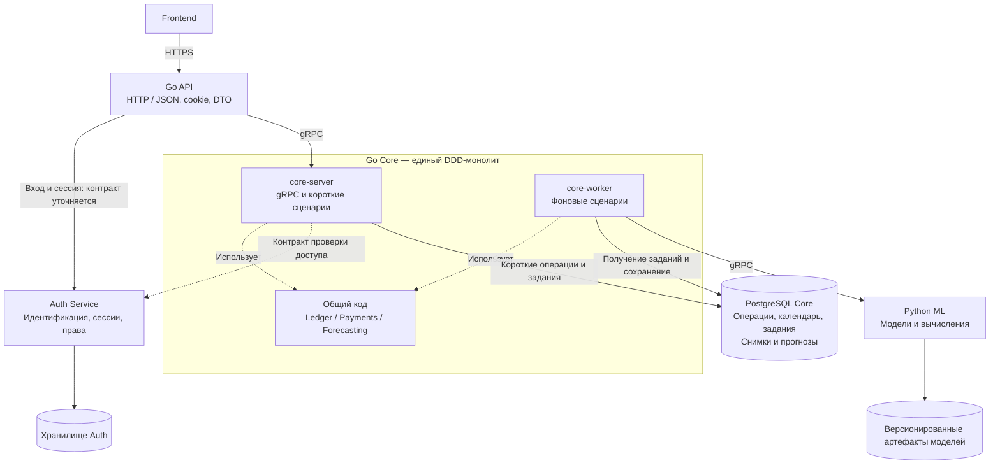
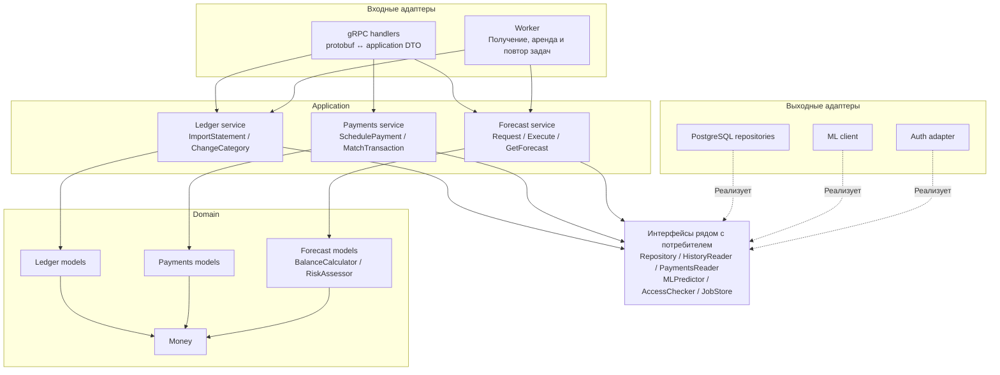
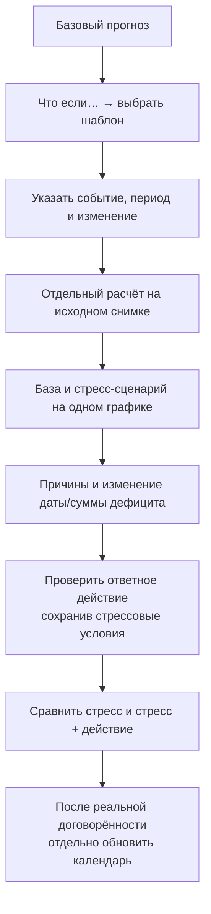

# Saldo: архитектура и план реализации сервиса прогнозирования денежных потоков

Ближайшая поставка уточнена владельцем 2026-10-24: дедлайн **25 октября, 12:00 МСК**,
приоритет — интеграция готовых частей и обязательный бизнес-сценарий. Порядок
ближайших работ/проверок — [план сдачи D1–D4](demo-integration.md).
Подтверждение email временно допускает произвольный шестизначный код только
в изолированном, явно включённом demo-профиле Auth (ADR-028); финансовая цепочка
проверяется с настоящим backend. Полный целевой объём и история этапов ниже
сохраняются; реальные письма/дополнительные Auth-функции не блокируют финансы.
Уточнение владельца 2026-10-24: Core → ML реализует ML-разработчик; API → Core
готовим в Go Core. Семантику сверяем с REST/Auth, подключаем канонические
proto/core/v1 и proto/ml/v1 без параллельных копий контракта.

Дата фиксации: 2026-10-23.
Уточнение владельца от 2026-10-23: полноценный пользовательский флоу
регистрации и авторизации включён в объём платформы.
Ответ эксперта, переданный владельцем 2026-10-23: самостоятельное ПО и часть
банка допустимы одинаково; оценка зависит от выполнения задач, а не формата продукта.
Дополнение Ивана Запары (в переданном сообщении 23.10.2026, 14:31): это ПО
для малого бизнеса; рекомендуется изучить аналоги и пользовательскую боль.
Последнее уточнение, переданное владельцем 2026-10-23: фокус — малый бизнес;
для базы достаточно ручного/файлового ввода, API-мок учётной системы/ФНС —
возможное дополнение демонстрации. Это пересказ в чате, автор и ссылка не указаны.
Отдельное решение владельца: две роли «владелец / финансист», приглашение
финансиста по известному email уже зарегистрированного аккаунта.
Последующее уточнение владельца от 2026-10-23 об оценке: за мок ФНС и другие
интеграции дадут дополнительные баллы. Число баллов и их вес не указаны.
Замечание экспертов, переданное владельцем 2026-10-24: сосредоточиться именно
на выполнении бизнес-требований. Автор и ссылка на исходное сообщение не указаны.
Приоритеты реализации и сквозной график уточнены ниже; это не отчёт о готовности функций.
Статус: целевая архитектура и ближайшие приоритеты зафиксированы; реализация идёт.
Актуальная готовность — [общая поставка](../../docs/integration-status.md) и план D1–D4;
историческое исходное состояние ниже не заменяет эту сводку.
Основание: ТЗ и архитектурное обсуждение с разработчиком в текущем чате.
Исходная проверка кода выполнена на HEAD `8819a9ed0d65528076fadccc512b22526250a911`;
обновление от 2026-10-23 учитывает локальный датасет и первую поставку REST.
Режим реализации: после каждого этапа остановка на ревью и явный апрув
разработчика по ADR-020. Запись этого плана не запускает реализацию,
коммит, push, создание PR, слияние или развёртывание.

## 1. Цель, источники и текущее состояние

Построить сервис для малого бизнеса, который по истории операций и известным
будущим платежам прогнозирует ежедневный остаток минимум на 30 дней,
предупреждает о кассовых разрывах и объясняет их причины. Пользователь должен
увидеть дату, размер и оценку вероятности дефицита и сравнить сценарии.

### Приоритет бизнес-требований — уточнение от 2026-10-24

Переданное владельцем замечание экспертов: основной фокус — выполнение
бизнес-требований малого бизнеса. Практическое решение команды: сначала довести
до проверяемого результата путь «загрузить/ввести историю → учесть известные
будущие платежи → получить прогноз от 30 дней → увидеть риск и его причины →
сравнить результат действия в сценарии». Технические задачи связывать с этим
пользовательским результатом и наблюдаемыми критериями приёмки.

Архитектура, инфраструктура и библиотеки поддерживают выполнение этого пути;
дополнительные технические усложнения откладываются, если не нужны для него
или корректности/безопасности. Базовый файловый/ручной ввод и работающий прогноз
приоритетнее демонстрационных интеграций. За моки ФНС/1С и другие интеграции
по ранее переданному уточнению дают дополнительные баллы; конкретные веса неизвестны.
Согласованные сервисные границы и требования изоляции данных сохраняются.

### Сквозной график «история → состояние → прогноз» — 2026-10-24

По поручению владельца зафиксирован основной график остатка одного подключённого
счёта компании:

- История — подтверждённые фактические EOD-остатки по датам, сплошная линия.
  Окно последних 30–90 дней — предложение UI, а не новый лимит хранения данных.
- Последнее известное состояние — точка принятого остатка с точной датой и
  источником. Подпись «Остаток на дату», без утверждения о live-остатке банка.
- Прогноз — отдельная пунктирная линия начиная с cutoff + 1 календарный день,
  от EOD ровно на cutoff выбранного прогноза, минимум на 30 дней.
- Метка сегодняшнего дня отделена от даты среза: при отставании выписки видны
  последняя подтверждённая дата и актуальность; непокрытые дни не становятся фактом.
- Пропуски истории — null/отсутствие покрытия, с разрывом линии и пояснением.
  Нельзя подставлять нули, молча переносить старый баланс или соединять
  неподтверждённые дни так, будто данные известны.
- Подписаны даты, RUB и нулевая линия; первая дата прогнозного дефицита выделена.
  Полоса неопределённости и вероятность показываются при обоснованной оценке
  модели; отсутствие оценки обозначается явно, без выдуманных процентов.
- В «что если» поверх базовой прогнозной линии добавляется сценарная. История
  общая, реальные факты не меняются. При новых данных старый прогноз сохраняется,
  помечается устаревшим и доступен новый расчёт; поздние факты сравниваются через план-факт.

Зависимость REST: `ForecastResult.daily_points` покрывает только горизонт
прогноза, `plan-fact` — сравнение с поздними фактами в этом горизонте. Полного
исторического ряда остатков до cutoff в текущем OpenAPI нет. Перед реализацией
графика в этапе 7 отдельно дополнить и проверить REST-контракт истории: scoped
company/account, период и даты, точные суммы/null, происхождение, покрытие,
revision и связь с датой/остатком выбранного прогноза. Новая ручка/схема этим
планом не объявляется уже описанной в OpenAPI или реализованной.

Приёмка: при выписке, отстающей от сегодняшнего дня, пользователь различает
историю, последнее подтверждённое состояние и прогноз; пропуск не выглядит
нулём; база и сценарий используют один срез; изменение данных не переписывает
сохранённый прогноз. До появления прогноза доступна фактическая часть с явным
предложением запустить расчёт, вместо фиктивной будущей линии.

Источники:

- ТЗ «Прогноз денежных потоков», 15 страниц, предоставлено разработчиком в PDF:
  `case-01a02e3f-1044-70fc-84bb-604d7c7c3ca3-b66554190d0972c5159d16d9610930fb59e7d77b36cd7d22774e161453e09d6d.pdf`.
  Сам PDF в репозиторий не добавлен. Номера страниц ниже — физические страницы PDF.
- Предоставленный локально `dataset/`: README, справочник 150 компаний,
  222 420 операций и 150 отдельных выписок. Формат, контрольные суммы и результаты
  проверки сохранены в [паспорте датасета](../references/dataset-profile.md).
- [Принятые ADR](../decisions.md), прежде всего ADR-001/002/003/009/020.
- [Правила локальной разработки](../workflows/local-development.md)
  и [формат этапов](../workflows/issue-planning.md).
- [Референсы Go-сервисов](../references/go-services.md).
- Локальный реестр вопросов к экспертам кейса и решений команды
  (`.agent/plans/case-expert-questions.md`, исключён из Git)
  для обсуждения после 18:00 МСК 2026-10-23; в E00 сохранён полученный ответ
  о формате продукта и дополнение Ивана Запары о пользователе и аналогах;
  E01 уточнён последним переданным ответом: файлового/ручного ввода достаточно
  для базы; E03–E07 частично определены самим ТЗ, доступность дополнительных
  наборов данных этим ответом не подтверждена.
  Повторная сверка требований и оставшихся уточнений сохранена в реестре.
- [Описание продукта и сквозного пользовательского сценария](saldo-product.md):
  назначение регистрации, путь от выписки до решения, экраны и рекомендации.
  Детализация интерфейса и онбординга в этом описании является предложением.
- Прямые уточнения разработчика: Core проектируется как DDD-монолит;
  Auth выделяется в отдельный сервис; обсуждена отдельная роль Core Worker.

В репозитории есть агентская инфраструктура и правила разработки. Прикладные
Go API, Auth, Core, Python ML, frontend и продуктовые protobuf пока отсутствуют.
Все их пути, модели, методы и проверки ниже — предлагаемые, а не существующий код.
Формат и качество предоставленного датасета проверены; модель не выбрана,
ML-метрики и замеры сервисов не проведены. Браузерный контракт v0.2.0 записан
в [OpenAPI](../../docs/api/openapi.yaml), пояснения и открытые решения —
в [передаче контрактов команде](../../docs/api/README.md). Это документационная
поставка на ревью, а не реализованный API, принятый ADR или завершённый этап 1.
Конкретный GitHub Issue для этой архитектуры не назначен; история GitHub по этому
поручению не проверялась. GBrain недоступен и не используется как источник фактов.

## 2. Что принято и что ещё является предложением

### Принятые основания

- ADR-002: браузер ↔ Go API — HTTP/JSON; Go API ↔ Core и Core ↔ ML —
  gRPC/protobuf на согласованных границах; PostgreSQL для состояния Core.
- ADR-003: канонические контракты `proto/core/v1/`, `proto/ml/v1/`,
  проверки и генерация Buf; Go bindings в `internal/gen/` потребителей,
  Python bindings внутри ML-сервиса.
- По прямому уточнению разработчика Core — единый модульный монолит по DDD.
  Предметные модули внутри него не становятся отдельными микросервисами.
- По прямому уточнению разработчика Auth — отдельный сервис.
  Прежнее предложение хранить пользователей и сессии внутри Core заменено.
- По прямому решению разработчика от 2026-10-23 платформа должна предоставлять
  полноценную самостоятельную регистрацию и авторизацию пользователя.
  Вариант только с заранее созданными демонстрационными аккаунтами не принимается.
  Способ входа, подтверждения контакта и восстановления ещё нужно выбрать.
- По уточнению владельца от 2026-10-23 в целевой объём включено добавление
  сотрудников в компанию с отдельными аккаунтами и разграничением доступа.
  Последующая конкретизация владельца: роли «владелец / финансист»;
  владелец приглашает финансиста по известному email зарегистрированного
  аккаунта. Подробные разрешения, уведомления и сроки приглашений ещё согласуются;
  это решение владельца о продукте, а не обязательное требование ТЗ.
- Fadwix не затрагивать. Продуктовые сервисы не разворачивать на runner
  без отдельного решения о целевом хосте и изоляции от CI/review.

### Целевой вариант для ревью этого плана

- Самостоятельная платформа для предпринимателя с собственной регистрацией
  и загрузкой файлов. Эксперт подтвердил допустимость такого формата (E00);
  встраивание в интернет-банк не требуется ради критериев оценки. Первый импортёр
  получает конкретный CSV-адаптер предоставленного набора; его формат описан в §7.
  Подключение банковского API остаётся возможным способом получения данных,
  а не обязательным следствием формата продукта.
- Фокус сценариев — финансовые задачи малого бизнеса: подготовка к платежам,
  выявление нехватки денег и сравнение вариантов действий. По рекомендации
  Ивана Запары предложен краткий обзор аналогов для уточнения UX и приоритетов;
  конкретные функции конкурентов не становятся обязательными требованиями.
  Основной путь — предприниматель, в том числе ИП, и приглашённый финансист;
  продукт не ограничивается только ИП и не превращается в корпоративную ERP.
- Core имеет две отдельно запускаемые роли: `core-server` и `core-worker`.
  Общие домен, прикладные сценарии, схема данных и совместимый цикл релизов.
- Go API — тонкий браузерный адаптер без собственного бизнес-хранилища.
- Начальный механизм фоновых задач — PostgreSQL; Worker вызывает Python ML
  по gRPC. Брокер не включён в базовый вариант.
- Frontend получает состояние задания автоматическим polling Go API.
- Целевой объём включает известные будущие платежи, проверку качества и четыре
  шаблона «что если» из ТЗ: задержка поступления, снижение выручки, разовый расход,
  рост постоянных расходов. По поручению владельца от 2026-10-23 зафиксированы
  сравнение прогнозов и проверка ответных действий. Первый вертикальный результат —
  задержка и разовый расход, затем снижение выручки и рост регулярных расходов.
  По последнему переданному уточнению ручного/файлового ввода достаточно для базы.
  Мок внешнего API — направление для дополнительных баллов по отдельному
  уточнению владельца; обязательный живой коннектор для базы не требуется.
- Точные схемы Auth, моделей, таблиц, RPC и численные бюджеты согласуются
  до реализации соответствующих этапов.

Это фиксация обсуждения, а не новый Accepted ADR. Перед реализацией закрепить
одобренные уточнения в `.agent/decisions.md`; текущие ADR здесь не переписаны.

## 3. Требования и границы MVP

| Область | Основание | Предлагаемое покрытие |
| --- | --- | --- |
| Импорт и категоризация | ТЗ, с. 4 и 8 | Загрузка истории, проверка данных, категории и исправления |
| Регулярность и будущие платежи | ТЗ, с. 4 | Найденные регулярные движения, введённые/импортированные ожидаемые платежи с источником |
| Прогноз и разрывы | ТЗ, с. 4–5 | Дневной горизонт от 30 дней, дата, сумма, вероятность и объяснение |
| Проверка качества | ТЗ, с. 8 и 12–13 | Историческая проверка на нескольких датах, сравнение с базовым подходом |
| Интерфейс | ТЗ, с. 5 и 8 | График остатков и неопределённости, предупреждения, состояние расчёта |
| Сценарии | Дополнительная задача, с. 7; детализация по поручению владельца | Четыре шаблона «что если», база/сценарий на одном графике, изменение рисков и проверка ответного действия; сначала задержка/разовый расход, затем выручка/регулярные расходы |
| План-факт | Дополнительная задача, с. 6 | Сопоставление ожидаемых и фактических платежей; показ просрочки и обновление прогноза |
| Безопасность и аккаунты | Дополнительное требование ТЗ, с. 10; полный флоу и сотрудники добавлены владельцем | Самостоятельная регистрация, вход, управление сессией, восстановление доступа, сотрудники/роли и отзыв доступа к компании, безопасные логи |

В ТЗ будущие счета и налоги из внешних источников включены в основные задачи,
а расширенные интеграции описаны среди дополнительных. Не считать все будущие
платежи необязательными. Последнее уточнение E01 снимает вопрос способа ввода
для базы: достаточно ручной формы/файла с явным источником. Живой коннектор
не является условием базового прототипа. По последующему уточнению владельца
мок ФНС и другие интеграции дают дополнительные баллы; точные баллы/веса не заданы.
Демонстрационный мок не является подключением к настоящей 1С/ФНС и обозначается
соответственно. Функциональное покрытие будущих событий сохраняется.
Автоматический расчёт налоговых обязательств не обещается: нужны исходные данные
и отдельно согласованные правила; даты и суммы можно вводить как будущие события.

Вне базового объёма: банковские подключения без доступов, полный набор 1С/ЭДО/
маркетплейсов, автоматический налоговый движок, Kafka, event sourcing,
распределённые саги, отдельные CQRS-хранилища, Kubernetes, отдельный сервис
уведомлений и GBrain как часть продукта. Оплата реальных обязательств не входит
в продукт: система прогнозирует и моделирует, а не переводит деньги.

### Повторная сверка вопросов с ТЗ, 2026-10-23

Найдены ответы в самом ТЗ, а не новые ответы экспертов. Номера страниц —
физические страницы PDF, начиная с титульной. Оставшиеся вопросы сужены:

| Тема | Уже определено ТЗ | Осталось уточнить |
| --- | --- | --- |
| Данные, E03 | С. 11: синтетические выписки за 1,5–2 года; получены CSV со 150 компаниями и 222 420 операциями, формат проверен (§7) | Доступность дополнительных будущих обязательств/доступов, валюта отсутствующих в CSV денежных единиц, время появления сведений для исторической проверки |
| Интеграции, E01/E08 | С. 4: счета и налоги из внешних источников в основных задачах; с. 7 и 9: расширенные источники/интеграции дополнительные | Базовый ввод из файла/формы достаточен; живой коннектор не обязателен. По последующему уточнению владельца за мок ФНС и другие интеграции дают допбаллы; их число/вес не указаны |
| Счета и горизонт, E04 | С. 3–4: остаток на счёте, дневной прогноз минимум на 30 дней | Обязательны ли консолидация счетов и мультивалютность; в ТЗ такого требования явно нет |
| Кассовый разрыв, E05 | С. 2 и 5: нехватка средств на обязательные платежи; дата, сумма, вероятность | Как агрегировать сумму длительного дефицита и учитывать овердрафт/резерв |
| Вероятность, E06 | С. 5: вероятность требуется | Событие за день/горизонт и способ проверки оценки |
| Качество, E07 | С. 8, 12–13: проверка модели, заблаговременность/корректность обнаружения разрывов, польза дополнительных источников, техническое качество, презентация | Численные метрики, пороги, веса, тестовый период и скрытая выборка, если они заданы организаторами |

Польза дополнительных источников — самостоятельный критерий с. 13.
Показывать, как источник изменяет качество, а не только факт его подключения.
Аутентификация указана на с. 10 среди дополнительных требований; полноценный
флоу регистрации включён отдельно прямым решением владельца платформы.

Приоритет разговора после уточнения E01: доступные дополнительные данные;
формализация суммы/вероятности; наличие общего количественного протокола оценки.
Определение разрыва, состав обещанной выписки, дневной горизонт и общие критерии
не нужно повторно запрашивать как отсутствующие требования. Не все оставшиеся
вопросы блокируют проектирование; конкретная схема первого импорта теперь
опирается на предоставленный датасет, дополнительные источники исследуются отдельно.

### Замечания и решения после уточнений владельца и эксперта

Зафиксировано 2026-10-23 по текущему чату. Переданный ответ эксперта и собственные
уточнения владельца различаются; автор последнего экспертного ответа и ссылка
на исходную переписку не указаны. Наши предлагаемые технические детали не являются
новыми требованиями эксперта или реализованными функциями.

| Замечание / источник | Зафиксированное решение и следствие |
| --- | --- |
| Эксперт через владельца: нужен фокус на малом бизнесе | Основной путь — предприниматель, в том числе ИП, и его финансист: подготовка к обязательным платежам, прогноз и понятные действия; без расширения в корпоративную ERP и без ограничения продукта только ИП |
| Эксперт через владельца: базово достаточно файла/ручного ввода | Форма и импорт — самостоятельный рабочий путь; подключение к живому банку/1С/ФНС не блокирует базовый MVP; E01 закрыт по этому минимуму |
| Владелец: за мок ФНС и другие интеграции дают допбаллы | Условие оценки подтверждено в переданном сообщении; исследование API/DTO вынесено в отдельный этап 1A. Точные баллы и веса не выдумывать |
| Идея демонстрационного API внешнего источника | Исследовать конкретные контракты, затем выбрать одну демо-интеграцию; показать получение дополнительных событий и их влияние на прогноз. Мок маркировать, источник/ID сохранять, повторы не создают дублей |
| Владелец: роли «владелец / финансист» | Использовать owner/financier в членстве компании; прежние предложения редактора/наблюдателя заменены, третья роль не входит в целевую модель |
| Владелец: приглашение по известному email существующего аккаунта | Только владелец приглашает зарегистрированного финансиста; зарегистрироваться при отсутствии аккаунта нужно отдельно до нового приглашения; не создавать аккаунт или лишнюю компанию за адресата |
| Наше предложение о полномочиях | Владелец управляет компанией, доступом и финансовыми функциями; финансист — данными, календарём, прогнозами/сценариями без управления участниками. Детальную матрицу согласовать до реализации |
| Наше предложение о принятии приглашения | Входящие приглашения в кабинете, явное принятие адресатом, проверка аккаунта/подтверждённого email, срока/отзыва; письмо — дополнительный канал. Пользователь не получает права только из-за знания ID или ссылки |
| Наше предложение о границах доступа | Роли действуют в компании, проверяются сервером; финансист не выдаёт себе owner и не приглашает участников. Отзыв сохраняет аккаунт и финансовую историю; проверка старых сессий и политика фоновых заданий остаются T04 |
| Исследование контрактов внешних систем | Смотреть каждый источник отдельно: внешний API/DTO → адаптер нашей системы → Ledger/Payments. Не предполагать единую DTO, прямую связь ФНС ↔ 1С или доступ к закрытым данным по одному ИНН |

Состояние: замечания и решения записаны в план. Веб-исследование, выбор поставщика,
подключение API и код мока ещё не выполнены. Отдельный этап 1A не меняет номера
существующих этапов и не является разрешением начать реализацию.

## 4. Компоненты и протоколы



Auth владеет пользовательскими данными, сессиями и разрешениями. Его хранилище
логически отделено от Core; отдельный физический сервер PostgreSQL не требуется
самим фактом выделения Auth. Core и API не читают таблицы Auth напрямую.
Стек Auth, его RPC/HTTP-контракт и возможный `proto/auth/v1/` ещё не выбраны.

API обрабатывает HTTP, формат запросов, ограничения загрузки, cookie/CORS/CSRF
при соответствующем способе входа, преобразование DTO и ошибок. Он не содержит
финансовых правил, расчёта дефицита, собственной очереди и доступа к Core DB.
Отдельный API добавляет сетевой переход и сопровождение; сохраняем его как
согласованную границу браузерного контракта и параллельной работы команды.

Core определяет фактическую принадлежность ресурса компании и проверяет доступ
через контракт Auth. Нельзя доверять `company_id` или `user_id` из браузерного
запроса без проверки. Локальная проверка токена или introspection, отзыв прав,
кеширование решений и поведение при недоступном Auth требуют отдельного решения.
Недоступность Auth нельзя трактовать как разрешение доступа.

### Полноценный флоу регистрации и авторизации

Самостоятельная регистрация подтверждена владельцем. Ниже — предлагаемая
детализация флоу для согласования способа входа, а не уже выбранный Auth-протокол:

1. Гость создаёт аккаунт через интерфейс платформы; данные проверяются,
   повторная регистрация обрабатывается предсказуемо.
2. Пользователь подтверждает контакт, если это требуется выбранным способом
   входа. Email/пароль, одноразовые коды или внешний провайдер ещё не выбраны.
3. Пользователь входит, получает сессию и проходит первичный онбординг:
   создаёт компанию или получает доступ к существующей по согласованным правилам.
4. Сессия позволяет продолжать работу и возвращаться в кабинет; истечение,
   обновление при выбранной схеме и отзыв обрабатываются явно.
5. Пользователь выходит; выход инвалидирует соответствующую сессию, а не только
   скрывает кабинет. Требование «выйти на всех устройствах» уточнить отдельно.
6. Пользователь восстанавливает потерянный доступ. Для парольной схемы нужны
   безопасное восстановление/смена пароля, одноразовый ограниченный по времени
   способ подтверждения и согласованное поведение старых сессий.

Auth владеет аккаунтом, учётными данными, подтверждениями и сессиями. API
предоставляет браузерный контракт, frontend — экраны и ошибки. Core получает
проверенную идентичность и проверяет право на конкретные финансовые данные.
Создание компании в Core и выдачу прав в Auth согласовать как отдельный
онбординг с восстановлением после частичного сбоя; регистрация сама по себе
не даёт доступа к чужой компании. Владелец Company и контракт её создания
ещё должны быть зафиксированы, прежде чем реализовывать онбординг.

Нужны проверки повторов запросов, истечения/повторного использования подтверждений,
неудачного входа, восстановления и выхода; ограничение частоты чувствительных
операций и отсутствие учётных данных в логах. Канал доставки подтверждений,
доступность его для демо, секреты и интеграция с провайдером пока открыты.
SSO, MFA и сложная ролевая модель не считаются автоматически включёнными.
Добавление сотрудников входит в целевой объём. По конкретизации владельца
используются две роли в компании: «владелец» (`owner`) и «финансист» (`financier`).
Предлагаемая матрица: владелец работает с данными и управляет компанией/доступом;
финансист импортирует данные, правит категории и календарь, запускает прогнозы
и сценарии, но не приглашает участников и не управляет компанией. Полный список
разрешений согласовать перед реализацией. Роль привязана к членству в конкретной
компании, не является выбираемой при регистрации глобальной ролью аккаунта.

Владелец указывает известный email уже зарегистрированного пользователя.
Предлагается сохранить приглашение адресату по его `user_id`, найденному Auth;
тот входит существующим аккаунтом, подтверждает соответствующий email и явно
принимает приглашение. До принятия членства нет. Для отсутствующего аккаунта
сначала нужна самостоятельная регистрация, затем новое приглашение владельца;
отложенное приглашение с регистрацией адресата не входит в первый вариант.
Принятие не создаёт финансисту лишнюю собственную компанию и не даёт прав владельца.

Предлагаемый минимальный канал — входящие приглашения в кабинете; отправка
письма опциональна и не обязательна для принятия под уже существующей сессией.
Не вводить публичный поиск/автодополнение всех пользователей по email.
Нужны ограничение срока, отмена/отклонение, безопасные повторы принятия,
проверка адресата и полномочий владельца. Для внутреннего приглашения ID сам
по себе не является секретом доступа: принять может только его адресат.
Приглашение финансиста не позволяет передать произвольную роль `owner` из браузера.

В целевом варианте членства и разрешения принадлежат Auth; Core проверяет их
через контракт Auth, без независимой копии прав. Отзыв членства сохраняет аккаунт
и финансовые данные компании, но закрывает доступ. Компания не должна остаться
без владельца; передачу владения не считать автоматически включённой функцией.
Порядок отзыва прав для старых сессий и политика уже принятых заданий согласуются
до реализации. Поддержка нескольких компаний у финансиста — отдельная граница
первого интерфейса, а не повод хранить глобальную роль.
Продуктовые вопросы о компаниях/ролях вынесены в E21, технические варианты Auth —
в T03/T04 локального реестра вопросов (не публикуется в Git).

## 5. Владение состоянием

| Компонент | В памяти | Долговременное состояние и владелец |
| --- | --- | --- |
| Frontend | Экран, фильтры, несохранённый ввод | Не источник бизнес-данных; возобновляет просмотр по ID |
| Go API | Текущий запрос, ограниченные буферы, gRPC-соединения | Бизнес-состояние отсутствует |
| Auth | Активные запросы и служебный кеш при выбранной схеме | Пользователи, сессии, права — собственное хранилище |
| core-server | Обслуживаемые запросы | Финансовые данные, задания и результаты — Core DB |
| core-worker | Текущая попытка и временные вычисления | Статусы, аренда, попытки, снимки и результаты — та же Core DB |
| Python ML | Загруженные модели, признаки, вычисления | Версионированные модели и параметры подготовки |

Core логически владеет бизнес-состоянием, но его процессы не требуют сохранения
памяти между запросами. API и Worker можно перезапускать без потери уже принятого
задания. Inference при сбое может выполняться повторно — это не exactly-once.
Файл на экземпляре API не может быть единственной копией принятого импорта.

Worker — другая роль запуска того же Core, а не независимый финансовый сервис
со своей копией правил и базой. Обе роли используют совместимые миграции и версии
заданий. Число экземпляров и DB-пулы ограничиваются общим бюджетом ресурсов.
Выделение процесса само по себе не ускоряет ML: тяжёлый inference уже в Python.

## 6. DDD-модули и зависимости Go Core

| Модуль | Предлагаемые модели | Ответственность |
| --- | --- | --- |
| Ledger | BankAccount, Transaction, StatementImport | Факты, импорт, категории, согласование остатков и повторные загрузки |
| Payments | ExpectedPayment, RecurrenceRule, PaymentMatch | Ожидаемые движения, источники, регулярность и связь с исполнением |
| Forecasting | Forecast, Scenario, InputSnapshot, DailyBalance, CashGap | Версии прогнозов, сценарии, остатки, риски и объяснения |

Имена и точные границы агрегатов уточняются по датасету и бизнес-инвариантам.
Не загружать всю историю компании в один агрегат. Дневной остаток и оценка риска
могут быть value objects/частью результата, а не самостоятельными агрегатами.
В минимальный общий финансовый словарь входит Money: сумма в минимальных
денежных единицах, валюта и явное округление. Валюты не складываются неявно.



Стрелки этой схемы — зависимости кода, не сетевые вызовы.

- Handler преобразует протокол и ошибки; финансовые правила в нём отсутствуют.
- Application координирует доступ, чтение, транзакции, модели и внешние порты.
- Domain содержит поведение моделей и допустимые переходы состояний, а не только
  структуры с полями. Не зависит от SQL, protobuf, gRPC и брокера.
- Repository/client реализуют хранение и интеграции. Интерфейс объявляет
  потребитель; общий пакет всех интерфейсов не является требованием схемы.
- Forecasting читает Ledger и Payments через явные прикладные контракты.
  Чужие таблицы не изменяет, чужие repositories напрямую не использует.
  Чтение согласованного снимка допускает координацию одной локальной транзакцией
  через явно переданные read-порты; сетевой ML-вызов вне SQL-транзакции.
- Внутренние вызовы — обычный Go-код. Доменные события допустимы, когда выражают
  бизнес-факт, но для каждого вызова модулей брокер и event bus не требуются.

### Предлагаемая структура

```text
services/
  api/                            # Тонкий HTTP/JSON адаптер
  auth/                           # Собственный сервис; стек уточняется
  ml/                             # Python inference и отдельные команды обучения/оценки
  core/
    cmd/
      core/main.go                # Роль core-server, gRPC
      worker/main.go              # Роль core-worker
    internal/
      app/                        # Явная сборка двух ролей, lifecycle
      config/
      handler/grpc/
        ledger/
        payments/
        forecasting/
      service/
        ledger/
        payments/
        forecasting/
      domain/
        ledger/
        payments/
        forecasting/
        money/
      repository/postgres/
        ledger/
        payments/
        forecasting/
        jobs/
      client/
        auth/
        ml/
      worker/
      gen/
    migrations/
frontend/
proto/
  core/v1/
  ml/v1/
```

Это карта ответственности, а не требование создать пустые пакеты заранее.
`app` владеет ресурсами и сборкой конструкторов; DI framework не требуется.
Миграции запускаются согласованным шагом, а не конкурентно каждой репликой.

### Применение референсов

- `references/hack-rnd-2026-spring/services/engine-go/internal/app/app.go`:
  явная сборка transport → service → repository. Там transport называется
  `delivery`; здесь предлагается `handler`. Не копировать чужой lifecycle целиком.
- `references/centralservice/internal/service/minecraft/trust/flow.go`:
  интерфейс repository рядом с потребителем. Не переносить игровую модель
  и состояние сессий в памяти как источник истины продукта.
- `references/centralservice/internal/repository/minecraft/trust/`:
  явные транзакции и SQL отдельно от сценариев; конкретный драйвер не выбран.
- `references/maxhack/services/gateway/`: тонкий entrypoint и разделение HTTP
  server/router/handler для API; MAX и Kafka не переносятся.
- `references/auth-service/`: ориентир для config и lifecycle; не подтверждает
  выбор его JWT-схемы или копирование реализации безопасности.

Оригиналы engine-go и centralservice изучались на чтение в этом обсуждении;
остальные приёмы сверены по реестру референсов. Это не подтверждение корректности
или прохождения тестов чужого кода. Локальные `references/` игнорируются Git.

## 7. Данные, импорт и платёжный календарь

Базовый путь по последнему переданному уточнению эксперта — ручной/файловый ввод.
Опциональная демонстрация интеграции: HTTP-мок учётной системы, отдающий известные
будущие счета/платежи, либо мок источника налоговых событий. Это предлагаемая
демо-схема, не проверенный контракт настоящей 1С/ФНС и не налоговый расчёт.
У мока явная маркировка демонстрационных данных; реальные доступы не нужны.
Адаптер Core/Worker приводит ответы к тем же моделям Ledger/Payments, что импорт,
сохраняя источник и внешние ID. Повторное получение не должно создавать дубли.
Мок не становится зависимостью основного ввода и не требует отдельного постоянного
продуктового сервиса. Выбор одного источника и точный формат согласовать отдельно.

### Проверенный файловый источник

Получен локальный датасет: 150 компаний, 222 420 операций за
2024-10-01 — 2026-09-30. Состав и контрольные суммы — в
[паспорте датасета](../references/dataset-profile.md).
Первый адаптер разбирает CSV UTF-8 с BOM, разделитель `;`, даты `YYYY-MM-DD`,
десятичные суммы с точкой. Колонки: `company_id`, `operation_id`,
`operation_date`, `amount`, `direction`, `counterparty_inn`, `counterparty_name`,
`payment_purpose`, `balance_eod`. Сумма положительна; направление задают
`Поступление`/`Списание`; ИНН читать строкой с сохранением ведущих нулей.
Универсальный мастер сопоставления колонок для этого адаптера не нужен.

`companies.csv` содержит справочник; `all_operations.csv` и 150 файлов
`statements/C001.csv` … `C150.csv` — одинаковая история в разных упаковках.
Не загружать их как независимые данные и не использовать как разные train/test.
Внешние `C001` и `operation_id` не являются внутренними идентификаторами
компании/счёта платформы. Пользователь явно выбирает одну внешнюю компанию
и разрешённую привязку к внутреннему счёту; общий файл не создаёт 150 арендаторов
и не выдаёт членство. По README это один счёт в одном банке на компанию;
номера счёта, валюты, категорий, налогового режима, будущих обязательств,
кредитных лимитов и разметки риска в полях нет.

В контракте v0.2.0 у счёта один источник фактических операций и наблюдаемых
остатков (`Account.transaction_source`): первая принятая ручная операция закрепляет
`manual_v1`, первый применённый внешний импорт операций или остатков —
`source_system` и `source_company_id`. Импорт только ожидаемых платежей
эту привязку не создаёт. Смешение фактов разных систем возвращает
`409 FACTUAL_SOURCE_CONFLICT`; C002 вместо C001 внутри выбранного источника —
`409 SOURCE_BINDING_CONFLICT`. Привязка проверяется атомарно при записи,
включая гонку двух первых импортов, и не меняется скрытно. Это предотвращает
двойной учёт одной выписки из CSV/учётной системы и не превращает внешний ID
в право доступа. Для дополнительной системы явно выбирать
`record_kinds: [planned_payments]`; внешняя синхронизация требует выбранного
набора типов записей, несовместимый набор отклоняется без молчаливого отбрасывания.
У файлового адаптера набор фиксирован: `transactions` + `balance_observations`.
Ручной подтверждённый остаток — отдельный якорь на явно выбранную дату,
он не меняет источник операций; подмена уже принятого остатка выписки на
ту же дату отклоняется конфликтом, неизвестные дни молча не заполняются.

Только RUB, один подключённый счёт на компанию и суммы строкой в копейках —
подтверждённые владельцем границы MVP (ADR-022),
а не подтверждённая валюта датасета. Исходную валюту нельзя
молча угадать; неподдерживаемую валюту другого источника явно отклонять.
Достаточность одного счёта подтверждена переданным ответом эксперта Анастасии
от 2026-10-23, 22:58–22:59: количество счетов выбирает команда, несколько будут
плюсом. Это закрывает вопрос обязательности консолидации; ADR-022 сохраняется.
Мультисчётность остаётся дополнительным последующим этапом. Пример 2–3 счетов
не является системным лимитом или подтверждением account ID в CSV.
Примеры email/password, HttpOnly cookie и CSRF в REST также остаются
предлагаемой политикой до согласования Auth.

### Принятие и качество импорта

При импорте Worker разбирает сохранённую загрузку и готовит предварительный
результат с выбранной привязкой, предупреждениями и ошибками.
Preview показывает выбранные типы данных, текущую и предполагаемую первую
привязку источника; запрет смешения повторно проверяется при применении.
Факты применяются через Ledger и версия данных обновляется только после явного подтверждения
пользователем; проверять ожидаемую версию данных, чтобы устаревший preview
не применялся незаметно. До подтверждения финансовая история не изменяется.
Ошибочная загрузка не должна
оставлять неотмеченный частичный импорт. Для ограниченных файлов допустимо
хранение в PostgreSQL; порог и необходимость object storage определить по данным.

Проверять знак/направление, валюту/согласованную конвенцию, даты, границы компании,
повтор загрузки, пропуски и согласование остатков. В этом наборе все внешние ID
уникальны и полных дублей нет; 21 пара совпадает по содержимому, кроме ID.
Такие пары показывать как возможные дубли, не удаляя автоматически.
Для повторов использовать ID в области источника, компании и привязки счёта;
изменившееся содержимое под прежним ID — конфликт, а не разрешение переписать факт.
Пустых ИНН контрагента — 11 166, назначений — 583: отсутствие сохраняется явно.

`balance_eod` — один наблюдаемый остаток конца дня, повторённый у всех его
операций; не суммировать. Первый начальный остаток выводится из первого EOD
и движений этого дня с пометкой происхождения. На 54 812 переходах между
последовательными наблюдаемыми днями найдены 99 ненулевых разниц сверки:
44 ровно по 0,01 и 55 больше 0,01 по модулю. Хранить исходный EOD, движения,
разницу и предупреждение; не подгонять их вымышленными операциями и не выдавать
конкретную причину расхождения за доказанную. День без строки может быть пропуском,
а не доказанным нулём. Сохранять исходный файл/хеш, строку, внешние ID,
версию адаптера и результат проверки для происхождения и повторяемости.

Будущих платежей в наборе нет. Их источники — ручной ввод и отдельный внешний
адаптер/мок; найденная регулярность остаётся проверяемым предложением.

Разделять:

1. Факт — уже выполненная операция Ledger.
2. Ожидание — счёт, аренда, налог или вручную введённый будущий платёж Payments.
3. Прогноз — неизвестное движение, оценённое по истории и модели.

У ожидания есть источник, сумма/валюта, направление, дата и допущения об исполнении.
Факт связывается с ожиданием, после чего ожидание не учитывается второй раз.
Найденная регулярность не должна дублировать явно введённый платёж.
Предлагается показывать просрочку и пересчитывать прогноз при изменении данных.
Первый шаг обновления — обработка новых операций и дневных агрегатов;
инкрементальное обучение модели не обещается без выбора алгоритма и замеров.

## 8. Контракт прогноза и граница с ML

Core хранит снимок входа: компанию/счета, начальный остаток, горизонт, используемые
операции и категории, будущие платежи, версию данных и параметры сценария.
Чтение Ledger и Payments должно соответствовать одной согласованной версии.
Ссылки только на изменяемые записи без их версии не обеспечивают такой снимок.

Для первой REST-версии `input.balance_as_of` равен `cutoff_date`: начальный
остаток — принятый EOD именно на дату среза. Если его нет, возвращается
`BALANCE_AS_OF_UNAVAILABLE`; выбрать покрытую дату или явно внести датированный
ручной остаток с происхождением и предупреждением качества. Нельзя молча
переносить старый остаток через неизвестные дни или строить вымышленный мост
из нулевых движений. Это ограничение проекта контракта на ревью, не Accepted ADR.
Запрос прогноза содержит `cutoff_date` и `horizon_days`; следующий день
`start_date` вычисляется сервером и остаётся в ответе, не дублируется в запросе.

ML отвечает за категоризацию, обнаружение регулярности, прогноз неизвестных
движений и неопределённость. Согласовать с Core явные правила включения/исключения
уже известных платежей; простое сложение полного ML-прогноза и календаря неверно.
ML не пишет финансовые таблицы Core и не владеет его схемой.

Core собирает потоки и остатки по формуле
`остаток следующего дня = предыдущий остаток + поступления − списания`.
Прогноз должен быть объясним через использованные
события, источники и допущения, а не через придуманное текстовое объяснение.

Для вероятности предлагается набор согласованных во времени ML-траекторий,
к которым применяется календарь. Отдельно считать вероятность отрицательного
остатка в конкретный день (`negative_balance_probability`) и хотя бы раз
за горизонт (`metrics.gap_probability`). Общий контейнер значения/причины
не задаёт событие; определения находятся у соответствующих полей.
Дневные вероятности нельзя складывать. Проверять калибровку;
не выводить произвольные проценты из одной линии или только пары квантилей.
Дневные данные не подтверждают отсутствие внутридневного разрыва.

В наборе возможен отрицательный остаток (овердрафт), но кредитные лимиты
не предоставлены. Первая REST-версия обозначает `below_zero_eod` как модельный
показатель ухода дневного остатка ниже нуля, а не доказанную невозможность платежа.
Порог и правило бизнес-риска, учёт лимита/резерва, определение события вероятности
и доступность самой вероятности требуют отдельного согласования; численный
дефицит и `null` вероятности не превращаются в утверждение о платёжеспособности.

Сценарий ссылается на базовые входные данные и содержит явные изменения
выбранных будущих потоков. Факты и базовый календарь не меняются. Полная
пользовательская механика и правила преобразований описаны ниже.

До первого inference закрепить модель, версию подготовки и согласованные
параметры расчёта; для стохастического подхода — seed и число траекторий.
Сценарии и повторы используют тот же контекст. Если нужная версия недоступна,
не сравнивать исходный результат с новой моделью незаметно: явно пересчитать
базу и сценарий парой либо сообщить о невозможности такого сравнения.
Точная форма контракта закрепления версии остаётся решением T06 до реализации.
Возможность быстрого пересчёта без повторного ML-вызова определить по зависимостям
модели, а не обещать для любого сценария. Переобучение модели не является
обязательным действием при каждом пользовательском сценарии.

Результат хранит снимок/его неизменяемую версию, модель и её версию, параметры,
для стохастического расчёта seed и число траекторий, дневные точки и риски.
Изменение данных во время расчёта не меняет его снимок: результат помечается
как основанный на более старой версии. Поздний результат не подменяет новый
«актуальный» прогноз только потому, что завершился последним.

### Сценарии «что если»: шаблоны, сравнение и ответные действия

Зафиксировано по поручению владельца от 2026-10-23. Основание — дополнительная
задача ТЗ, физическая с. 7. Четыре негативных события и сравнение базового/негативного
прогнозов заданы ТЗ; формы, показатели сравнения, правила ответных действий
и порядок реализации ниже — детализация нашей идеи. Это целевая функциональность,
а не реализованный контракт. Пользовательское описание — в
[описании продукта](saldo-product.md).

| Шаблон | Параметры формы | Преобразование |
| --- | --- | --- |
| Клиент задержит оплату | Конкретный ожидаемый платёж, новая дата или задержка; примеры ТЗ — 2–4 недели | Перенести только неоплаченную часть со старой даты на новую, не добавлять второе полное поступление |
| Выручка снизится | Процент, период и выбранные потоки от продаж; примеры ТЗ — 10–30% | Уменьшить прогнозируемые поступления от продаж в выбранном периоде; явно включать известные счета только по отдельному выбору |
| Появится разовый расход | Назначение, сумма, валюта и дата | Добавить гипотетическое списание только внутри сценария |
| Вырастут постоянные расходы | Выбранная регулярная статья, дата начала, процент или новая сумма | Изменить соответствующие будущие расходы, не создавать копию исходного обязательства |

Правила преобразований:

- Выбранные события идентифицируются по источнику/ID и версии, а не только
  по тексту назначения. Выполненная часть платежа и фактическая история неизменяемы.
- «Выручка» здесь задаёт область ожидаемых денежных поступлений от продаж.
  Кредиты, взносы владельца и внутренние переводы не уменьшаются. В форме явно
  видно, изменяются ли только оценки ML или также выбранные известные счета.
- Рост расходов действует с выбранной будущей даты и на выбранную статью.
  Повышение в процентах и установка новой суммы — альтернативные способы задания.
- Правило действует на один экономический поток один раз. Регулярность, календарь
  и ML должны использовать согласованное исключение двойного учёта. Если модель
  не выдаёт необходимую детализацию, нельзя скрытно уменьшить все поступления:
  нужен соответствующий контракт/пересчёт или явная недоступность такого варианта.
- Перенос за конец горизонта сохраняет обязательство/ожидание с новой датой.
  Показывать, что деньги просто вышли за период; изменение конечного остатка
  не означает исчезновение платежа. Расход вне горизонта также явно обозначается.
- Отдельные сценарии независимы, пока пользователь явно не объединит изменения.
  Для сочетания показывать полный набор условий; конфликтующие изменения одного
  события отклонять или разрешать через явный выбор, а не применять скрытым порядком.
- Проверять даты, суммы, валюту, область действия, оставшуюся сумму и полномочия
  пользователя. Численные ограничения формы согласовать по данным; диапазоны
  примеров ТЗ не объявлять автоматически единственными допустимыми значениями.

Пользовательский путь:



UI: кнопка «Что если…», выбор шаблона, короткая форма, «Рассчитать сценарий»,
статус фонового расчёта и две подписанные линии. Отдельно показать список условий,
источник данных и актуальность снимка. Для сравнения с ответным действием выбирается
пара «стресс / стресс + действие»; исходный прогноз сохраняется. Не требуется
универсальный редактор правил или граф произвольно вложенных сценариев.

Для ответного действия Core возвращает в `result.effective_occurrences`
эффективные части платежей после стресса: устойчивый `effective_occurrence_id`,
исходные ID, текущую дату и `remaining_amount`, доступность действия.
Frontend передаёт в `response_action.target` только `effective_occurrence_id`
выбранной части, не воспроизводит преобразования Core и не вычисляет
оставшуюся сумму. Запрос содержит только
`name`, `comparison_parent_scenario_id` и `response_action`; Core наследует
базу и полный стресс, проверяет принадлежность выбранной части родителю
и доступную сумму. Копию `changes` и `base_forecast_id` клиент не передаёт.

Показатели сравнения: первая дата дефицита; максимальная недостающая сумма
за горизонт; минимальный расчётный остаток; вероятность и её изменение, если
выбранная модель даёт проверенную оценку. Сравнивать одинаковый горизонт, валюту
и определение события риска. Подписывать, что показывается максимум дефицита,
а не сумма отрицательных остатков за дни. При отсутствии дефицита показывать
«не выявлен в выбранном горизонте», не придумывать дату; недостаточные данные
не считать нулевым риском. Смысл вероятности остаётся уточнением E06.

Сообщение объясняет изменение: «При задержке оплаты дефицит появится раньше;
максимальная нехватка увеличится на …». Даты и суммы берутся из расчётов.
Вероятность разрыва при заданном условии не означает вероятность самой задержки.
Разницу между двумя линиями нельзя объявлять оценкой вероятности.

Ответное действие связывает конкретное событие, условие выполнимости и рассчитанный
эффект. Примеры: согласовать раннюю частичную оплату клиента; согласовать перенос
выбранного расхода; исключить необязательную планируемую покупку. Не предлагать
одностороннее изменение обязательств и не выдавать доступность кредита за факт.
Изменение применяется к условиям выбранного стресс-сценария, а не к исходной базе
с потерей задержки. При переносе части клиентской оплаты остаток исходной суммы
сохраняется на её сценарной дате; новые деньги не создаются. До согласования
это гипотеза. Расчёт не отправляет распоряжений банку и не меняет основной календарь.

Состояние хранится в Forecasting Core: компания, автор, ссылка на базовый прогноз
и снимок, закреплённый контекст модели, явные изменения, статус задания и результат.
Для варианта с ответным действием сохранять полный итоговый набор условий и ссылку
на сравниваемый стресс-вариант, без отдельного движка вложенности. Детали DTO/RPC
согласовать на этапе 1. Worker использует существующий механизм заданий;
браузер — существующий polling. Отдельный сервис или брокер не требуется.
Права на создание и просмотр проверяются в компании, включая доступ к базовому
прогнозу. Новые данные помечают сравнение как основанное на старом снимке,
не пересобирают его незаметно на другой истории.

### Выполнение фонового прогноза

```mermaid
sequenceDiagram
    autonumber
    participant UI as Frontend
    participant API as Go API
    participant C as core-server
    participant DB as PostgreSQL Core
    participant W as core-worker
    participant ML as Python ML
    UI->>API: Создать прогноз + ключ идемпотентности
    API->>C: RequestForecast
    C->>C: Проверить доступ и параметры
    C->>DB: Транзакция: снимок + прогноз + задание
    DB-->>C: forecast_id, queued
    C-->>API: Принято
    API-->>UI: 202 Accepted + forecast_id
    W->>DB: Получить задание с арендой и номером попытки
    DB-->>W: Неизменяемый вход
    W->>ML: gRPC Predict с отдельным deadline
    ML-->>W: Прогноз движений, траектории, версия модели
    W->>W: Доменные расчёты остатков и рисков
    W->>DB: Проверить попытку; сохранить результат и завершение
    UI->>API: GET /forecasts/{id}
    API->>C: GetForecast
    C->>DB: Проверка принадлежности и чтение
    C-->>API: Статус, версия и результат
    API-->>UI: Данные для экрана
```

Имена RPC/HTTP — предварительные. Ручное обучение, первичная категоризация
и backtesting не прячутся внутри каждого пользовательского Predict.

## 9. Надёжность Worker и вариант с брокером

В базовом варианте сервер атомарно создаёт прогноз и задание в PostgreSQL.
Worker получает задание конкурентно-безопасным способом, фиксирует ограниченную
аренду/номер попытки и освобождает SQL-транзакцию до сетевых вычислений.
После падения аренда истекает; работа может быть выполнена повторно.

Требуются:

- идентификатор задания, вид и версия payload, снимок, попытки, `available_at`,
  `lease_until`, общий deadline, причина последней ошибки;
- допустимые переходы `queued → running → succeeded / failed`, ограниченные
  технические повторы с backoff/jitter; не повторять бесконечно плохие данные;
- ключ идемпотентности, привязанный к компании/пользователю и содержимому:
  одинаковый ключ и другой запрос дают конфликт;
- проверка действующей попытки при публикации: старый Worker не перезаписывает
  новый результат; итог и статус сохраняются атомарно;
- ограниченный параллелизм и размеры очереди/запросов, учёт мощности ML;
- наблюдаемость возраста очереди, времени этапов, повторов и зависших заданий;
- остановка роли и восстановление без потери сохранённых заданий.

Состояние технической попытки и состояние бизнес-прогноза не обязаны совпадать:
ошибка попытки не переводит прогноз в окончательный failed, пока допустим повтор.
Отмена gRPC не гарантирует, что Python немедленно остановил вычисления:
координацию отмены и защиту от позднего результата реализовать явно.
Фоновая работа использует служебную идентичность, не сохранённую сессию браузера;
политику отзыва доступа после постановки задания ещё определить.

Очередь PostgreSQL — тоже код и ответственность команды: аренда, повторы,
идемпотентность и очистка не возникают автоматически. Выделение Worker не требует
выбора брокера; две роли используют одну доменную модель и схему данных.

Брокер рассмотреть, если ML должен самостоятельно выбирать задачи, нужны
независимые потребители, буферизация/доставка между сервисами или другой профиль
нагрузки. Это допустимо и при малом объёме: решение не только о throughput.
При замене Core ↔ ML на сообщения согласовать изменение ADR-002.

Вариант сообщений: команда `ComputeCashFlow` → ML → факт `CashFlowComputed`
→ Core сохраняет итог → событие `ForecastCompleted`. ML-расчёт ещё не означает
готовность пользовательского прогноза. Нужны outbox при создании задания,
подтверждения публикации и обработки, идемпотентный приём результата,
версии схем, корреляция, ограниченные повторы и DLQ/процедура восстановления.
ML подтверждает команду после надёжной передачи результата; повтор вычисления
при сбое допустим. Финальные изменения и исходящее событие Core согласуются
транзакционно. End-to-end exactly-once не обещается.

Глобальный порядок не требуется. Версии входа и попытки защищают от перестановки
результатов разных заданий. В сообщения передавать ID неизменяемого снимка или
ограниченный payload; не ссылаться на «текущие данные» и не рассылать всю выписку
всем подписчикам. Replay не должен самовольно менять текущий прогноз или повторять
пользовательские уведомления. Event sourcing и саги не требуются для чтения данных
и вычисления прогноза без реальных денежных переводов.

## 10. Frontend, получение результата и бюджеты времени

Пользователь нажимает «Построить прогноз» один раз. API возвращает ID принятого
задания; frontend автоматически опрашивает его состояние. Повторная кнопка для
проверки готовности не нужна. GET статуса не создаёт новое задание.

Предварительные настройки для обычного inference, не согласованные SLA:

| Параметр | Начальное предложение |
| --- | --- |
| Опрос первые 10 секунд | Следующий запрос через 1 секунду после завершения предыдущего |
| Дальнейший опрос | Пауза 3 секунды между запросами |
| Один HTTP-запрос | Таймаут 5 секунд |
| Один ML-вызов | Начальный deadline 30 секунд, уточнить по p95 |
| Общий бюджет обычного прогноза | Кандидат 120 секунд, включая очередь и повторы; проверить нагрузкой |
| Долгое ожидание в UI | Через 15–20 секунд объяснить, что расчёт продолжается |

У импорта, категоризации, обучения и backtesting собственные бюджеты, пока TBD.
Нельзя применять 120 секунд ко всем операциям. Повтор ML должен помещаться
в остаток общего бюджета; после его исчерпания старые результаты не принимаются.

Ошибка HTTP-запроса статуса не является failed прогноза. Frontend делает
ограниченный по частоте повтор с увеличенной паузой; бизнес-статус определяет Core.
При уходе со страницы polling прекращается, принятое задание продолжается.
При возвращении восстанавливать конкретный ID или список доступных заданий,
не смешивая сценарии и вкладки через один глобальный «последний прогноз».
При возвращении видимости страницы обновить статус; фоновые таймеры браузера
не дают строгой гарантии интервала. Остановить опрос при терминальном статусе.
Показывать реальные этапы; процент без измеримого прогресса не выдумывать.

SSE — возможное последующее улучшение. События брокера сами браузер не уведомляют.
Даже при SSE нужны авторизация подписки, переподключение, чтение состояния после
разрыва и способ доставки сигналов между экземплярами API. БД остаётся источником
статуса; потеря сигнала не должна навсегда скрывать готовый прогноз.

Оценки из обсуждения — гипотезы для одной компании, дневного горизонта 30 дней,
CPU и загруженной модели: простой подготовленный прогноз — десятки/сотни мс,
модель с признаками — около 0,1–3 с, полный расчёт — около 0,5–5 с.
Первичный импорт/обучение — секунды или минуты, подбор и backtesting — минуты
или часы. Это не бенчмарк, не верхняя граница и не гарантия оборудования.
Измерять отдельно очередь, подготовку, inference и сохранение, cold/warm start,
p50/p95, память и параллельные задания. Асинхронность не уменьшает время вычисления.

## 11. Модель, качество и эксплуатационные ограничения

Начать с объяснимого базового прогноза: регулярные события, календарные
закономерности и простой прогноз остаточных движений. Затем сравнить гибридный
подход с обучаемой моделью и признаками истории/календаря. Конкретная библиотека
не выбрана; сложную модель принимать по результатам проверки, а не заранее.
Категоризация: правила по назначению/контрагенту, исправления пользователем;
обучаемый классификатор — после проверки наличия или подготовки разметки.

Качество проверять на последовательных исторических срезах с горизонтом 30 дней:
обучение, признаки, регулярность и известные события доступны только до среза.
Не использовать случайное перемешивание будущего с прошлым. При сравнении моделей
оставить финальный период для независимой проверки. Оценивать ошибку остатка
в рублях, обнаружение разрывов, ложные тревоги, время предупреждения, ошибку даты
и суммы, покрытие интервалов и калибровку вероятностей. Численный порог качества
согласовать после анализа данных; MAPE около нуля не использовать как основную
метрику. При недостаточной истории показывать ограничение качества, а не
неподтверждённую уверенность. Пропуск данных отличать от дня без операций.

Для полученного набора четырём компаниям доступно меньше 90 календарных дней
истории: C049 — 80, C068 — 72, C081 — 55, C110 — 50; результаты для них показывать
отдельно, не исключая молча. Демо использует выбранный исторический срез:
30-дневную проверку проводить только при наличии последующего факта; после
2026-09-30 факта в наборе нет. Срез применяется и к обучению/подбору параметров,
и к версии модельного артефакта, а не только к входу inference. Нет данных
о времени появления сведений: явно описать конвенцию доступности, не строить
«известный» календарь по будущим операциям. Качество дневного баланса оценивать
с учётом предупреждений сверки; отрицательный EOD не размечает автоматически
невозможность оплатить обязательство при неизвестном лимите овердрафта.

Для объяснений достаточно событий, дат, источников и сценарных допущений.
Отдельный LLM и использование подписки ChatGPT командного runner для продукта
не включены в архитектуру. GBrain — вспомогательная память разработки, не БД
и не компонент вычисления прогноза.

Продуктовые логи содержат технические ID, длительности и безопасные коды ошибок,
но не пароли, токены, полные выписки и назначения платежей. Ограничить входные
файлы и RPC payload, параллелизм, DB-пулы и время внешних вызовов. Хост, CPU/RAM,
целевую нагрузку, резервное копирование и хранение модельных артефактов ещё выбрать.
Добавление процесса без лимитов не изолирует ресурсы одного физического хоста.

## 12. Этапы реализации

Проверки ниже описывают критерии этапов; выполненные проверки config/log
подэтапа Core 2.1 отражены в [его плане](go-core-foundation.md).
Файловая проверка датасета отражена в паспорте; REST v0.2.0 — документационная
поставка на ревью, не доказательство реализации API или принятия этапов.
Отдельный этап 1A добавлен по поручению владельца; номера и история этапов 1–8
сохраняются. Он исследует внешние контракты, не блокируя базовый файловый путь.
Уточнённый порядок ближайших работ от 2026-10-23: контрактная часть этапа 1 —
согласование и фиксация REST Frontend ↔ Go API в `docs/api/openapi.yaml`
→ ревью этой поставки разработчиком → сразу этап 1A исследования внешних
API/DTO → остальные задачи этапа 1 и реализация по согласованным зависимостям.
Для старта 1A не ждать всех protobuf или завершения всего этапа 1;
датасет уже получен, а исследование дополнительных API ещё не выполнялось;
фиксация REST сама по себе не означает принятие остальных результатов этапа 1.

### Этап 1 — данные, контракты и архитектурные решения

Статус: В работе.
Зависимости: согласование плана и открытых контрактных решений. Датасет уже
получен и проверен, первый CSV-формат известен; ответы менторов — для доступности
дополнительных наборов, валютной конвенции, смысла разрыва с овердрафтом и протокола
оценки. Достаточность базового файлового ввода уточнена в E01. Уже определённые
ТЗ требования и закрытые датасетом неизвестные не ставить на повторное ожидание.
Результат: проверенная схема входа и согласованные границы первой реализации.
Компоненты: `.agent/decisions.md`, этот план, `proto/core/v1/`, `proto/ml/v1/`,
контракт Auth и конфигурация Buf; `docs/api/openapi.yaml`, `docs/api/README.md`,
`.agent/references/dataset-profile.md`, примеры данных без секретов.

Подготовлено на ревью: паспорт предоставленного набора и браузерный REST v0.2.0
с телами/ответами. Контракт не реализован, оставшиеся решения и совместимость
с будущими protobuf не приняты; статус всего этапа не означает его завершения.

- [ ] Согласовать подготовленную первую поставку REST Frontend ↔ Go API
  в `docs/api/openapi.yaml`: маршруты и DTO, тела запросов/ответов, ошибки,
  сессии/права, деньги/валюта/даты, пагинация, идемпотентность и фоновые статусы.
  Включить импорт из файла и внешней системы через наш Go API, отделив
  стабильный браузерный контракт от ещё не исследованных DTO поставщиков.
- Валютная граница согласована владельцем 2026-10-23 (ADR-022): только RUB,
  `amount_minor` строкой в копейках и явный `currency: "RUB"`, один подключённый
  счёт на компанию, без выбора валюты и конвертации. Неподдерживаемую валюту
  отклонять явно, не переименовывать в RUB и не суммировать с рублями.
  Принятие этой границы не завершает этап 1 и не утверждает остальные REST-решения.
- [ ] Предъявить REST-файл на отдельное ревью; после явного согласования
  сразу перейти к исследованию этапа 1A, не объявляя весь этап 1 завершённым.
- [ ] Принять проверенный паспорт набора и конвенции адаптера: привязку внешней
  компании/счёта, RUB при отсутствии валюты, происхождение EOD, качество и повторы;
  формат/объём/отсутствие разметки уже проверены, пересчитать при замене файлов.
- [ ] Уточнить доступность дополнительных данных, время команды и целевое окружение;
  учесть подтверждённые допбаллы за мок ФНС/другие интеграции; исследование
  конкретного источника и его DTO выполнить отдельно на этапе 1A.
- [ ] Кратко изучить 2–3 аналога по рекомендации эксперта: ввод данных,
  календарь, предупреждения и сценарии. Зафиксировать применимые выводы для MVP
  и их источники; исследование ещё не выполнено и не расширяет скоуп автоматически.
- [ ] Согласовать Auth, Core Worker, снимок, категории, траектории и ошибки.
- [ ] Согласовать контекст модели до inference и контракты четырёх сценариев:
  выбранные потоки, параметры, правила сочетания, сравнения и ответных действий.
- [ ] Закрепить одобренные решения в ADR; определить схемы и генерацию контрактов.

Проверки: Buf lint/generate/breaking по применимости, сборка Go/Python bindings,
проверка примеров запросов, ошибок и единиц сумм обеими сторонами.
Для первой REST-поставки: валидность OpenAPI, соответствие примеров схемам,
полнота сценариев Frontend, согласование открытых решений Auth и проверка
соответствия принятой валютной конвенции;
эти проверки не требуют готовых protobuf. Датасет проверен отдельно, но это
не подтверждает корректность ещё не реализованного импортера или ML.
Завершение: данные описаны, контракты совместимы, открытые блокирующие вопросы
разрешены, новая архитектура не противоречит ADR.
Ревью: остановка до явного апрува разработчика.

### Этап 1A — поиск в сети официальных API и DTO ФНС, 1С и систем малого бизнеса

Статус: Не начат.
Зависимости: согласованные границы базового ввода и продукта, зафиксированный
и одобренный REST-файл `docs/api/openapi.yaml` из контрактной части этапа 1,
доступные официальные документы. Начать сразу после этой поставки REST,
не ожидая остальных задач этапа 1. Реальные учётные данные, доступ к компаниям
не нужны для начала исследования; датасет получен, файловый путь не зависит
от наличия живого коннектора.
Результат: обзор конкретных источников и версий с подтверждёнными API/DTO,
примерами запросов/ответов и отображением полей на наш домен; обоснованный выбор
одного демонстрационного подключения для дополнительных баллов.
Компоненты: этот план, будущий `.agent/references/external-data-contracts.md`,
будущие обезличенные примеры в `.agent/references/external-data-examples/`;
кандидаты на адаптер Core/Worker и тестовый HTTP-мок описываются без реализации.

- [ ] Найти в сети официальные документации ФНС, конкретной конфигурации/версии
  1С и ещё 1–2 подходящих для малого бизнеса источников учётных/финансовых данных.
  Применимость источников обосновать пользовательским сценарием, а не названием.
  Использовать Context7 для доступной документации, сверять сведения с первичными
  источниками; при отсутствии индексации читать официальные материалы через веб.
- [ ] Для каждого кандидата сохранить ссылки, дату проверки, продукт/конфигурацию
  и версию API, формат обмена, доступность спецификации, ограничения документации.
  Отдельно установить, какие поля зависят от конфигурации/версии системы.
- [ ] Найти подтверждённые схемы и примеры запросов/ответов: идентификаторы
  организации/счёта/документа, операции, выставленные/полученные счета, сроки оплаты,
  статусы/частичные оплаты и налоговые события — только где источник их предоставляет.
  Не приписывать каждому API весь желаемый нами набор данных.
- [ ] Зафиксировать для каждого поля тип, обязательность/null, единицы сумм/валюты,
  знак/направление, формат дат/времени, даты появления/изменения сведений, внешний ID.
  Описать пагинацию, получение изменений, ошибки и лимиты, если они документированы.
- [ ] Разделить открытые данные, публичную документацию и доступ к закрытым данным
  компании. Указать требуемую авторизацию/согласие/договор или отсутствие публичных
  сведений об этом. Не считать один ИНН разрешением читать данные компании.
- [ ] Составить mapping «внешний DTO → нормализация/адаптер → Ledger/Payments»:
  фактическая операция отдельно от будущего ожидания; остаток неоплаченной суммы,
  категории/источник и устойчивый внешний ID; правила повторного импорта/синхронизации.
  Внешние DTO не превращать в доменные модели Core или канонический protobuf.
- [ ] Сравнить кандидатов по полезности для прогноза, наличию проверяемого контракта,
  сложности демонстрации и необходимым доступам. Выбрать один первый источник
  и согласовать с владельцем объём демонстрации, не устанавливая неизвестные веса баллов.
- [ ] Описать спецификацию HTTP-мока выбранного источника: операции, поля, ошибки,
  повторные ответы и детерминированные синтетические примеры. Отделить подтверждённые
  части контракта от упрощений/наших допущений; если точный контракт недоступен,
  не называть собственный DTO совместимым с настоящим API.
- [ ] Описать проверяемый демо-путь: файл с историей → прогноз → получение новых
  счетов/обязательств из API-мока → обновление календаря → сравнение прогноза/риска.
  Для данных мока предусмотреть явную маркировку; повторное получение не создаёт дублей.

Проверки: ссылки и версии источников сверены; схемы/примеры соответствуют указанным
документам и перечисленным полям; допущения и отсутствующие спецификации отмечены;
денежные единицы и даты согласованы в mapping; нет секретов/реальных персональных
данных; проверяется полезность данных для малого бизнеса и граница открытого доступа.
Здесь не заявляются успешные реальные вызовы ФНС/1С, совместимость реализации
или начисленные баллы: этап выполняет исследование и готовит демонстрационный контракт.
Завершение: отчёт, таблица DTO/mapping и примеры подготовлены; выбран и согласован
первый демонстрационный источник либо обоснованно зафиксировано, почему нужен
собственный упрощённый контракт. Известно, какие поля и ограничения мока подтверждены.
Статус исследования до выполнения этих действий остаётся «Не начат».
Ревью: остановка для проверки найденных источников/DTO и явного апрува владельца;
реализация адаптера и мока требует отдельного согласования объёма. Для этого этапа
не выполняются логин к реальным компаниям, установка сервисов и развёртывание.

### Этап 2 — доменная модель и хранение Core

Статус: основа 2.1–2.4 принята владельцем 2026-10-24.
Зависимости: этап 1.
Результат: модели Ledger/Payments/Forecasting и надёжное сохранение их состояния.
Компоненты: `services/core/internal/domain/`, `service/`, `repository/postgres/`,
`migrations/`, `config/`, `app/`.

Детализация структуры, локального `pkg/log`, выбора зависимостей и подэтапов
2.1–2.4 — [план первого этапа Go Core](go-core-foundation.md). По поручению
владельца подэтапы 2.1–2.4 реализованы, проверены и приняты 2026-10-24.
Снимок не включает inference/ModelContext и достоверный исторический календарь;
ближайшая интеграция и текущие будущие платежи остаются в D1–D2.

- [ ] Реализовать Money, границы компании, допустимые состояния и инварианты.
- [ ] Добавить прикладные порты и repositories, миграции и версии данных.
- [ ] Реализовать согласованный снимок без сетевых вызовов внутри транзакции.

Проверки: денежная арифметика, валюта, переходы состояний; интеграционные проверки
PostgreSQL, rollback и гонка изменения данных при чтении снимка.
Завершение: инварианты проверяемы без транспорта, данные переживают перезапуск,
модули не изменяют чужие таблицы, snapshot соответствует одной версии.
Ревью: остановка до явного апрува разработчика.

### Этап 3 — backend регистрации, авторизации и защищённая граница Core

Статус: Не начат.
Зависимости: этапы 1–2, утверждённый механизм Auth.
Результат: backend полного Auth-флоу позволяет новому пользователю
зарегистрироваться, войти, восстановить доступ и работать в пределах своих прав.
Компоненты: `services/auth/`, `services/api/`,
`services/core/internal/handler/grpc/`, `services/core/internal/client/auth/`,
`services/core/internal/app/` и контракт Auth.

- [ ] Реализовать самостоятельную регистрацию, вход, выход, восстановление
  доступа и жизненный цикл сессий по выбранному способу входа.
- [ ] Добавить подтверждение контакта при необходимости, обработку повторов
  и интеграцию с выбранным каналом доставки без хранения секретов в коде.
- [ ] Реализовать согласованный онбординг компании и выдачу прав с восстановлением
  частичного сбоя между Auth и Core.
- [ ] Реализовать приглашение зарегистрированного пользователя по известному email
  на роль финансиста, принятие/отклонение/отзыв и членство с ролями owner/financier;
  проверить разрешения и отзыв доступа в компании.
- [ ] Настроить API, преобразование ошибок и проверку доступа в Core.
- [ ] Обеспечить передачу проверяемой идентичности и безопасное логирование.

Проверки: новая/повторная регистрация, подтверждения и их истечение по выбранной
схеме, успешный/ошибочный вход, выход и повторное использование отозванной сессии,
восстановление доступа, частичный сбой онбординга, чужая компания и подмена ID,
недоступный Auth/канал доставки, cookie/CSRF по применимости, ограничение частоты,
отсутствие секретов в ответах и логах; API не получает DB-доступ Core.
Для сотрудников: чужой адресат, истёкшее/отозванное приглашение, повтор принятия,
отсутствующий аккаунт, неподтверждённый email, отсутствие доступа до принятия,
подмена компании/роли, попытка финансиста пригласить участника или получить owner,
действия без полномочий, отзыв при активной сессии
и защита последнего владельца; старые права не обходят отзыв доступа.
Завершение: backend-флоу нового пользователя проверен через HTTP/gRPC без заранее
созданного аккаунта; обход API не обходит доступ Core. Экраны — этап 7.
Ревью: остановка до явного апрува разработчика.

### Этап 4 — импорт, категоризация и будущие платежи

Статус: Не начат.
Зависимости: этапы 1–3.
Результат: история и календарь дают проверяемый вход прогноза.
Компоненты: Ledger/Payments в `services/core/`, загрузка в `services/api/`,
категоризация и обнаружение регулярности в `services/ml/`.

- [ ] Реализовать ограниченную загрузку и сохранение принятого файла.
- [ ] Реализовать адаптер конкретного CSV (UTF-8 BOM, `;`, точные десятичные
  суммы, строковые ИНН); привязку одной внешней компании к разрешённому счёту.
- [ ] Разделить проверку/preview и явное применение с проверкой версии данных;
  до подтверждения факты не меняются. Сохранить происхождение и предупреждения.
- [ ] Добавить стратегию повторного импорта по внешнему ID и категории;
  возможный дубль с другим ID не удалять автоматически.
- [ ] Добавить ввод ожидаемых событий, источник, исправления и сопоставление факта.

Проверки: реальные примеры датасета, BOM/разделитель/нулевые префиксы ИНН,
пустые ИНН/назначения, общий файл и выбранная внешняя компания, повтор одной
истории в разных упаковках, сменившееся содержимое старого ID, 21 пара возможных
дублей, наблюдаемые остатки/99 разниц сверки, пропуски, устаревшее подтверждение,
частичный сбой и двойной учёт. Ошибка не оставляет незаметных частичных фактов.
Завершение: ошибочный импорт диагностируется, факты и ожидания различимы,
ручное исправление сохраняется, повтор не создаёт необоснованных дублей.
Ревью: остановка до явного апрува разработчика.

### Этап 5 — базовый ML-прогноз и доменный расчёт рисков

Статус: Не начат.
Зависимости: этапы 1–4.
Результат: воспроизводимый прогноз на 30 дней с проверкой качества.
Компоненты: `services/ml/`, ML-адаптер и Forecasting в `services/core/`,
контракты Core/ML и команды обучения/оценки.

- [ ] Реализовать базовый подход, версионированные модели и inference.
- [ ] Закреплять контекст модели/подготовки до inference; сценарии и повторы
  используют его же, несовместимые версии не сравниваются как эффект сценария.
- [ ] Согласовать неизвестные движения с известными событиями и траекториями.
- [ ] Добавить расчёт остатков/рисков, объяснения и сохранение параметров.
- [ ] Провести временную проверку на исторических срезах, сравнение с простым
  базовым подходом, отдельный отчёт по короткой/неполной истории и замеры
  cold/warm start; артефакты обучения и календарь не знают будущего после среза.

Проверки: отсутствие утечки будущего, известные платежи учтены один раз,
дата/сумма разрыва, воспроизводимость, вероятность/покрытие, малая история,
ошибочный ответ ML, время и память на целевом CPU.
Завершение: получен отчёт с фактическими метриками, ограничениями и обоснованием
модели; время и вероятность не выданы за проверенные без замеров.
Ревью: остановка до явного апрува разработчика.

### Этап 6 — отдельный Core Worker и долговечные задания

Статус: Не начат.
Зависимости: этапы 2–5, выбранный механизм очереди и формат задания.
Результат: сервер принимает работу, Worker независимо выполняет её и восстанавливается.
Компоненты: `services/core/cmd/core/`, `cmd/worker/`, `internal/app/`,
`internal/worker/`, repositories/jobs, статусы Core/API.

- [ ] Разделить роли запуска с общей моделью и прикладными сценариями.
- [ ] Реализовать создание/получение задач, аренду, deadline, повторы и fencing.
- [ ] Добавить ключи идемпотентности, терминальные ошибки и наблюдаемость.
- [ ] Определить бюджеты для каждого вида работы по замерам этапа 5.

Проверки: конкурирующие Worker, падение после получения и после сохранения,
истечение аренды, запоздалый ответ, недоступный ML, повтор и конфликт ключа,
отмена/остановка процессов, исчерпание бюджета; SQL-транзакция не держится на ML.
Завершение: принятые задачи восстанавливаются, результат не дублируется и не
перезаписывается старой попыткой; API/server/worker перезапускаются независимо.
Ревью: остановка до явного апрува разработчика.

### Этап 7 — интерфейс, polling, сценарии и план-факт

Статус: Не начат.
Зависимости: этапы 3–6.
Результат: пользователь проходит основной путь и понимает предупреждение;
четыре шаблона «что если» сравниваются с базой, ответное действие — со стрессом.
Компоненты: `frontend/`, HTTP DTO `services/api/`, Forecasting и Worker Core,
ML-адаптер и контракты сценариев по применимости.

- [ ] Добавить импорт из файла и внешней системы в «Операции и данные»:
  выбор источника, доступные подключения, маркировка mock, запуск,
  сводка результата и ошибки; конкретный источник выбирается на этапе 1A.
  Сохранить базовый файловый путь независимо от доступности внешнего источника.
- [ ] Добавить категории, календарь, график и предупреждения.
- [ ] Согласовать и дополнить REST историческим рядом остатков до cutoff;
  текущие ForecastResult/plan-fact не заменяют эту поставку. Проверить даты,
  null-пропуски, provenance, company/account/revision и стык с прогнозным EOD.
- [ ] Реализовать сквозной график из раздела 1: история, датированный остаток,
  прогноз, отдельная метка сегодня и сценарная линия на общем основании.
- [ ] Добавить экраны регистрации, входа, подтверждения при выбранной схеме,
  восстановления доступа, выхода и первичного онбординга компании.
- [ ] Добавить раздел сотрудников: список участников/приглашений, принятие,
  приглашение существующего аккаунта на роль финансиста по email и отзыв доступа
  с серверной проверкой полномочий; третья роль не включена.
- [ ] Реализовать автоматический polling, возобновление просмотра и ошибки сети.
- [ ] Сначала пройти вертикальный путь задержки конкретного поступления
  и разового расхода: форма, сохранение изменений, расчёт и сравнение с базой.
- [ ] Затем добавить снижение выручки и рост выбранных постоянных расходов
  с явным периодом и областью действия, без изменения посторонних потоков.
- [ ] Показать две линии, первую дату дефицита, максимум недостающей суммы,
  минимальный остаток и сопоставимую оценку вероятности при её наличии.
- [ ] Добавить проверку ответного действия поверх стрессовых условий:
  частичная ранняя оплата/согласованный перенос расхода, условие и эффект;
  сохранить исходный план и полный набор изменений каждого варианта.
- [ ] Показать источники, просрочку, план-факт и версию данных результата.

Проверки: полный браузерный путь нового пользователя от регистрации до кабинета,
неудачные подтверждения/восстановление, выход и истечение сессии;
приглашение сотрудника с отдельным аккаунтом, допустимые действия его роли,
отзыв доступа и отображение истёкшего/отозванного приглашения;
медленное/ошибочное задание, перезагрузка страницы, разные вкладки,
истечение доступа, потеря сети, старый результат, реальные этапы без фиктивных
процентов; сценарий не меняет исходные операции и календарь.
Для «что если»: каждый из четырёх шаблонов; частичная оплата, сохранение суммы
при переносе, событие за горизонтом, отсутствие дефицита, точная граница периода,
категории продаж без кредитов/переводов, изменение регулярного расхода без дубля,
конфликт изменений одного события и явное сочетание независимых изменений.
Сравнение использует один снимок/контекст модели; смена модели не становится
«эффектом» сценария. Ответное действие сохраняет стрессовые условия и не считается
реально согласованным. Нельзя выводить вероятность из двух линий или нулевой риск
при недостатке данных. Проверить отказ в создании/чтении чужого сценария и возврат
к сохранённому результату после закрытия страницы.
Завершение: ручная кнопка проверки не требуется, готовый результат появляется
автоматически, опрос останавливается, объяснение связано с исходными событиями.
Ревью: остановка до явного апрува разработчика.

### Этап 8 — сквозная проверка и демонстрация

Статус: Не начат.
Зависимости: этапы 1–7.
Результат: проверенный локальный/изолированный прототип и доказательства для защиты.
Компоненты: прикладные сервисы, frontend, продуктовые CI/Compose после выбора путей,
отчёт качества, архитектурные схемы и инструкция воспроизведения.

- [ ] Проверить сквозной путь от входа/импорта до сценария и предупреждения;
  продемонстрировать четыре шаблона и путь «стресс → ответное действие → сравнение».
- [ ] Проверить регистрацию нового пользователя, восстановление доступа и выход
  через интерфейс на выбранном демонстрационном окружении.
- [ ] Настроить соответствующие изменениям Go/Python/Buf проверки и сборки.
- [ ] Зафиксировать фактические задержки, ограничения нагрузки и сценарии сбоев.
- [ ] Подготовить демонстрацию: импорт → прогноз → риск → задержка оплаты → сравнение.
- [ ] Для каждого основного бизнес-требования показать пользовательское действие
  и проверяемый результат; технические схемы и моки дополняют эту демонстрацию.

Проверки: реальный gRPC между Go/Python и Auth, PostgreSQL и рестарты ролей;
целевые Go tests/lint, Ruff check/format и Python tests, Buf generation,
проверки frontend и целевой race-тест при изменении конкурентного кода.
Завершение: метрики и реализованные функции подтверждены; заглушки не выданы
за реальные интеграции, данные изолированы, демонстрация воспроизводима.
Ревью: остановка до явного апрува разработчика. Деплой и публикация отдельно.

## 13. Общая приёмка, риски и открытые решения

Общая приёмка: полноценные регистрация/вход/восстановление/выход и согласованный
онбординг компании, добавление сотрудников и отзыв их доступа по ролям;
защищённый импорт и календарь; прогноз от 30 дней; график и
объяснимые предупреждения с оценкой неопределённости; четыре сценарных шаблона
и проверка ответного действия без изменения фактов; отчёт качества без утечки;
восстановление заданий; отсутствие смешения
компаний и чувствительных логов. Архитектурные схемы соответствуют реально
реализованным процессам, версиям контрактов и владельцам данных.

Все спорные моменты собраны в локальном реестре вопросов (исключён из Git):
E00 — полученный ответ о формате продукта, E01–E23 — остальные вопросы экспертам
кейса, T01–T10 — решения нашей команды.
Повторная сверка ТЗ сохранена в разделе 3 и реестре: E03–E07 частично определены
документом. Отдельное позднее уточнение E01, переданное владельцем: базовый
файловый/ручной ввод достаточен, мок внешнего API — возможное дополнение демо;
живой коннектор не обязателен. Фактическая выдача дополнительных данных E03
по-прежнему не подтверждена. Приоритетны три уточнения: дополнительные данные;
сумма/вероятность разрыва; количественный
протокол оценки. Остальные вопросы — подробный чек-лист, а не общая блокировка
старта. Полноценная регистрация, две роли owner/financier и приглашение
зарегистрированного финансиста по известному email уже решены владельцем
и не ставятся на повторное согласование; уточняются разрешения, сроки/уведомления
приглашений и первичная связь пользователя с компанией.

Из последнего ревью остаются технические замечания, а не вопросы экспертам:

- R01: модель/версию подготовки и параметры случайности нужно закреплять до
  inference; сценарии и повторы должны наследовать тот же контекст либо базовый
  и изменённый прогноз пересчитываются вместе (T06). Требование теперь раскрыто
  в разделе 8 и проверках этапов 5/7; точная форма ML-контракта ещё не согласована
  и реализация не проверена. Это уточнение плана, не закрытие проверки кода.
- R02: этап 4 использует Worker, который появляется только на этапе 6,
  зависящем от этапов 2–5 (T07). До реализации перестроить зависимости:
  минимальная очередь/Worker до импорта, ML-бюджеты после замеров этапа 5.

Для R01 уточнены требования к контексту и сравнениям в плане; T06 остаётся открыт.
Порядок этапов по R02 обновлением данных/REST не исправлен. Этап 1 в работе:
паспорт набора и первая поставка REST подготовлены на ревью. Этап 2 в работе:
Core 2.1 (модуль/config/log) реализован и на ревью, остальные подэтапы и этапы
не начаты. Проверки схем/примеров не являются проверками реализации,
ни один этап не принят без явного апрува разработчика.

Главные риски: двойной учёт календаря и модели; неверные остатки/валюты;
утечка будущего в метрики; необоснованная вероятность; смешанный snapshot;
потерянное задание, дубли и поздние результаты; несогласованные версии двух
ролей; отсутствие реального источника будущих платежей. Проверки этих рисков
включены в этапы, численные SLA пока не утверждены.

Не выделять дополнительные сервисы только потому, что Auth вынесен отдельно.
Ledger, Payments, Forecasting и импорт остаются в Core. Notifications и внешние
коннекторы — кандидаты при появлении самостоятельных требований и владельцев.

Уточнение Core от 2026-10-24 (ADR-024/025): внутренние resource IDs — UUID
(новые UUIDv7); внешний namespace и Auth-owned IDs остаются по своим контрактам.
Хранение через sqlx/pgx-stdlib; pool создаётся в отдельном `internal/app/postgres`,
repository получает готовые DB/Tx. Порты объявляются у потребителя, реализации
сервисов приватные. Это уточнение реализации, а не принятие подэтапа 2.3.
