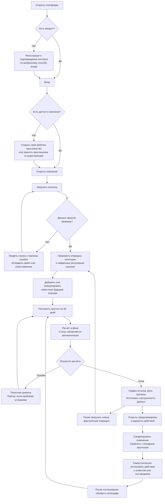

# Saldo: финансовый прогноз и предупреждения для малого бизнеса

Дата: 2026-10-23. Статус: описание целевого продукта для обсуждения.
Это пользовательская детализация [архитектурного плана](saldo-architecture.md),
а не отчёт о реализованных возможностях и не новый Accepted ADR.
Реализация продукта не начата. Полный реестр вопросов и экспертных ответов
(`.agent/plans/case-expert-questions.md`) остаётся локальным и исключён из Git.
Сводка замечаний приведена ниже; повторная сверка ТЗ сохранена в разделе 3 плана.
Уточнение владельца от 2026-10-23: добавление сотрудников в компанию входит
в целевой объём платформы. Последующее решение владельца: ровно две роли,
`owner`/`financier` («владелец»/«финансист»); приглашать уже зарегистрированного
человека по известному email. Это решения владельца, а не ответы эксперта.
Детализация полномочий и технические политики ниже остаются предложениями.

## 1. Для кого и какую задачу решаем

Самостоятельное веб-приложение для владельца небольшого бизнеса, который
планирует поступления и обязательные платежи. Оно помогает ответить:

- Сколько доступных денег отражено в последних загруженных данных?
- Хватит ли их на ближайшие обязательства, если поступления придут по плану?
- Когда и какой суммы может не хватить, насколько неопределён прогноз?
- Какие платежи и предположения создают риск?
- Как изменится результат, если договориться об ином сроке или частичной оплате?

В объяснениях можно опираться на знакомые примеры ИП с магазином или небольшим
сервисным бизнесом; целевая аудитория при этом не ограничивается только ИП.

Пользователь загружает историю, добавляет известные обязательства, получает
дневной прогноз минимум на 30 дней и сравнивает возможные действия.
Название и банковский логотип в наброске интерфейса не означают существующую
интеграцию с банком или автоматическое получение денег/данных клиента.

ТЗ допускает продукт внутри банка; эксперт подтвердил равноправие форматов.
Для обсуждаемой реализации выбран самостоятельный продукт со своей регистрацией.
Выполнение платежей, выдача кредита и бухгалтерский/налоговый учёт не входят
в базовую функцию: результат приложения — прогноз и проверка вариантов действий.

## 2. Граница функциональности

| Основание | Что должно появиться |
| --- | --- |
| Основные задачи ТЗ, с. 4–5, минимум с. 8 | Приём истории, категоризация, регулярность, учёт известных счетов/налогов, дневной прогноз от 30 дней, дата/сумма/вероятность разрыва, график, предупреждения, проверка качества |
| Решение владельца | Полная самостоятельная регистрация, вход, восстановление доступа, выход; роли `owner`/`financier`, приглашение зарегистрированного сотрудника по известному email; отдельный Auth, DDD-монолит Core |
| Переданное уточнение эксперта | Для базового решения достаточно файлового/ручного ввода; обязательный live-коннектор не требуется. Автор уточнения не указан |
| Переданное владельцем условие оценки, 2026-10-23 | За mock ФНС и другие интеграции дают дополнительные баллы. Они не обязательны для базового прототипа; количество баллов не зафиксировано |
| Целевое расширение нашего плана | Календарь будущих платежей, четыре шаблона «что если» из ТЗ с. 7 и сравнение сценариев; моделирование ответного действия, обновление при новых данных, план-факт |
| Что определено полученным набором | 150 компаний, 222 420 операций за 2024-10-01 — 2026-09-30; конкретный CSV-формат и один исходный счёт на компанию по README; без валюты, категорий и будущего календаря |
| Что ещё уточняется | Валютная конвенция, смысл разрыва при неизвестном овердрафте, доступность дополнительных наборов/доступов; конкретные источники, протоколы и DTO дополнительного обмена |
| Последующее развитие | Несколько счетов/валют при наличии требований, банковские и учётные коннекторы, дополнительные каналы уведомлений |

Первый импорт использует предоставленный CSV: UTF-8 с BOM, `;`, даты
`YYYY-MM-DD`, десятичные суммы с точкой, строковые ИНН с ведущими нулями.
README описывает один счёт в одном банке на компанию; номера счёта нет.
Один подключённый счёт на компанию — подтверждённая владельцем граница MVP (ADR-022),
а не обещание консолидации всех денег бизнеса. Проверенные свойства набора —
в [паспорте датасета](../references/dataset-profile.md).
Календарь налоговых платежей не означает автоматическое вычисление налогов
без необходимых данных; налоговых режимов и будущих обязательств в CSV нет.

Переданное уточнение эксперта Анастасии от 2026-10-23, 22:58–22:59:
достаточно одного счёта; один или несколько — на усмотрение команды,
поддержка нескольких будет плюсом. Пример 2–3 счетов у небольшой компании
не задаёт обязательный лимит. Для основной версии сохраняется один подключённый
счёт (ADR-022), мультисчётность — дополнительный последующий этап.
Ответ не устанавливает наличие идентификаторов счетов/собственных переводов
в датасете; перед консолидацией потребуются явные mapping и правила переводов.

Решение владельца от 2026-10-23 (ADR-022): в MVP поддерживать только RUB.
В REST DTO сохранять валюту (`currency: "RUB"`), суммы передавать строкой
в минимальных единицах (копейках); выбор валюты в интерфейсе не показывать.
Другую валюту в файле/внешнем источнике явно отклонять с объяснением;
смешанную выписку не суммировать и не импортировать частично без предупреждения.
Курсы, конвертация и валютная переоценка в этот вариант не входят.
RUB-only — решение продукта, а не требование ТЗ. В предоставленных файлах
и README валюта явно не указана: использовать принятую конвенцию адаптера/MVP,
не выдавать RUB за подтверждённое свойство набора. REST v0.2.0 фиксирует это
как ограничение MVP, без конвертации и скрытого переименования.

Первая поставка контрактов Frontend ↔ Go API записана в
[OpenAPI v0.2.0](../../docs/api/openapi.yaml); маршруты, тела, ответы и открытые
решения поясняет [документ для команды](../../docs/api/README.md). Это контракт
на ревью, а не работающие ручки. Предлагаемые email/password, HttpOnly cookie,
CSRF ещё требуют согласования; RUB/один подключённый счёт приняты в ADR-022.

Уточнение о достаточности файлового/ручного ввода передано разработчиком как
ответ эксперта; имя/роль автора и ссылка на исходное сообщение не предоставлены.
Оно не отменяет учёт известных будущих платежей и проверку качества прогноза.
По переданному владельцем условию оценки от 2026-10-23 подтверждено:
за mock ФНС и другие интеграции дают дополнительные баллы. Количество баллов
не зафиксировано; это дополнительная возможность, а не условие готовности
базового прототипа. Конкретные поставщики и протоколы пока не выбраны.
Для такой демонстрации можно рассмотреть явно помеченный mock API
внешнего источника: учётной системы вроде 1С либо тестового источника налоговых
событий, условно ФНС. Это предлагаемый учебный обмен с тестовыми датами и суммами,
а не работающая интеграция с 1С/ФНС или использование реальных открытых данных.
Наличие публичного API и правила получения реальных сведений без исследования
не обещаем; расчёт налоговых обязательств этим вариантом не добавляется.

### Журнал последних замечаний и решений

Зафиксировано по поручению владельца. В колонке «Источник» отделены его
уточнения и переданные ответы эксперта; колонка решений содержит нашу
детализацию. Предложения не выдаются за уже реализованные или утверждённые
пользователем технические политики.

| Замечание и источник | Зафиксированное решение или предложение |
| --- | --- |
| ТЗ и переданный ответ эксперта: продукт для малого бизнеса | ИП используем как понятный пример, не ограничиваем платформу только этой организационной формой |
| Переданное уточнение эксперта, автор не указан: файла/формы достаточно для базы | Сохраняем файловый/ручной ввод; не требуем live-коннектор ради базового сценария, но учитываем будущие события и проверяем прогноз |
| Переданное владельцем условие оценки от 2026-10-23: mock ФНС и другие интеграции дают допбаллы | Фиксируем дополнительный зачёт без указанного числа баллов; для базы они не обязательны. Поставщик/протокол ещё не выбран. Mock учётной системы и mock ФНС — разные варианты с разными данными/DTO; демо не обозначаем live-интеграцией, открытыми данными или налоговым расчётом |
| Решение владельца: ровно `owner`/`financier` | Сохраняем две роли; предлагаем владельцу управление компанией/доступом, финансисту — финансовые операции без управления компанией/участниками. Матрица ещё согласуется |
| Решение владельца: приглашать зарегистрированного человека по известному email | Владелец вводит email существующего аккаунта. Не создаёт аккаунт за сотрудника; незарегистрированный сначала регистрируется отдельно, затем владелец приглашает заново |
| Наша детализация принятия и интерфейса | Предлагаем явное принятие под существующим аккаунтом с проверкой подтверждённого email и in-app уведомление; это предложения, а не прямые условия владельца. Email-доставка — необязательный дополнительный канал, провайдер не выбран |
| Наша детализация выдачи и отзыва доступа | Создание приглашения не выдаёт права автоматически; сервер проверяет адресата/компанию, срок и отзыв. Повтор не создаёт второе членство; отзыв не удаляет аккаунт или финансовые факты |
| Наша детализация границ компании | Членство и роль действуют в конкретной компании, не глобально. Принятие приглашения не создаёт сотруднику лишнюю Company; общих паролей, публичного поиска пользователей и выбора `owner` в форме приглашения не предлагаем |

Новое поручение владельца — отдельно исследовать в сети API/DTO и форматы
обмена ФНС, 1С и других систем малого бизнеса. Оно выделяется в **этап 1A**
[основного плана, §12](saldo-architecture.md#12-этапы-реализации).
Статус: **не начат**, в этом дополнении поиск не выполняется. Нужно проверить
первичные источники, назначение и доступность данных, форматы/версии, условия
доступа и возможность сопоставления с нашими моделями. До результата не выбираем
общий внешний DTO, не обещаем публичный live API и не расширяем налоговую функцию.

## 3. Полный путь предпринимателя



### Первый вход и компания

Предлагаемый простой вариант входа — email и пароль с подтверждением email
и восстановлением доступа. Конкретный способ ещё не утверждён. Выход завершает
сессию на сервере; при истечении сессии пользователь снова входит и возвращается
к своей компании и сохранённым результатам.

При создании компании пользователь создаёт рабочее пространство для данных,
указывает название и при необходимости ИНН. Ввод ИНН не подтверждает юридические
полномочия и не открывает чужие данные. Не показываем список чужих компаний
для свободного присоединения. Саморегистрация в нашем MVP подтверждает аккаунт,
а не право представлять юрлицо перед банком.

Поддержка сотрудников включена владельцем в целевой объём. Компания объединяет
несколько пользователей с отдельными аккаунтами и разрешениями; общий пароль
не нужен. Членство в компании связывает пользователя, компанию и роль.

### Сотрудники и приглашения

По решению владельца приглашение создаётся только для уже зарегистрированного
пользователя по известному email. Если аккаунта ещё нет, человек сначала
регистрируется отдельно, после чего владелец повторяет приглашение. В MVP
не сохраняем приглашения в ожидании будущей регистрации и не создаём аккаунт
сотрудника за него.

Предлагаемый флоу: владелец открывает «Компания → Сотрудники → Добавить
сотрудника», вводит email и отправляет приглашение. Сервер проверяет полномочия
владельца, находит существующий аккаунт и назначает приглашению `financier`.
В форме нет выбора `owner`: роль приглашённого не задаётся браузером.
Публичный поиск пользователей и автодополнение email не включены в MVP.

Предлагаем показывать приглашение в кабинете адресата как in-app уведомление.
Это наш вариант канала, а не прямо утверждённое владельцем условие;
конкретный поток принятия ещё согласуется. Email может дублировать уведомление,
но не обязателен для MVP. Почтовый провайдер не выбран. Для in-app принятия
секретная ссылка или отдельный токен не обязательны: сервер проверяет текущий
аккаунт и запись приглашения.

В предлагаемом потоке адресат входит существующим аккаунтом с подтверждённым
email и явно принимает приглашение. Сервер проверяет совпадение аккаунта и email
адресата, компанию, срок действия и отсутствие отзыва, затем создаёт членство. Создание приглашения
само по себе не выдаёт права; принятие без проверок их также не выдаёт.
Присоединение не создаёт сотруднику дополнительную собственную компанию.

Срок действия ограничен и ещё согласуется; приглашение одноразовое и отзываемое.
Повторное принятие безопасно и не создаёт второго членства. Финансист принимает
приглашение своим аккаунтом, а не использует сессию или пароль владельца.

Набор ролей `owner`/`financier` принят владельцем. Предлагаемая матрица
полномочий для согласования:

| Роль | Возможности |
| --- | --- |
| `owner` — владелец | Доступ ко всем финансовым данным и функциям компании, управление компанией и доступом сотрудников |
| `financier` — финансист | Работа с операциями, импортом, категориями, календарём, прогнозами и сценариями; без управления компанией и участниками |

Роль действует внутри конкретной компании. Управление компанией и участниками
проверяется сервером; нельзя оставить компанию без владельца. Отзыв членства
закрывает доступ к этой компании, сохраняя аккаунт человека и финансовые данные.
Механизм проверки/отзыва должен исключать продолжение доступа по старым правам;
судьбу уже принятых фоновых заданий согласовать отдельно.

В текущем целевом варианте Auth отвечает за членства/разрешения, Core — за
финансовые ресурсы и проверку доступа через Auth. Независимую вторую копию прав
в Core не создаём; точные контракты и владение Company остаются в T04 плана.

### Загрузка и подготовка

Раздел импорта `/companies/:companyId/imports` (предлагаемый маршрут)
доступен из «Операции и данные» и позволяет выбрать «Файл» или «Внешняя система».
Для внешней системы показать доступные источники, статус подключения,
период и доступный состав данных, действие импорта и результат/ошибки.
Для выбранного демонстрационного источника использовать явную пометку «Mock»;
не показывать несуществующее подключение к реальной ФНС/1С как работающее.
Настройка подключения и авторизация зависят от исследованного API конкретного
источника; frontend обращается к Go API, адаптер выполняется на backend.
Файловый ввод остаётся базовым независимым путём; демонстрационная интеграция
даёт дополнительные баллы по переданному условию оценки.

Перед импортом пользователь видит поддерживаемый формат и пример полей.
После проверки — период, число операций, счёт/валюту, ошибки и предупреждения.
Для первого датасета сопоставление колонок не требуется. В общем файле
пользователь выбирает одну внешнюю компанию (например, `C001`) и связывает
её с разрешённым счётом своего рабочего пространства; это не создаёт компанию
или доступ по внешнему ID/ИНН. После предварительного результата требуется
явное подтверждение применения; до него история не меняется. При изменении
данных с момента проверки показываем конфликт и обновлённую проверку.
Весь импорт
либо принят согласованно, либо имеет явно показанное состояние и ошибки;
половина файла не становится незаметно «всей историей».
Оба пути сохраняют источник и доступные внешние ID, показывают сводку
принятия данных и не создают дубли при повторном импорте.

В проекте REST v0.2.0 у счёта один источник фактических операций и наблюдаемых
остатков: первая принятая ручная операция закрепляет `manual_v1`, первый
применённый внешний импорт операций или остатков — выбранную систему
и внешнюю компанию. Импорт только ожидаемых платежей эту привязку не создаёт.
Смешение фактов разных систем возвращает `409 FACTUAL_SOURCE_CONFLICT`;
попытка импортировать C002 вместо C001 внутри того же источника —
`409 SOURCE_BINDING_CONFLICT`. Preview показывает текущую/предполагаемую
привязку, а сервер повторно проверяет её атомарно при применении.
Другую систему можно явно выбрать только для ожидаемых платежей:
`record_kinds: [planned_payments]`. Пользователь выбирает типы данных внешней
синхронизации; несовместимый набор отклоняется без скрытого отбрасывания.
У файлового адаптера набор фиксирован: операции и наблюдаемые остатки.
Ручной подтверждённый остаток разрешён как отдельный датированный якорь,
не меняющий источник операций; нельзя незаметно заменить им уже принятый
остаток выписки на ту же дату или заполнить неизвестные дни.

`all_operations.csv` и отдельные выписки содержат одну и ту же историю;
повторная загрузка иной упаковки не должна удваивать операции. Внешний ID
определяет повтор в области источника/счёта/компании; совпадение содержимого
при другом ID отмечается как возможный дубль. В наборе 21 такая пара,
но полных дублей и повторяющихся `operation_id` нет — удаление по сходству
необоснованно. Пустые ИНН (11 166) и назначения (583) допускаются с явной
пометкой. Разницы сверки остатков показываем отдельно: наблюдаемый EOD
не суммируется по строкам и не исправляется вымышленной операцией.

Ближайший порядок подготовки: ревью подготовленного REST v0.2.0
в `docs/api/openapi.yaml`, после явного согласования сразу этап 1A исследования
внешних API/DTO архитектурного плана. Датасет уже получен, файл REST подготовлен;
исследование дополнительных API не начато, реализация импортера также не начата.

Операции получают категории. Пользователь проверяет сомнительные результаты
и может исправить категорию. Найденные регулярные платежи показаны как предложения,
а не автоматически подтверждённые новые обязательства. Повторная загрузка не должна
создавать дубли, но одинаковые сумма/дата/контрагент сами по себе не доказывают дубль.

### Календарь и прогноз

Предоставленный датасет содержит факты без категорий, будущих сроков/обязательств
и отметок времени появления сведений. Будущий календарь вводится вручную или
получается из отдельного источника; вычисленная по истории регулярность остаётся
предложением. В историческом демо нельзя использовать последующие операции
как будто будущий платёж уже был известен на дату среза.

Календарь содержит направление, сумму, дату, контрагента/назначение и источник:
введено пользователем, загруженный счёт, внешний источник, найденная регулярность.
Даты обещаний клиента — ожидания, а не факт поступления. При фактической оплате
ожидание сопоставляется с операцией и перестаёт учитываться повторно.

ML оценивает неизвестные будущие движения и неопределённость на основе истории.
Core соединяет их с известными событиями по согласованным правилам исключения
двойного учёта. Одна только арифметика календаря не заменяет ML-прогноз из ТЗ.

В REST v0.2.0 начальный остаток должен быть принятым EOD на выбранную дату
среза: `input.balance_as_of = cutoff_date`. Если такого остатка нет, показываем
`BALANCE_AS_OF_UNAVAILABLE` и предлагаем выбрать покрытую дату либо явно
внести ручной датированный остаток с происхождением и предупреждением качества.
Старый остаток нельзя переносить через неизвестные дни, считая движения нулевыми.
Это предлагаемое ограничение текущего контракта, а не Accepted ADR.
Frontend передаёт `cutoff_date` и `horizon_days`; сервер вычисляет следующий
день начала прогноза и возвращает его как `start_date`.

Пользователь запускает расчёт один раз. Экран показывает реальные этапы:
«В очереди», «Рассчитываем», затем результат или причину ошибки. Фронт опрашивает
статус автоматически; ручная кнопка проверки не требуется. Уход со страницы
не отменяет принятое задание. При возвращении открывается сохранённый расчёт.

Новые данные не меняют уже построенный прогноз незаметно. Показываем, что он
основан на старой версии, и строим новый. Предыдущий результат доступен с датой
и исходными допущениями. Ошибка запроса статуса не означает ошибку самого расчёта.

## 4. Зачем нужны аккаунт и авторизация

| Механизм | Какую задачу решает |
| --- | --- |
| Аутентификация | Определяет, кто вошёл; позволяет вернуться к своим данным, восстановить доступ и завершить сессию |
| Авторизация | Проверяет, к каким компаниям, выпискам, календарям и прогнозам этот человек имеет доступ и что вправе менять |
| Подключение банка, если появится | Даёт согласованный доступ к конкретным банковским данным через поддерживаемый банком механизм |

Аккаунт нужен потому, что мы сохраняем финансовую историю и результаты между
посещениями и обслуживаем разные компании. Без проверки прав запросом чужого
`company_id` можно было бы прочитать или изменить чужую выписку. Проверки нужны
на сервере при каждом доступе к ресурсу; скрытая кнопка в интерфейсе их не заменяет.

В целевой архитектуре Auth владеет аккаунтами, сессиями и разрешениями;
Core хранит компанию и финансовые данные и проверяет доступ через контракт Auth.
Владение Company и восстановление после частичного сбоя создания пространства
ещё нужно закрепить техническим решением. API не читает таблицы Auth/Core напрямую.

Простая регистрация не подключает банковский счёт. Для файлового импорта
банковский вход не нужен. При будущей API-интеграции пользователь отдельно
подключает источник и даёт доступ, если провайдер поддерживает такой механизм;
ИНН используется как идентификатор, а не пароль или банковское согласие.

## 5. Что происходит в нашей архитектуре

```mermaid
sequenceDiagram
    autonumber
    participant U as Предприниматель / Frontend
    participant A as Go API
    participant S as Auth
    participant C as Go Core server
    participant D as PostgreSQL Core
    participant W as Core Worker
    participant M as Python ML
    U->>A: Регистрация / вход
    A->>S: Создать аккаунт / проверить вход
    S-->>A: Проверенная сессия
    A-->>U: Доступ к личному кабинету
    U->>A: Загрузить выписку / изменить календарь компании
    A->>C: Проверенный пользователь + запрос
    C->>S: Проверить право доступа к компании
    S-->>C: Решение о доступе
    C->>D: Принять импорт / сохранить события и версию
    Note over C,W: Разбор импорта и категоризация могут выполняться Worker
    U->>A: Построить прогноз
    A->>C: Запрос расчёта
    C->>S: Проверить разрешение
    C->>D: Снимок входа + расчёт + долговечное задание
    C-->>A: ID расчёта, queued
    A-->>U: Задание принято
    W->>D: Взять задание
    W->>M: gRPC: прогноз по снимку
    M-->>W: Оценки движений и неопределённость
    W->>W: Дневные остатки, риски, причины
    W->>D: Сохранить результат и завершить задание
    loop Пока расчёт не завершён
        U->>A: Получить статус конкретного расчёта
        A->>C: Получить статус с проверкой доступа
        C->>D: Прочитать состояние
        C-->>A: Статус / результат
        A-->>U: Данные для экрана
    end
    U->>A: Сценарий: перенести часть конкретного поступления
    A->>C: Создать отдельный расчёт от исходного снимка
    Note over C,M: Тот же контекст расчёта; изменение только выбранного условия
    C-->>A: ID отдельного расчёта; исходный план сохранён
    A-->>U: Сценарий принят, тот же цикл получения результата
```

Это схема ответственности; имена методов, Auth-протокол и финансовые модели
не утверждаются этим описанием. Worker и Core server — две роли одного Core,
а не два независимых владельца финансов. Начальный механизм заданий — PostgreSQL,
а уведомление браузера о готовности — polling Go API. Брокер для этого не требуется.
Требование одинакового модельного контекста базы, сценария и повторов раскрыто
в §8 архитектурного плана. Точная форма ML-контракта остаётся открытой в T06;
схема показывает целевое поведение, реализация и проверка кода не заявляются.

## 6. Интерфейс на основе наброска фронтенда

Основа — предоставленный разработчиком скриншот: тёмная шапка с брендингом,
слева карточки остатка/ситуации/предупреждений, справа график. Сохраняем композицию.

| Элемент наброска | Предлагаемое содержание |
| --- | --- |
| Шапка | Компания, доступный счёт при необходимости выбора, профиль и выход. Брендинг не обозначает подключённый API |
| «Денег на счёте сейчас» | «Остаток загруженного счёта на дату выписки». В наборе факт заканчивается не позднее 30 сентября 2026; показываем конкретный исторический срез, не текущий банковский остаток и не все деньги компании |
| «Ваша ситуация» | «Возможен дефицит 40 000 ₽ с 27 октября». Дата/сумма, доступная оценка вероятности и переход к причинам |
| График | Подписанные даты и рубли, нулевая линия, различимые факт/прогноз, диапазон неопределённости при наличии оценки, выделение первого дефицита |
| «Предупреждения» | Короткое объяснение: деньги на зарплату нужны раньше ожидаемой оплаты клиента; связанные платежи, источники и действие «Проверить варианты» |
| Под графиком / в деталях | Календарь ближайших событий, переключение исходного прогноза и сценария, время расчёта и актуальность данных |

Основная навигация: «Обзор», «Операции и данные», «Календарь», «Сценарии».
Это смысловые разделы; для компактного MVP календарь/сценарии можно открывать
внутри обзора, не создавая отдельные большие экраны.
В «Операции и данные» включён импорт из файла и внешней системы;
его можно открыть отдельной страницей или мастером с выбором источника.
В меню компании — раздел «Сотрудники»: участники, роли `owner`/`financier`,
ожидающие принятия приглашения зарегистрированным пользователям и форма
«Добавить сотрудника» с email для владельца. В предлагаемом in-app варианте
адресат видит уведомление и действие принятия в своём кабинете;
email-доставка — необязательное дополнение.

Нужны состояния до первой загрузки, обработки импорта, ошибок строк, расчёта,
недостаточной истории, готового прогноза, устаревшего результата и истёкшей сессии.
«Риска нет» допустимо только с уточнением горизонта и допущений; нехватка данных
не превращается в зелёное подтверждение безопасности. Цвет дублируется текстом.

Для исторического демо показываем выбранную дату среза, дату последних данных,
покрытие истории и предупреждения качества. У C049/C068/C081/C110 меньше 90 дней
истории: это отдельное состояние качества, а не отсутствие риска. Ожидаемый
отрицательный EOD в первой версии (`below_zero_eod`) обозначаем как модельный
дефицит относительно нуля: при неизвестном лимите овердрафта нельзя утверждать,
что банк отклонит платёж. Порог и бизнес-правила риска остаются на согласование.

## 7. Как подаём причины и рекомендации

Карточка риска отвечает последовательно:

1. **Когда и сколько:** дата первого дефицита и понятная подпись его суммы.
2. **Почему:** конкретные события до этой даты и поступления после неё.
3. **На чём основано:** источник остатка, календаря и неизвестных движений;
   дата обновления, предположения и ограничения прогноза.
4. **Что можно проверить:** варианты с кнопкой моделирования и явными условиями.

Предлагаемый первый механизм рекомендаций — правила и пересчёт сценариев
на структурированных данных Core. LLM для обязательного потока не требуется.
Текст причины не должен выдавать выдуманную историю бизнеса за объяснение ML.
Для предложенного действия показываем изменение результата, а не только общий совет.

Структура одного варианта: действие → конкретный платёж → условие выполнимости
→ изменение даты/суммы → результат сценария → кнопка «Смоделировать».
Сценарий не переводит деньги и не изменяет исходный календарь. После реального
согласования пользователь отдельно сохраняет новое ожидание и пересчитывает план.

Проценты вероятности выводятся только из подходящей модели с проверкой качества;
календарный дефицит сам по себе не даёт вероятность. До готовности такой оценки
в макете допустимо «Вероятность пока не рассчитана», но это промежуточное состояние:
финальная функция оценки вероятности обязательна по ТЗ.

### «Что если»: стресс-сценарий и ответное действие

По поручению владельца от 2026-10-23 фиксируем развиваемую идею целиком.
Целевой объём — четыре типа неблагоприятных событий из задачи со звёздочкой
на физической с. 7 ТЗ: задержка оплаты на 2–4 недели, снижение выручки на 10–30%,
внеплановый расход и рост постоянных расходов. ТЗ требует сравнить базовый
и негативный прогноз на одном графике и показать дату/сумму возможного разрыва.
Формы, метрики сравнения, порядок реализации и переход от стресса к ответному
действию ниже — наши предлагаемые решения, а не дополнительные ответы экспертов.
Функции ещё не реализованы; точные поля и правила согласуются перед реализацией.

**Путь пользователя:** «Что если» → выбор шаблона → форма с параметрами
→ «Рассчитать» → базовый и сценарный прогноз на одном графике
→ при необходимости «Проверить ответное действие» → новый расчёт сравнения.
Кнопка доступна у готового прогноза; пользователь видит, от какой его версии
строится сценарий. Расчёт выполняется через тот же механизм фонового задания
и автоматического получения статуса, без повторной ручной проверки готовности.

| Шаблон | Что выбирает пользователь | Как меняются условия сценария |
| --- | --- | --- |
| Клиент заплатит позже | Ожидаемое поступление/счёт, всю сумму или часть, новую дату либо задержку в днях; пример ТЗ — 2–4 недели. Форма показывает старую и новую даты | Выбранная сумма переносится на новую дату, неперенесённая часть остаётся на прежней. Полная сумма поступления не возникает повторно |
| Выручка снизится | Период, категории поступлений от продаж и процент снижения; примеры ТЗ — 10–30%. Видны выбранные компоненты и исключения | Уменьшаются прогнозируемые поступления от продаж в выбранном периоде. Кредиты, взносы собственника и внутренние переводы не затрагиваются. Уже выставленные счета и явные события календаря сохраняются, пока пользователь отдельно не выберет их изменение |
| Возникнет разовый расход | Сумму, дату, категорию/назначение и при необходимости выбранный счёт в доступной области прогноза | Добавляется одно сценарное списание, например на ремонт оборудования; реальная операция или обязательство в календаре не создаётся |
| Постоянные расходы вырастут | Статью/категорию и конкретные будущие события, период действия, процент или новую сумму; видны затрагиваемые платежи | Меняются суммы выбранных будущих событий, включая соответствующие вхождения регулярного платежа. Исходные и увеличенные суммы не складываются как два отдельных обязательства |

Диапазоны 2–4 недели и 10–30% — примеры ТЗ, а не единственные допустимые
значения формы. Точные численные ограничения ещё согласуются.

Форма показывает область изменения до запуска: какие события/компоненты,
суммы, даты и период затронуты. Выбор категории служит фильтром, а не разрешением
незаметно изменить любые поступления/списания. Неизвестный состав выручки нельзя
автоматически заменить всеми входящими операциями; требуется проверенное
сопоставление категорий с прогнозируемыми компонентами.

**Сравнение результатов.** Общая ось дат и одна шкала денег; база и сценарий
различаются цветом и подписью. Диапазон неопределённости показывается при наличии
обоснованной оценки. Рядом — параметры изменения, источники и следующие показатели:

| Показатель | Смысл в сравнении |
| --- | --- |
| `first_gap` | Первая дата нехватки по согласованному определению разрыва; отдельно показывать, если разрыв появился, исчез или наступил раньше/позже |
| `max_shortfall` | Максимальная недостающая сумма за горизонт по тому же правилу; не смешивать с дефицитом первого дня |
| `min_balance` | Минимальный дневной остаток за горизонт в выбранной области прогноза |
| `probability` | Вероятность определённого события, если она оценима выбранной моделью; явно подписывать «в этот день» или «хотя бы раз за горизонт» |

Определение разрыва, суммы и вероятностного события связано с оставшимися
уточнениями E05/E06. Для базы и сценария используются одинаковые определения
и горизонт. Отсутствие оценки вероятности не превращается в 0% и не мешает
показать доступное сравнение, но не закрывает обязательную итоговую оценку из ТЗ.
Процент снижения выручки в форме не является вероятностью разрыва.
В REST дневное `negative_balance_probability` и горизонтальное
`metrics.gap_probability` имеют разные определения события; дневные оценки
нельзя складывать для получения вероятности хотя бы одного разрыва за период.

**От стресса к ответному действию.** После расчёта пользователь может проверить
вариант подготовки: частичное поступление раньше, согласованный перенос
расхода либо другое явно заданное изменение. Карточка содержит действие,
связанный платёж, условие выполнимости и рассчитанный эффект относительно
стресс-сценария. Например: «если клиент согласится перечислить часть раньше,
изменится дата/размер дефицита»; согласие клиента не считается полученным.

Ответный вариант всегда наследует **стрессовые условия**, а не создаётся заново
от исходного благоприятного плана. Если стресс перенёс поступление на более
позднюю дату, ответ «часть получить раньше» переносит только эту часть;
остаток остаётся на стрессовой дате, не возвращается незаметно на исходную.
Сравнение показывается парами: сначала «база / стресс», затем «стресс /
стресс + действие». Все три версии сохраняются, но три линии одновременно
не требуются. Пользователь видит, какое изменение внесло само действие
и какие неблагоприятные условия сохранились.
Для выбора платежа Core возвращает эффективные части после стресса
(`result.effective_occurrences`): ID части, исходные ID, текущую дату,
оставшуюся сумму и доступность ответного действия. Frontend показывает эти
части и передаёт в `response_action.target` только выбранный
`effective_occurrence_id`; повторно рассчитывать
разбиение платежа на клиенте не требуется. Запрос содержит имя, ID стрессового
родителя и действие; базу и полный набор стрессовых условий наследует сервер,
а не клиент через копию параметров.
Это моделирование условий и эффекта, без банковских поручений, переводов
или утверждения доступности кредита. После реального согласования изменение
календаря сохраняется отдельным действием пользователя.

**Правила сохранения и воспроизводимости:**

- Сценарий ссылается на сохранённый базовый прогноз и неизменяемый снимок;
  содержит свои параметры и результат, не переписывает факты или календарь.
- Фиксируются версия модели, подготовки данных и параметры случайности.
  Для сравнения сохраняется общий вычислительный контекст базы и сценария;
  если прежний контекст недоступен, оба результата пересчитываются вместе
  и показываются как новая пара. Требование R01 раскрыто в §8 архитектурного
  плана; точная форма ML-контракта T06 пока открыта, реализация не начата.
- Условия изменяют выбранные компоненты один раз: ни регулярность, ни явный
  счёт, ни ML не должны вернуть ту же сумму второй копией после преобразования.
  Частичный перенос сохраняет остаток и общую сумму исходного события.
- Перенос за конец горизонта означает, что событие не входит в текущие дневные
  точки; ожидание и сумма долга сохраняются с новой датой. Интерфейс показывает
  выход за горизонт, не выдавая отсутствие разрыва в нём за исчезновение долга.
- Отдельные стресс-сценарии независимы. Несколько шаблонов объединяются только
  по явному выбору; набор и порядок изменений видны, пересечения не применяются
  дважды. Ответное действие — явное продолжение выбранного стресса, а не
  автоматическое объединение с другими независимыми вариантами.

**Предлагаемый порядок реализации:** сначала задержка поступления и разовый
расход, затем снижение выручки и рост постоянных расходов. Это очередность,
а не сокращение целевого объёма до одного сценария: итоговая цель — все четыре
шаблона, сравнение и проверка ответного действия. Конкретное объединение
нескольких стрессов согласуется отдельно; автоматически оно не включается.

## 8. Прогнанный учебный пример

Предприниматель зарегистрировался, создал пространство компании, загрузил историю
и проверил категории. По последней выписке на 23 октября у него 200 000 ₽.
Он добавил будущие платежи и запустил прогноз на 24 октября — 22 ноября.
Для прозрачной арифметики ниже рассматриваем только перечисленные события;
других движений нет. Это иллюстрация календаря и сценариев, не результат обучения ML.
В полноценном продукте отдельно добавляется оценка неизвестных движений.

| Дата | Событие | Расчётный остаток, ₽ |
| --- | --- | ---: |
| 23 октября | Последний фактический остаток | 200 000 |
| 25 октября | Аренда −80 000 | 120 000 |
| 26 октября | Поставщик −60 000 | 60 000 |
| 27 октября | Зарплата −100 000 | −40 000 |
| 30 октября | Ожидаемая оплата клиента +150 000 | 110 000 |
| 22 ноября | Конец горизонта, других движений в примере нет | 110 000 |

Отрицательная точка здесь означает недостающую сумму при попытке выполнить
все запланированные платежи. Она не утверждает, что банк исполнит платёж
без средств или предоставит овердрафт. Дневной расчёт не исключает проблемы
очерёдности поступлений и списаний внутри дня.

Карточка предупреждения:

> **27 октября может не хватить 40 000 ₽ на обязательные платежи.**
> После аренды и оплаты поставщика останется 60 000 ₽, зарплата составит
> 100 000 ₽. Оплата клиента 150 000 ₽ ожидается только 30 октября.
> Основано на выписке до 23 октября и введённом календаре.

Два независимых варианта от исходного плана:

| Вариант | Изменение | Результат при выполнении допущения |
| --- | --- | --- |
| Проверить возможность частичной оплаты раньше | 50 000 из клиентских 150 000 перенести на 26 октября; на 30 октября остаётся 100 000 | На 27 октября 10 000 ₽, дневного дефицита нет; итог 110 000 ₽ |
| Проверить возможность переноса поставщику | По согласованию перенести 60 000 с 26 на 31 октября | На 27 октября 20 000 ₽, дневного дефицита нет; на 31 октября и в конце горизонта 110 000 ₽ |

Варианты не складываются автоматически. Они сохраняют общую сумму поступлений
и списаний; нельзя посчитать ранние 50 000 и оставить полные 150 000 на старую дату.
Не предлагаем односторонне переносить обязательства и не выдаём доступность
кредита за факт. Если пользователь не может договориться, исходный риск сохраняется.

Затем пользователь возвращается с новой выпиской. Если клиент оплатил,
факт сопоставляется с ожидаемым событием; второе поступление не создаётся.
Если срока исполнения уже нет, событие становится просроченным, что видно
на экране; новый прогноз учитывает изменившееся ожидание. Так замыкается
цикл «факт → ожидания → прогноз → действие → новый факт».

## 9. Когда пользовательский сценарий можно считать готовым

- Новый пользователь сам регистрируется, входит, восстанавливает доступ и выходит.
- Он возвращается к своему пространству; чужие ресурсы недоступны при прямом запросе.
- Владелец приглашает уже зарегистрированного по известному email;
  в предлагаемом потоке адресат видит приглашение в кабинете, входит своим
  аккаунтом с подтверждённым email и явно принимает его. Сервер выдаёт только
  права `financier`, не создавая лишнюю компанию.
- Для незарегистрированного сначала требуется отдельная регистрация и новое
  приглашение владельца. Повторы/истечение/отзыв приглашения и отзыв членства
  обработаны; финансист не управляет компанией или участниками.
- Выписка проверяется, категории и источники понятны, повтор не удваивает историю.
- Известные события и оценки ML не учитывают один платёж дважды.
- Расчёт переживает закрытие страницы; готовность появляется автоматически.
- Есть минимум 30 дневных точек, дата/сумма/обоснованная вероятность риска.
- Предупреждение ведёт к исходным событиям и воспроизводимому объяснению.
- Доступны четыре шаблона «что если»: задержка поступления, снижение выручки,
  разовый расход, рост постоянных расходов; параметры и область изменения видны.
- База и сценарий показаны на одном графике с одинаковым горизонтом;
  `first_gap`, `max_shortfall`, `min_balance` и оценимая вероятность сравнимы.
- Ответное действие применяется к стрессовым условиям, показывает условие
  выполнимости и эффект, сохраняя остальные изменения стресса.
- Сценарии сохраняют исходные факты, календарь и вычислительный контекст;
  частичные изменения не создают дублей, выход за горизонт не удаляет долг.
- Новые факты обновляют актуальность и не подменяют историю расчётов.
- Команда показывает проверку прогноза на историческом периоде без знания будущего,
  включая корректность обнаружения разрывов и пользу дополнительных источников.
- Для данного набора train/validation/test разделены по времени, артефакты модели
  и календарь учитывают только сведения на дату среза; общий файл/его выписки
  не считаются независимыми наборами. После 2026-09-30 нет факта для оценки.
- На графике и в предупреждениях видны историческая актуальность, загруженный
  счёт, ограничения короткой истории, качества остатков и неизвестного овердрафта.

Это целевые критерии; они не отмечены выполненными. Конкретная реализация идёт
по этапам архитектурного плана после их согласования, с ревью разработчиком.

Уточнение Core от 2026-10-24 (ADR-024/025): внутренние resource IDs — UUID
(новые UUIDv7); внешний namespace и Auth-owned IDs остаются по своим контрактам.
Хранение через sqlx/pgx-stdlib; pool создаётся в отдельном `internal/app/postgres`,
repository получает готовые DB/Tx. Порты объявляются у потребителя, реализации
сервисов приватные. Это уточнение реализации, а не принятие подэтапа 2.3.
